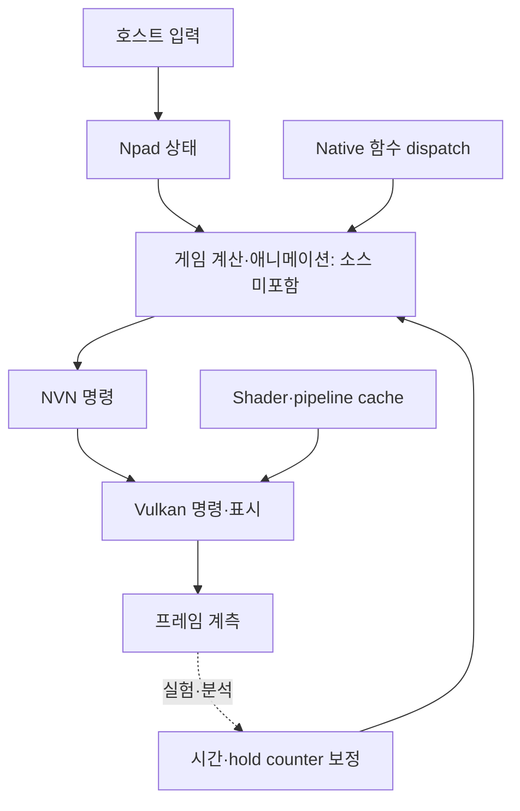

# 캐릭터 입력 → 계산 → 표시 흐름

기준: Savage Wind `ad95614c2c90fc29f4a1ea40de38a70896666e15`, holdem `0401c1d168dff6c8123f29a2c56efbe743b8e4d7`. 아래 함수명은 이 버전에서 확인했다. 캐릭터 원본 게임 코드가 없는 구간은 명시적으로 표시한다.

## 1. Savage Wind에서 실제로 읽을 수 있는 경로

| 순서 | 소스와 진입점 | 확인 가능한 역할 | 확인할 수 없는 것 |
|---|---|---|---|
| 1 | [hle/input.c](upstream/runtime/hle/input.c): `fill_state`, `hid_state_fullkey` | 키보드/패드/마우스/스크립트 입력을 Npad 상태로 변환; 메뉴 입력 소유권, 축 clamp, dead zone, 대각선 속도 정규화 | Link의 공격 판정·콤보 자체 |
| 2 | [gamelib.c](upstream/runtime/gamelib.c), [dispatch.c](upstream/runtime/dispatch.c): `dispatch_init`, `dispatch_lookup`, `rt_dispatch` | 별도 게임 라이브러리의 guest 함수 주소를 native 함수에 연결. 스레드별 4,096칸 direct-mapped dispatch cache와 miss 시 이진 탐색 | 포함되지 않은 guest 함수의 캐릭터 로직 |
| 3 | [hle/framepace.c](upstream/runtime/hle/framepace.c): `framepace_target`, `rt_vfr_update`, `framepace_presented` | 표시 FPS와 게임 시간의 관계 조정; hold counter 보정; 메뉴/이벤트/영상의 30FPS 예외 | Unity에 그대로 쓸 범용 timestep 구현 |
| 4 | **게임 라이브러리 — 미포함** | 이동·물리·AI·스킨/애니메이션 및 NVN 호출은 실제 게임 쪽에서 발생 | 이 연구본만으로 Link 컨트롤러를 복사/이식할 수 없음 |
| 5 | [nvn/cmdbuf.c](upstream/runtime/nvn/cmdbuf.c), [nvn/objects.c](upstream/runtime/nvn/objects.c), [vulkan/exec.c](upstream/runtime/nvn/vulkan/exec.c): `backend_execute`, `exec_list`, `draw_` | NVN 명령 기록/큐 처리와 Vulkan 명령 실행; shader/pipeline/state 준비 | 원본 캐릭터 topology, 본, 텍스처, animation graph |
| 6 | [nvn/objects.c](upstream/runtime/nvn/objects.c): `present_pace`, `nvnQueuePresentTexture`; [vulkan/device.c](upstream/runtime/nvn/vulkan/device.c): `backend_present` | 프레임 제출/대기/표시와 성능 기록 | 모바일 Unity에서의 동일 성능 보장 |

### 시간 처리에서 배울 점과 그대로 옮기면 안 되는 점

`rt_vfr_update`는 시간 부채, 약 20프레임 평균, step 변화 제한과 interval hysteresis를 사용한다. 메뉴/이벤트는 frame-count 기반 동작을 보존하기 위해 별도로 취급한다. 이것은 특정 게임의 **VFR 메모리 주소/구조에 대한 보정**이며, 주소와 계수를 Unity에 복사하는 방식은 적절하지 않다.

holdem에는 이미 `.02초` 고정 전투 step이 있다. 연구할 원칙은 **표시 FPS를 바꿔도 이동 거리·공격 주기·쿨다운·카메라와 입력 감각이 달라지지 않아야 한다**는 것이다. 고정 전투 step을 Savage Wind의 가변 step으로 교체하는 제안이 아니다.

## 2. holdem / Pink Glass에 대응되는 실제 경로

이 경로는 원격의 `docs/unity/client-source-snapshot/2026-11-05/Runtime/`를 확인한 것이다. 실제 작업 PC의 `G:/new_project/IslandGame` 후속 수정과 다를 수 있으므로 먼저 해시를 대조한다.

| 단계 | 현재 소스 | 확인한 사실과 다음 조사 |
|---|---|---|
| 입력 전달 | [RpgLocalStageSession.cs](../../../unity/client-source-snapshot/2026-11-05/Runtime/RpgLocalStageSession.cs): `Update` | 매 Update에 input JObject/문자열을 만들고 `Submit`에 전달. 입력 변경 빈도와 할당 비용을 먼저 계측 |
| 전투 작업 스레드 | [StageCombatWorker.cs](../../../unity/client-source-snapshot/2026-11-05/Runtime/StageCombatWorker.cs): `Submit`, `Run`, `TakeSnapshot` | 한 worker가 Jint와 mutable state 소유. `.02초` step, batch 최대 5, pending time 최대 `.5초`. `DroppedSeconds`, `MaxBatchMilliseconds` 계측값 존재 |
| 원본 전투 실행 | [client-kernel.ts](../../../../src/components/rpg/rogue-stage/client-kernel.ts): `stageAdvance` | 원본 `RogueEngine.step(.02, input)` 실행. snapshot 요청/구역 경계일 때 JSON 생성. 별도 간이 전투식이 아님 |
| 메인 스레드 반영 | `RpgLocalStageSession.Update` | JSON parse 후 State 교체. 큰 불변 메타데이터 이동으로 성좌 deep-copy를 이미 줄임. 구역 경계에서 서버 확정 대기 |
| 표시 시간 | [NativeCombatPresentation.cs](../../../unity/client-source-snapshot/2026-11-05/Runtime/NativeCombatPresentation.cs): `NativeCombatClock`, `ProjectHero`, `MotionTime` | snapshot 시간에 최대 `.15초` lead를 더하는 표시 예측. 단순한 두 snapshot 보간이라고 설명하지 않음 |
| 프레임 표시 | [NativeBattle.cs](../../../unity/client-source-snapshot/2026-11-05/Runtime/NativeBattle.cs): `LateUpdate` | 표시 시계 계산, 프레임 advance 최대 `.05초`, hero projection, 표시 actor 순회, 카메라 follow |
| 모델/포즈 | [Battle3DView.cs](../../../unity/client-source-snapshot/2026-11-05/Runtime/Battle3DView.cs): `Draw`, `ShowOnly`, `Follow` | Pink Glass/슬라임은 `AnimationClip.SampleAnimation`. 컴포넌트 Animator는 생성 시 끔. 공격 접촉은 현재 clip 길이의 `.45`를 사용 |
| 발 접지 | [BattleGroundingProfile.cs](../../../unity/client-source-snapshot/2026-11-05/Runtime/BattleGroundingProfile.cs): `TryHeight` | 오프라인 접지 샘플을 조회. 매 프레임 mesh vertex를 다시 굽는 경로가 아님 |

### 이미 있는 최적화 — 다시 구현하지 말 것

- `Battle3DView.MaximumPooledSlimes=16` 및 Create/ShowOnly의 풀 반환·재사용.
- 전투 전용 카메라 frustum 검사, `CulledSamples` 기록.
- 화면 중심으로부터의 위치에 따른 슬라임 60/30/15Hz pose sampling, 개체별 phase 분산, `ThrottledSamples` 기록.
- 재사용 primitive mesh와 sharedMaterial, 스킨의 `updateWhenOffscreen=false`.
- `CreatedModels`, `ReusedModels`, `SampleCalls`, `HeroGroundError` 진단값.
- worker snapshot은 wall-clock 약 50ms 간격 요청. worker가 느리면 실제 20Hz를 보장하지 않는다.
- 일반 미궁은 진행 중 HTTP tick 없이 구역 경계에서 서버와 통신. 성장/포커 등 다른 흐름과 혼동하지 않는다.

### 캐릭터 품질의 확인 기준

30/60/90/120 표시 FPS에서 같은 10초 입력의 이동 거리, 공격 횟수, 쿨다운, 점프/착지, 카메라 상대 위치를 비교한다. 렌더 pose 샘플 수가 같을 필요는 없지만 고정 step 전투 결과는 같아야 한다. 공격 serial+실제 접촉 시점을 기준으로 VFX가 한 번만 발생하는지 확인한다. 화면 밖이었다가 복귀할 때 최신 포즈·접지·죽음 상태가 맞는지 확인한다.

Pink Glass 65본/18클립을 Hunyuan static mesh export로 대체하면 모션 보존이 깨질 수 있다. 새 아트는 기존 스킨/클립/접지 프로필과 함께 검증한다. 모델 triangles 수만 줄였다고 Jint, JSON, shader, overdraw 병목이 해결됐다고 판단하지 않는다.
