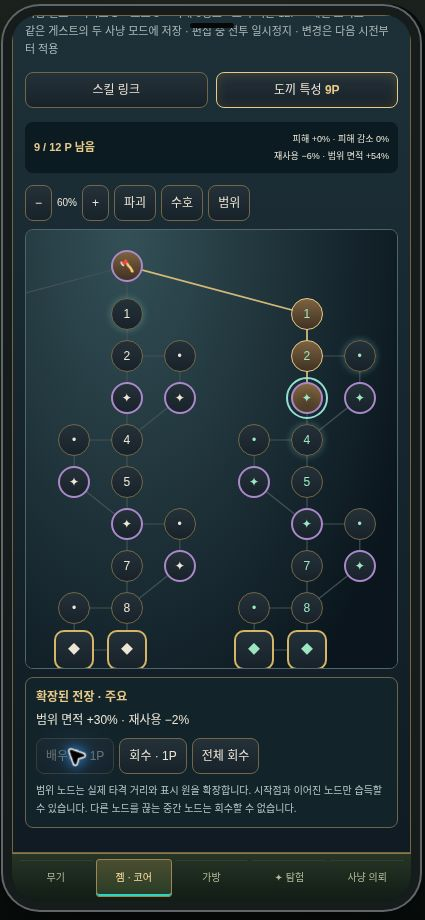
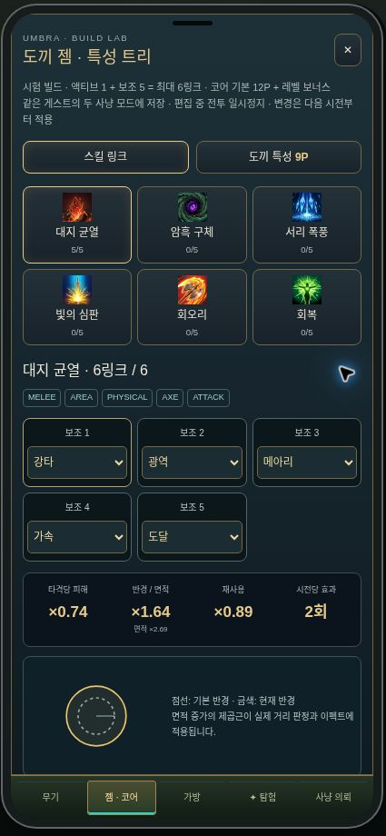

# Axe tree, six-link supports and extended-range damage

Implemented from uploaded `PoE_스킬시스템_완전해설.pdf` and the requested incremental-number approach. Scope: default `/hunt` rogue combat damage/HP, shared build compiler, saved builds, UI and Unity-ready arithmetic/data. Legacy recovered campaign still uses its original finite-number settlement; it shares the new build/range compiler. Account currency and old native growth tables were not converted into arbitrary-exponent balances.

## Build contract

- Version2, weapon:`axe`. Six active skills, each with five support sockets: **one active + five supports = six-link**. Same support cannot repeat in a link; at least one support tag must match. Healing has fewer compatible supports, so its maximum usable count depends on tags.
- V1 three-support saves are copied and padded with two empty sockets. Existing gem IDs, allocated node IDs, gold/EXP and revision are retained. Invalid legacy shapes are rejected. SQLite compare-and-swap and duplicate-sequence contracts retained.
- 52 nodes: root,27 original IDs repurposed as axe damage/guard/area spokes,24 side nodes forming alternate connected paths. Small, notable and keystone nodes. Allocation requires root connectivity and points; refunds cannot disconnect owned nodes. Basic12P plus level bonus, cap51.
- Axe nodes apply while wielding axe. Legacy campaign passes actual weapon type; other weapons do not get axe passives. Rogue currently uses Hong's axe only. Node bonuses apply to damage skills while that weapon archetype is equipped, rather than copying PoE class starts.

## Area is the priority

`area = (1 + sum(increasedArea)) * product(moreArea) * product(supportArea)`

`radiusMultiplier = sqrt(area)`

First area node: +12% area, radius×sqrt(1.12). Major area nodes add30%. Keystone branches include larger area with less damage (e.g.×1.75 area /×0.80 damage). Damage increases add, More/Less factors multiply.

Applied to skill hit distance, basic axe cleave distance, AUTO basic reach, and visual effect scaling. Skill and basic attack capture modifiers when the attack begins. UI shows both area and radius plus a proportional circle comparison. Tree pans/zooms, has a Range shortcut, and displays availability/owned/selected nodes. Existing room membership and line-of-sight guards still prevent hitting across locked rooms/gaps.

Build/help editor now pauses authoritative rogue time, waves, HP damage and cooldowns. Resume does not simulate the editing interval. Build commands still save while paused. Legacy campaign UI keeps its existing behavior.

## Big-number authority

Web dependency pinned:`break_infinity.js@2.2.0` (MIT). Unity port actually linked from the upstream JS repository:`Razenpok/BreakInfinity.cs`, upstream HEAD `ef06986e88f55593622ad38e7f0c11a458df80cd`; vendored BigDouble.cs and original MIT license under `unity/IslandCombat/Runtime/BigNumbers`.

These are mantissa/exponent **floating-point approximations**, not arbitrary-precision integers. JS Number/C# double can represent the magnitude10^100, but cannot retain every integer digit; their finite magnitude ends near10^308. Break Infinity extends exponent range while retaining roughly double precision. Do not use this as a claim of exact integer currency/accounting.

`damage = Big(base) * (1 + increased) * product(more)`

Actual rogue HP authority is Decimal in a WeakMap attached to the entity. Damage, healing, minimum/applied damage and remaining HP stay in Decimal. Snapshots expose scientific strings `bigHP`/`bigMaxHP`; numeric HP fields remain compatibility/display projections (normalized10000 for very large/tiny maximums). Positions, timers, radii and bounded build coefficients remain ordinary numbers. Damage FX use compact strings for huge values. Invalid/NaN/infinite inputs rejected; interface exponent limit±1e9.

RogueEngine's optional third constructor argument is a **trusted server-only combat scale** for simulation/import tests. It scales hero/mob HP, base damage and healing consistently. The public input parser does not accept a combat scale. Current live prototype base stats stay at their existing magnitudes; no unrequested exponential economy was invented.

## Files / Unity handoff

- `src/components/rpg/combat-big.ts`: validated amounts, damage, settlement, labels, authoritative vitals.
- `src/components/rpg/hunt-build.ts`: version migration, nodes/edges, tags and compiler.
- `public/rpg/builds/axe-v2.json`: exported52-node catalog, graph edges, six skills, six support definitions, formula metadata. Regenerate:`npm run rpg:export:axe`.
- `unity/IslandCombat/Runtime/BigNumbers/BigDouble.cs` +`LICENSE`: upstream library.
- `AxeBuildMath.cs`: BigDouble damage/HP settlement, area radius, tag/duplicate support validation, build compiler, graph connectivity and serializable catalog/amount DTOs. Copy directory into Unity Assets/Scripts; import JSON as TextAsset, parse with `JsonUtility.FromJson<AxeCatalog>(text)`. Supply selected axe nodes and five support positions to Compile. Code is Unity-compatible System-only math; it does not add a complete Unity combat controller or UI.
- `scripts/rpg/csharp-parity`: .NET8 runner/project; no binary/SDK committed.

## Verification

435 passing tests:135 existing RPG,244 poker,41 rogue/pace/horde/map,15 build/big-number/migration/area/pause tests. RPG typecheck and production build passed. Real rogue combat exercised at10^1000, including hit→death→one reward, healing and JSON display ratios; tiny10^-1000 vitality remains alive. Boundary enemies are missed without an area node, hit after allocation, and still missed beyond the expanded radius. V1 migration preserves balances; alternate graph path permits only a connected refund.

**50 cross-language vectors passed**:18 damage calculations from10^-30 through10^10000,24 real skill/gem/node configurations including heals and keystone tradeoffs,8 HP settlements. Exponents exact, relative mantissa/build-field tolerance1e-12. This verifies these formulas/data cases, not every method in both libraries or bit-for-bit equality across all platforms.

`DOTNET=/path/to/dotnet npm run test:rpg:parity` builds and runs the normal .NET project. This container's SDK CLI fails to read its own process metadata; actual C# was compiled with the same .NET8 SDK's Roslyn csc entrypoint against163 .NET reference assemblies and executed through the .NET runtime. The test accepted `PARITY_DLL=/tmp/rpg-parity.dll`. Unity Editor/play-mode execution was not available and is not claimed.

Formal verification omitted: existing CAS/sequence protocol not replaced; bounded graph/connectivity, migration, pause/reconnect and actual combat guards tested directly. No total-game safety proof claimed.

Vendored BigDouble.cs SHA256: `2228487ee4583b20c235936bf6c4aebe6549c41bcb52c0978dd4eb6d0c17d10b`.

## Operational verification

Runtime commit `c8c3f4bed954f6b9d5f7fcde131d9bd5d238f39d` pushed to main and feat/rpg-axe-sixlink-bigdamage. Render deploy `dep-dbj9jk95efls73dqh0d0` reached **live** at2026-11-01 01:47:52 UTC (October31 in New York). Release endpoint matched that hash; health reported web:true/poker:true.

In live Chrome, linked power/wide/echo/quick/reach to Rift: five supports, heading6/6. Learned area nodes2_1,2_2,2_3: points12→9, area increased+54%. Combined compiled area2.695 (UI rounds displayed floating value to2.69), radius1.6416455 (UI×1.64), per-hit effect0.739206, cooldown0.891825, two pulses. Quest gold/wave remained frozen while editing. Returned to character selection and entered a fresh run; five supports and9 remaining points persisted. No application-origin console errors observed; browser-extension metadata errors excluded. Source-level boundary-hit tests, rather than screenshots alone, verify actual expanded collision reach.

Save rollback note: once a v2 build is saved, old v1-only server code cannot read it without a deliberate downgrade migration; do not silently discard the new two sockets or side nodes to roll back.
