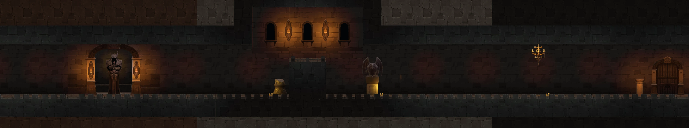
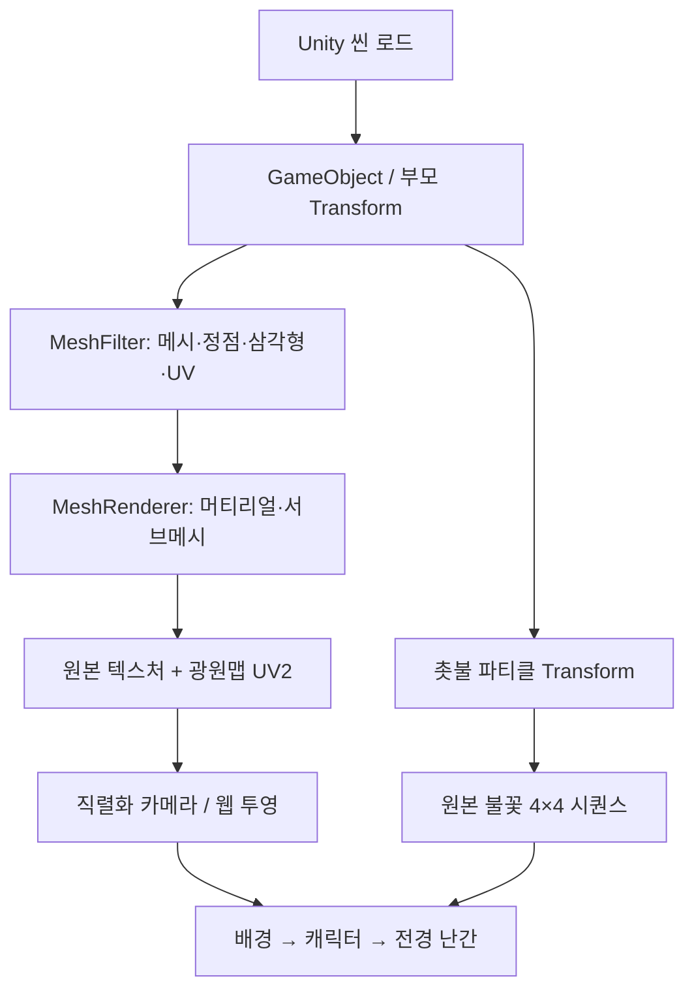

# 촛불 던전 한 맵 복원 — Map002_001

## 결과와 확인 방법

`Assets/InHouse/Maps/Scenes/Map002_001.unity`를 원본 번들에서 읽었다. 어두운 석벽·촛대·횃불·기둥·난간·문이 있는 유한 회랑이다. **단일 스프라이트나 Spine 맵이 아니라 3D 메시를 배치한 Unity 씬**이다. 새 배경을 AI로 그리거나 눈대중으로 파츠를 재배치하지 않았다.

- [파츠·원본 텍스처·배치 검사 화면](https://holdem-coin-tavern.onrender.com/rpg/maps/candle-dungeon/index.html)
- [사냥 화면](https://holdem-coin-tavern.onrender.com/hunt): 캐릭터 선택 아래 **테스트 맵 → 촛불 지하 회랑**을 선택한다.
- [이동 GIF](../../public/rpg/maps/candle-dungeon/preview.gif)
- [원본 배치/메시/UV JSON](../../public/rpg/maps/candle-dungeon/scene.json)
- [번들 해시와 추출 근거](../../public/rpg/maps/candle-dungeon/evidence.json)
- [웹 좌표 투영과 파츠 경계](../../public/rpg/maps/candle-dungeon/layout.json)



현재 웹에는 **맵 비주얼 검증용 선택지**로 연결한다. 원작 던전의 몬스터·웨이브·충돌·스테이지 해금까지 이 맵에 연결한 것은 아니다. 기존 테스트 전투의 진행과 성장 수치를 사용한다. 원본 Map002_001을 임의로 ‘미궁 2-1’에 매핑하지 않았다.

## 실제 조립 구조



| 항목 | 확인 결과 |
|---|---:|
| 실제 씬 GameObject / Transform | 464 / 464 |
| MeshRenderer | 110개 중 활성 복원 108개 |
| 참조 메시 | 33종 |
| 머티리얼 / 텍스처 | 14 / 14 |
| Light 객체 | 38개 — 비활성 여부도 보존 |
| 현재 추출한 불꽃 이미터 | 6개 |
| MapHelper의 MapGrid 블록 배치 | 10개 |
| 원본 바닥의 대표 수평면 | Unity Y=10 |
| StartPoint 캐릭터 원점 | Unity Y=11 |
| 진행 축과 시작/끝 | Z=-63 → Z=7 |

### Transform과 동일 메시 재사용

일반 파츠는 부모부터 `T × R(quaternion) × S` 행렬을 누적해 월드 좌표를 만든다. 같은 메시라도 인스턴스 Transform이 다르므로 별도 배치로 취급한다. `Kannan_pillar*`, `Kannan_wall*`, `Cave_Candle*`, `Kannan_Center_GuardRail*` 등이 실제 원본 이름이다.

`Combined Mesh (root: scene)`는 정적 배칭된 메시다. 원본 `m_StaticBatchInfo.firstSubMesh/subMeshCount`로 사용할 서브메시를 선택하고 배치 루트 행렬을 적용한다. 이미 배칭된 월드 정점에 개별 파츠의 Transform을 다시 곱하지 않는다. 이것이 어긋나면 바닥·벽이 중복 이동한다.

### 텍스처를 붙이는 방법

그림을 사각형으로 잘라 임의 좌표에 붙이지 않는다. 메시의 `m_UV0`로 원본 머티리얼 텍스처를 샘플링하고, 머티리얼의 `_MainTex` 타일링·오프셋을 적용한다. UV가 0~1 밖에 있으면 텍스처 반복이 필요하다. 조명은 별도 `UV2`와 `m_LightmapTilingOffset`을 통해 원본 베이크된 Lightmap을 조회한다.

원본의 Texture2D, 광원맵 PNG는 수정하지 않고 보존했다. 웹 렌더러의 RGBM 디코드 배수 34.49324 / 지수 2.2, 노출 1.6은 현재 렌더링 어댑터의 가정이다. Unity의 실제 셰이더·감마·후처리까지 동일하다는 뜻은 아니다.

### 전경과 바닥 접점

StartPoint Y=11은 배우의 원점이며 발바닥이 아니다. 실제 수평 바닥 삼각형의 지배적인 높이는 Y=10이다(해당 높이의 수평 삼각형 면적 약 880 제곱 Unity 단위). 웹 캐릭터 발을 Y=11에 맞추면 바닥 위로 떠 보인다.

캐릭터의 원본 시작 깊이 X=-4를 기준으로 뒤쪽/앞쪽 메시를 별도 투명 레이어로 베이크했다. 전경 난간과 앞쪽 바닥은 캐릭터 뒤가 아니라 **캐릭터 렌더링 뒤에** 덮어 그린다. 이는 원본 깊이 관계를 벨트 스크롤 화면으로 옮기는 2.5D 어댑터이며, 원작의 자유로운 3D 이동을 대체하는 완전한 깊이 버퍼는 아니다.

`dungeonPlacement()`는 원본 시작 픽셀/끝 픽셀을 웹 월드의 0/끝에 연결한다. 이미지의 실제 바닥 픽셀을 현재 발 접점에 일치시킨다. 배경 그림 높이를 임의로 창 높이에 맞추거나 숲처럼 반복 타일링하지 않는다.

### 촛불

원본 `Effect_FireSequence_01` 파티클 6개에서 월드 위치, 수명, 크기, 부모 스케일, 머티리얼 참조를 추출했다. 불꽃 텍스처는 **4×4, 16프레임**이다. 원본 UV의 아래 행부터 프레임을 읽고 Canvas 가산 합성으로 검은 배경을 처리한다. 광원 밝기는 원본 광원맵에 베이크된 값을 사용한다. 실시간 그림자·원본 ParticleSystem의 모든 속도/난수/수명 곡선을 재현했다고 주장하지 않는다.

## 원본에서 찾은 로딩·배치 코드

네이티브 감사 코드도 [archive/rpg/maps/candle-dungeon/code](../../archive/rpg/maps/candle-dungeon/code)에 보존했다. C# export의 빈 함수 몸체만으로 동작을 추정하지 않고 원본 네이티브 분석과 직렬화 데이터를 함께 봤다.

| 함수 | 토큰 | 역할과 해석 범위 |
|---|---|---|
| MapScene.Load | 0x6000357 | 씬 이름과 비동기 로딩 핸들을 사용하는 진입점 |
| MapScene.OnLoad | 0x6000360 | 로드 결과 처리와 SetScene 연결 |
| MapScene.SetScene | 0x6000361 | 로드된 씬·루트·MapHelper·엔티티/카메라 관련 상태 연결 |
| MapLoopController.Update | 0x6000351 | 다른 반복형 배경에서 참고할 카메라 기준 3블록 순환 로직. 이번 유한 던전 전체를 반복시키는 용도로 사용하지 않음 |

`MapHelper._grid.blocks`는 블록 ID·격자 좌표·MapBlockMeta 참조를 보관한다. `MapBlockMeta`에는 폭·높이·셀 데이터·attachment 참조가 있다. 이를 벽 그림의 자동 배치 목록으로 단정하면 안 된다. **화면에 보이는 실제 메시 조립 결과는 씬에 직렬화된 MeshFilter/MeshRenderer/Transform에서 복원**했다. 그리드와 원본 블록 메타도 압축 근거 파일에 별도로 보존했다.

## 파일과 재현

```text
scripts/rpg/restore_dungeon.py      원본 한 씬의 계층·메시·UV·조명·블록 추출
scripts/rpg/render_dungeon.py       실제 정점을 EGL/소프트웨어 OpenGL로 렌더
scripts/rpg/preview-dungeon.mjs     현재 홍 리그를 붙인 이동 GIF용 프레임
src/components/rpg/hunt-map.ts     웹 월드→베이크 이미지/촛불 투영
public/rpg/maps/candle-dungeon/
  scene.json                      해석 가능한 실제 조립 데이터
  source.json.gz                  원본 Transform·Renderer·Material·MapHelper 등
  textures/*.png                  원본 디코딩 텍스처/광원맵
  layout.json                     웹 투영, 바닥, 파츠 경계, 불꽃 좌표
  panorama.webp                   전체 조립 검토 이미지
  background.webp                 캐릭터 뒤쪽 메시
  foreground.webp                 캐릭터 앞쪽 메시
  native.png                      직렬화 카메라를 해석한 참고 이미지
  preview.gif                     실제 조립 결과 이동 미리보기
  index.html                      파츠 선택·텍스처 검사 화면
```

```sh
python -m pip install UnityPy==1.25.4 numpy Pillow moderngl
python scripts/rpg/restore_dungeon.py --scenes /path/map_scenes_all_4b458b9f2434e6d32bf59723a0ba1ae6.bundle --assets /path/map_assets_all_9a2547367880a72516ddfb87af0076d5.bundle
python scripts/rpg/render_dungeon.py public/rpg/maps/candle-dungeon
npm run check:rpg
node --import ./mini-services/poker-server/node_modules/tsx/dist/loader.mjs --test scripts/rpg/test-dungeon.ts
```

EGL 렌더는 Mesa llvmpipe에서 실행 확인했다. 일반 Windows에서 같은 EGL 백엔드가 된다고 보장하지 않는다. 추출은 Windows에서도 가능한 Python 코드이며, 웹 실행은 미리 베이크한 에셋만 사용하므로 UnityPy/OpenGL 설치를 요구하지 않는다.

## 아직 미복원인 부분

`Vignette`, `DitheredLightOverlay`의 Mesh는 `unity default resources`의 PathID 10209를 참조한다. 제공된 번들에 이 기본 리소스가 없어 두 후처리 평면은 제외했다. 임의 메시를 원본인 것처럼 채우지 않았으며 evidence.json에 기록했다. 원본 게임 런타임의 카메라 컨트롤러·셰이더·실시간 조명·후처리·전체 충돌 및 해당 던전의 스테이지 진행은 별도 연결 대상이다.

이번 변경은 시각 에셋/맵 어댑터다. 기존 단위·회귀 테스트와 타입/빌드를 사용하고 별도 형식 검증 모델은 만들지 않았다.
