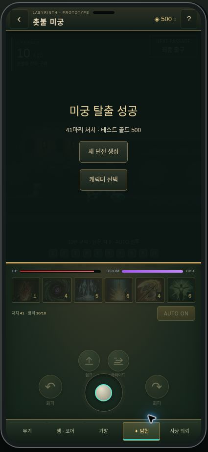

# 기본 사냥 던전 — 전투 속도 보완

적용 범위는 `/hunt`의 기본 바르디안 회랑 모드다. 기존 성장 사냥·홀덤 엔진의 속도와 보상 계산은 변경하지 않는다.

## 변경

- 캐릭터·몬스터 메쉬는 기존 프로젝트에서 사용하는 WebGL 렌더러 경로를 기본으로 사용한다. GPU 레이어를 한 번 합성하고 HP·공격 예고 표시는 그 위에 유지한다. WebGL이 없으면 기존 Canvas2D 삼각형 렌더링으로 돌아간다. 이미지와 리깅 데이터는 바꾸지 않는다.

- 서버 스냅샷 사이에도 공격·스킬·점프·Rush 표시 시간을 프레임마다 진행한다. 서버 확인 시점에서 최대 150ms까지만 예측하고, 응답이 끊기면 더 진행하지 않는다. 공격 포즈는 기존 contact remapping에 40ms snap / 100ms hold 구간을 사용하는 경로를 적용한다.
- 수동 이동은 마지막 확인된 위치에서 최대 150ms만 미리 표시한다. 방 경계·지형·마지막 확인된 몬스터 충돌을 적용한다. 피해·체력·쿨다운·처치·방 이동·보상은 클라이언트에서 추정하거나 확정하지 않는다. 몬스터 이동에 따른 오차는 다음 서버 응답으로 보정한다.
- 통신은 100ms 고정 interval 대신 응답 완료 후 이어지는 직렬 요청으로 변경했다. 전경 최소 요청 간격은 50ms이며, 키·스틱·버튼 변경 시 다음 가능한 전송을 예약한다. 느린 응답을 기다리는 동안 요청을 겹쳐 보내지 않는다.
- 재전송은 같은 id/sequence/body를 유지한다. 타임아웃은 일반 요청 5초, 최초 입장 20초다. 오류 시 200ms부터 최대 1초까지 재시도 대기하며, 입력 이벤트가 반복되어도 재시도 예정 시각을 뒤로 밀지 않는다. 나가기/재시작 시 요청·타이머를 취소한다.
- 서버는 1초 이하의 정상 지연을 20ms 이하 단계로 전부 처리한다. 1초를 초과한 긴 단절은 중립 입력으로 250ms만 처리한다. 재접속 시 오래된 AUTO/이동 입력으로 누적 사냥하지 않는다. 중복 sequence는 기존 결과를 재생하며 시간을 추가하지 않는다. 역행한 시계로 추가 시간이 발생하지 않도록 last 값을 보호한다.
- 이동 속도 180 → 210 월드 단위/초. 달리기 표시 배속도 같은 비율로 조정한다.
- 일반 공격은 이미 복원한 Axe 행동 프로필을 1.12배 배속으로 적용한다. 1~4타는 약 0.446초 / 타격 0.179초, 5타는 약 0.598초 / 타격 0.268초. 기존의 전 타격 0.56초 / 0.20초 균일 처리를 제거한다. 피해량은 그대로다.
- AUTO는 같은 구역의 가까운 적에게 grounded Rush로 접근한다. 속도는 복원된 RushSpeed 20 × 현재 맵 단위 24 = 480이다. 진입 거리 125~260, 정지 거리 72는 웹 조정값이다. 지형·몬스터 충돌을 유지하고, 회피 무적을 부여하지 않는다. 수동 이동·AUTO 해제·대상 사망으로 중지되며 점프·회피로 중단할 수 있다. 출구의 점프/슬라이딩 판정과 구역 개방은 기존 서버 규칙을 유지한다.

원작 전체 속도를 정확히 재현했다고 주장하는 변경은 아니다. 공개된 복원 프로필과 현재 웹 맵을 연결한 조정이며 원본 화면의 픽셀 단위와 현재 월드 단위는 동일하지 않다.

## 검증

`npm run test:rpg:rogue`에 `test-pace.ts`를 포함한다. 시각 시계의 연속성·예측 상한·사망 정지, 타격별 contact, 벽/몬스터 충돌, 예측 상태 불변성, 점프 예측과 구역 생성 분리, 50~1000ms 통신 간격별 서버 진행, 중복 요청, 역행 시계, 긴 재접속, Rush 취소·충돌·피격, 입력 폭주 시 재시도 기아 방지를 검사한다. 기존 AUTO 30개 시드 완주와 모든 출구 통과 회귀 테스트도 포함된다.

- `npm run check:rpg`
- `npm run test:rpg:rogue`
- `npm run test:rpg:build`
- `npm run test:rpg`
- `npm test --prefix mini-services/poker-server`
- `node node_modules/next/dist/bin/next build --webpack`
- `RPG_SMOKE_URL=<origin> node scripts/rpg/smoke-pace.mjs`: 실제 API에 400ms 간격 요청을 보내 누적 게임 시간이 실제 시간과 맞는지 검사하고 중복 요청 결과도 비교한다.
- `RPG_SMOKE_URL=<origin> node scripts/rpg/smoke-build.mjs`: 기존 젬·코어·저장 경로 회귀 검사.

기존 sequence/CAS 계약을 재사용하며 제한된 지연 구간·중복·취소·예측 불변성을 결정적 테스트로 직접 검사할 수 있어 형식 검증은 실행하지 않았다. 이 검증은 모든 휴대폰에서 60FPS가 나온다는 보장이 아니다. Canvas2D 폴백은 유지한다. `canvas.dataset.renderer`, `drawMs`, `frameMs`로 현재 렌더러와 프레임 간격을 확인할 수 있다. 해당 평균값은 현재 실행 환경의 관측값이며 모든 기기 성능을 대표하지 않는다.

## 운영 검증 기록 (2026-10-31)

- 운영 코드: `07e992b` (전투/통신 보완 `6e8ee5c` 포함). Render live 상태와 `/api/release`, `/healthz` 응답을 확인했다.
- 전체 회귀 범위: RPG/에셋 135, 던전/속도 32, 젬/코어 7, 홀덤 244건 통과. 렌더링 보완 후 관련 접지·메쉬·이동 범위 49건과 타입 검사·프로덕션 빌드도 통과했다.
- 400ms 간격 실제 API 검사: 로컬 실제 1.633초/게임 1.634초, 운영 실제 2.209초/게임 2.300초. 중복 요청은 동일 응답을 반환했다. 기존 젬·코어 API 검사도 통과했다.
- 운영 브라우저에서 수동 키 이동·터치 스틱 드래그·수동 스킬·재시작·AUTO 전 구역 통과를 확인했다. 최종 버전에서 10구역 정리, 41마리 처치, 통과 기록 `0,1,2,3,4,5,6,7,8`, 미궁 탈출 성공을 확인했다.
- 검증 브라우저의 실제 선택은 Canvas 폴백이었다. WebGL 경로의 실제 GPU 렌더링과 기기별 FPS는 이 환경에서 확인하지 못했다. 실기 성능 확인 없이 60FPS를 보장하지 않는다.

