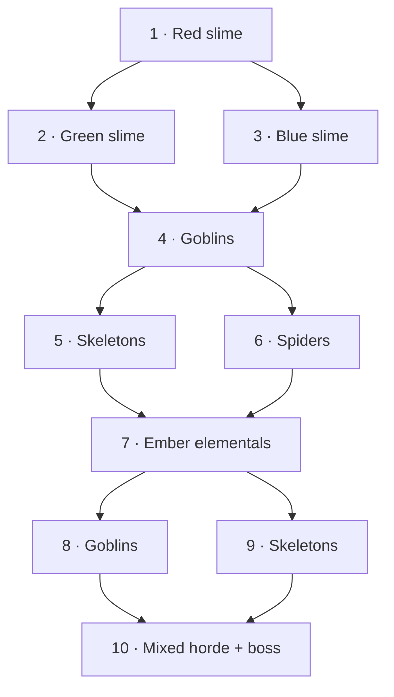
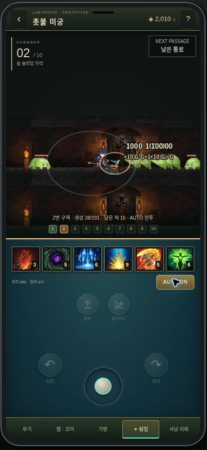

# Guide 123456: forked Vardian-style horde prototype

Source: uploaded `123456.pptx`, three slides, 2026-10-31. Applied to `/hunt` default Hong rogue run, not the legacy campaign or poker engine.

## Guide mapping

| Slide | Implementation |
| --- | --- |
| 1 | Six skills, AUTO/status, jump+slide upper center, evade left/right, central lower stick, existing footer. Teal legacy console. Hide player HP/EXP/ROOM vitals row; HP remains authoritative internally. |
| 2 | Ten arena definitions, three upper/lower forks, common intermediate platforms and final boss. Each run visits seven arenas. AUTO chooses upper. Manual fork buttons or W/up and S/down choose paths near an open exit. Ordinary movement is X-only; jump/drop/climb changes elevation. |
| 3 | Arena width 24–27 tiles (1,152–1,296 world units). Thirty on entry, deterministic random total 150–200 inclusive of entry pack. Eight per timed batch, last normal batch by 55 seconds of active simulation. No kill deadline. Each room has its own species theme. |

Final room's random total includes **one boss**. Normal enemies are all generated within 55 seconds; boss appears after they are killed, with no timer requirement. Exit requires entire scheduled budget and boss dead. Empty intervals between waves never clear a room. Entered arenas spawn once; selected arena is not populated until successful landing. Alternative branches are not required for completion.

## Native evidence and adaptation boundary

Original `MapEntityReactorSpawnBase.cs` / `MapEntityReactorSpawnMonster.cs` expose range, spawn groups, spawned UIDs and all-dead status. Exported `MapEntityReactorSpawnMonster__OnAdvance__T6000415.txt` calls NotifySpawnMonster, exact-position selection and actor IsDead. Existing `hunt-scene-flow.ts` already represents delay/repeat/interval/count and area/clear messages.

Soul Sanctuary-specific TrialData and exact timer/reward DB were **not present** in the accessible dump. Therefore this is a guide-based adaptation of that structure, not a claim to have restored Sanctuary's exact native balance. 30 / 150–200 / 55 seconds are explicit prototype settings in `rogue/encounters.ts`. Scene art remains recovered Map002_001 with existing source jump/slide/climb timing. Slime colors, goblins, skeletons, spiders and fire elementals use recovered native assets.

## Performance and safety

- 1D spatial bins for crowd separation; enemy crowd uses 4-unit minimum spacing, player collision remains solid.
- At most 24 visible enemy rigs evaluated live, plus Hong. Further visible enemies use eight-frame Canvas bakes of the same native clips, retaining crowd visibility/animation. Offscreen actors culled; removed actor/position caches pruned. This changes presentation only.
- Recent corpses retained 0.65 seconds; FX/snapshot limited to 96. No endless corpse history.
- Player damage has 0.4-second shared hit grace, separate from 0.15-second flash, to prevent simultaneous stacked hits from instantly killing the test character. Normal hit65/boss350 and 10,000 testHP retained; UI hides numeric HP.
- Input parser validates branch; in-flight traversal cannot reroute. Existing session ID, sequence replay, catchup bounds and saved-build CAS remain in place. Test-run coins are not written into account balances.
- 55 seconds means active server simulation time. Pausing a tab does not spawn hundreds offscreen or manufacture rewards; existing bounded reconnect policy remains.

## Verification

- RPG typecheck and production build.
- 43 focused tests: all eight branch combinations, 100 map seeds, all five passage types, correct/wrong gate actions, no pre-landing spawn, duplicate-sequence replay, real horde AUTO completion across four production seeds, 30 seed small-pack route tests, spawn deadline/budget/no-kill-timeout, reward and corpse/FX bounds, skill/build/pace regression.
- Full existing RPG and poker suites run before release; exact results and live visual QA appended after deployment.
- Formal verification omitted: existing sequence/CAS protocol unchanged, synchronous bounded wave/route behavior exercised directly with all fork combinations and replay/interruption regressions. No formal-proof claim.

Remaining limits: native Sanctuary balance unavailable; prototype HP/damage/rewards are not economy restoration. Actual low-end mobile FPS and WebGL branch require device testing; cloud browser timing is not a reliable FPS measure.

Pre-release results: `check:rpg` passed; Next production build passed; focused 43/43 (36 rogue/pace/horde + 7 build); existing RPG 135/135; poker 244/244. Total 422 passing tests. No poker policy or campaign balance changes.

## Deployment and live QA

Runtime commit `d54a579c4c0187939dd83e89649ad03ce4fbd7e9` pushed atomically to `main` and `feat/rpg-guide-123456`. Render deploy `dep-dbj74bmq1p3s73afk9kg` reached **live** at 2026-10-31 22:58:52 UTC. `/api/release` returned that exact revision; `/healthz` returned `status:ok`, `web:true`, `poker:true`.

In live Chrome: Hong selection → hunt → initial30/179 → incremental spawn38/179 →166/179 →179/179, no premature room clear. Toggled AUTO off and on; observed 39 visible living enemies with detailed-rig cap24 and animated crowd fallback, then AUTO cleared the first room and chose room2 (upper green-slime path). Next room showed38/191, confirming separate budget/theme. No application-origin errors observed; extension metadata errors excluded. Under cloud Canvas fallback a sample draw was17.45ms, while frame intervals were heavily throttled; this is **not** an FPS guarantee. Native Canvas bake smoke check rendered45 clips across all nine regular species with non-empty pixels.

Visible HP/EXP absent. DOM geometry: jump/slide row y609, evades y731, stick y760, footer inside phone; no overlap at tested399×886 content size. Small-screen rules retain a compact277px console.

