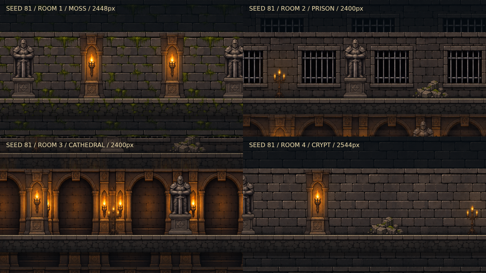

# Modular long dungeon: implementation and handoff

Request: adapt uploaded `Gemini_Generated_Image_ggs102ggs102ggs1.jpg` into procedurally varied Vardian-style side-scrolling regions, with more space to retreat and evade. This expands the current horde prototype, retaining X-only movement, action-linked elevation, three upper/lower choices and common boss. It does not turn combat or growth into an Isaac-style top-down game.

## What changes per seed

- Arena length **44–54 tiles / 2,112–2,592 world units**, formerly24–27 /1,152–1,296. Average length about1.92×.
- 4- or5-tile gaps, varying96–144-unit branch height changes and common platform heights. Slide links keep equal source/destination elevation. Actual collision/traversal coordinates match visible platform heights.
- Four wall/floor styles: ancient crypt, moss corridor, barred prison, torch-lit sanctuary. Each run includes all four. Seeded positions/types of columns, candle stands, statues and rubble, about10–13 props per region.
- Modular atlas panels repeat along the arena instead of stretching a complete native map panorama. Far masonry has slower parallax; play-plane floors, props and doors follow world coordinates.
- Doors visually switch closed/open from authoritative room-clear state. Jump/down/climb and slide links still use existing tested server traversal.

The ten-room branching graph is retained deliberately. This version randomizes arena dimensions, elevation and modular assembly, not the number of rooms or every graph edge. Interior props are background scenery; they do not create unimplemented loot, ladders, stairs or super-jump interactions.

## Retreat and spawn safety

- First player spawn moves from arena center to the sixth tile after the entrance, leaving over300 world units behind the player. Later entries keep their original landing point and encounter boundary.
- No spawn nests in the first240 world units of the room, plus72 margin. Every **new** monster is at least240 world units away from the player. Nests use the forward lane whenever available; the distant rear lane is used only when the hero has reached the far end and no forward lane remains. This avoids new flanking packs closing the retreat route while fighting in the middle of an arena.
- Monster count stays entry30, total150–200, normal batches complete by55 seconds, no kill deadline. Existing enemies may chase into the refuge; it is movement space, not an invulnerable sanctuary.
- Player cannot walk through mobs. Jump/dodge/slide maximum-three-enemy crossing rule remains. Existing attack, damage, skills and economy values unchanged.
- Lower-branch passage label now follows the actual in-flight gate instead of showing AUTO's upper preference.

## Assets and renderer

- `public/rpg/maps/modular-dungeon/atlas-v1.png`:1536×1024 RGBA, generated with built-in image generation using the supplied image as a visual reference. Alpha inspected; unused background transparent. Original generated output retained separately, approved copy shipped in repository.
- `public/rpg/maps/modular-dungeon/manifest.json`:12 measured source rectangles, top-left pixel coordinates. Can also feed Unity Sprite Editor.
- `src/components/rpg/rogue/scenery.ts`:source rectangles and Canvas assembler. Runtime UV/source-rectangle cropping only; no post-generation resampling or chroma-key processing of artwork.
- `map.ts`:deterministic arena/height/decor data, restores external rot-js RNG state.
- `encounters.ts` / `engine.ts`:safe spawn lanes, entry refuge, actual selected passage.
- Existing actor scale, phone frame, lower UI and native Hong/monster animation retained. WebGL live-rig budget and Canvas crowd bakes retained.

## Verification

`check:rpg` and production Next build. Focused48 tests:41 rogue/pace/horde/modular +7 saved-build tests. Existing RPG135 and poker244 regressions. Total427 tests. New checks cover100 seed layouts and deterministic reproduction, all four styles, variation in elevations/props, slide height alignment, actual dodge/slide retreat across30 seeds, reinforcement safety at both arena ends, lower-passage label and retreat after all reinforcements arrive. Existing tests still cover all8 branch combinations and real production horde AUTO completion.

Formal verification not run: synchronous map/spawn changes are covered directly by these bounded geometry, replay and integration tests; no sequence/CAS protocol or economy invariant changed. Real device FPS and subjective combat-space feel still need user feedback. Decorations are visual only.

## Final generation prompt (built-in image generation)

Reference image: uploaded modular dungeon sheet, used for style only. Output:transparent background enabled.

> Use case: stylized-concept. Production asset: modular 2D SIDE VIEW dungeon game tiles atlas, based on the attached reference as STYLE ONLY. Generate ONE atlas image, landscape 3:2 aspect ratio, arranged in EXACTLY 4 equal columns and 3 equal rows (12 cells). Each asset stays entirely within its cell, generous transparent gutter around separate objects. GENUINELY TRANSPARENT BACKGROUND, NO grid, NO labels, NO words, NO letters, NO watermark, NO characters. Dark charcoal stone, muted brown/gold, restrained warm amber torchlight, crisp game painted outlines consistent with reference. Row 1 left to right: (1) plain horizontal stone brick WALL rectangular seamless fill reaching cell edges, (2) mossy horizontal crypt WALL seamless fill reaching cell edges, (3) dark iron barred dungeon window embedded in rectangular brick wall reaching cell edges, (4) warm torch-lit arched cathedral wall niche rectangular wall reaching cell edges. Row 2 left to right: (5) continuous horizontal playable stone FLOOR cross-section, flat top surface at 20% of cell height and sturdy deep masonry below, left/right edges tile seamlessly, (6) cracked moss stone FLOOR cross-section with same flat top at20%, seamless horizontal, (7) isolated tall gothic stone arch pillar with orange wall torch on it, (8) isolated wrought iron candle stand with three small flames. Row3 left to right: (9) isolated CLOSED iron-and-wood arched door, (10) isolated OPEN matching doorway with dark entrance and open wood panels, (11) isolated ancient stone knight statue on plinth, (12) isolated low ruined stone rubble mound. Assets must be orthographic side-on front view suitable for compositing in a side scrolling 2D action game. No perspective floor planes, no isometric geometry. Preserve dark dungeon visual language but create new clean usable modular assets. Four wall cells intentionally opaque rectangular fills, floor cells solid below flat upper edge, all other empty/gutter pixels transparent.

The generator did not follow an exact uniform grid for its second/third rows. The measured manifest handles the actual placement rather than assuming equal cells.
