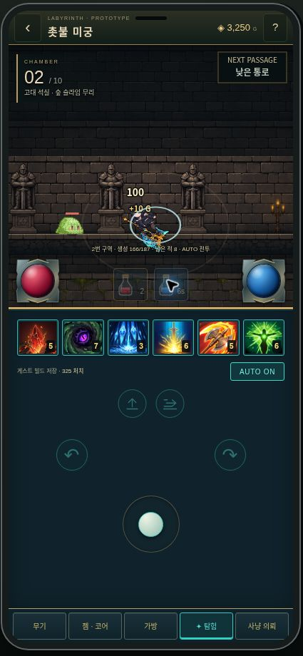

# Reference orb console and two test potions

Applied to default `/hunt` rogue prototype using uploaded `image(20261101-015229).png` as visual reference.

## UI

- Crimson HP orb left, blue mana orb right, mounted at the lower edge of the battle viewport. Code-native SVG metal mounts and CSS glass/liquid/highlights; scalable UI artwork, no bitmap dependency. Fill uses actual current/max values, including the existing large-number HP projection. Numeric HP/MP labels hidden; percentage available to assistive technology.
- Center holds **exactly two** flask buttons: health and mana, with remaining charges/cooldown. Existing six skills, AUTO, jump+slide pair, symmetric evades, movement stick and footer retained. Cyan outlined controls and a dark flat console, more vertical control spacing, compact battlefield progress.
- Slightly shorter battle viewport / longer lower panel matches the supplied portrait proportions. Existing desktop phone frame retained. Small-height rule uses285px lower console; orbs shrink to49px, potion tap targets remain44px wide.

## Prototype resource behavior

- HP potion restores40% maxHP via Decimal authority, mana potion restores50% maxMP. Each has3 charges per run, individual8-second cooldown. Full resource, empty charges, cooldown, death or paused editing do not consume a potion. Potions can be used during an attack without interrupting its motion.
- MP100, regeneration10/second, six skill costs8/10/12/14/8/10. This is a forgiving test resource policy for the UI, not a claim to have restored native Vardian mana balance. A repeat-support echo pays once per cast. Failed/queued casts pay only on actual start; low-MP manual reservation resumes on regeneration, AUTO falls back to basic attacks.
- Z=HP potion, X=MP potion. Potion requests suppress a held Space attack flag for that request, preserving single-action server validation; subsequent held attacks continue normally.
- Only this run's test inventory is affected; legacy account consumables and saved currencies are unchanged. New run resets test charges. No automatic potion spending added.
- Existing sequence replay prevents double consumption on a retry. Editor pause freezes mana regeneration, HP damage, waves and potion timers.

Files:`rogue/ResourceHud.tsx`, `resources.ts`, `rogue.css`, `engine.ts`, client command composition and server input parser.

Verification: RPG typecheck, Next production build;47 rogue/map/pace/resource tests,15 build/big-number tests,135 existing RPG and244 poker =441 passing tests. Six new tests cover capped HP/MP recovery, depletion/cooldowns/pause, mana reservations, zero-MP AUTO, huge-HP potion and sequence-replayed/invalid potion commands. Formal verification omitted: existing synchronous command and replay protocol retained and directly tested.

## Deployment and live QA

Runtime `ec57eab0f6dfcc241f0f305a69b7d09619157dae` pushed atomically to main and feat/rpg-health-mana-orbs. Render deploy `dep-dbj9s1rbc2fs73d96drg` is live. `/healthz` returned web=true,poker=true; `/api/release` returned the exact runtime revision.

Browser QA at https://holdem-coin-tavern.onrender.com/hunt: entered as Hong, AUTO continued through room2; HP potion brought the displayed99% to100% and started8s cooldown. Both HP and mana buttons were used and each remaining-charge text later showed2 (from3); mana potion cooldown visible in screenshot. Six skills, jump/slide and symmetric evades remained visible. Screenshot records actual live UI, not a mockup. Cloud canvas timing is not a device-FPS benchmark.

