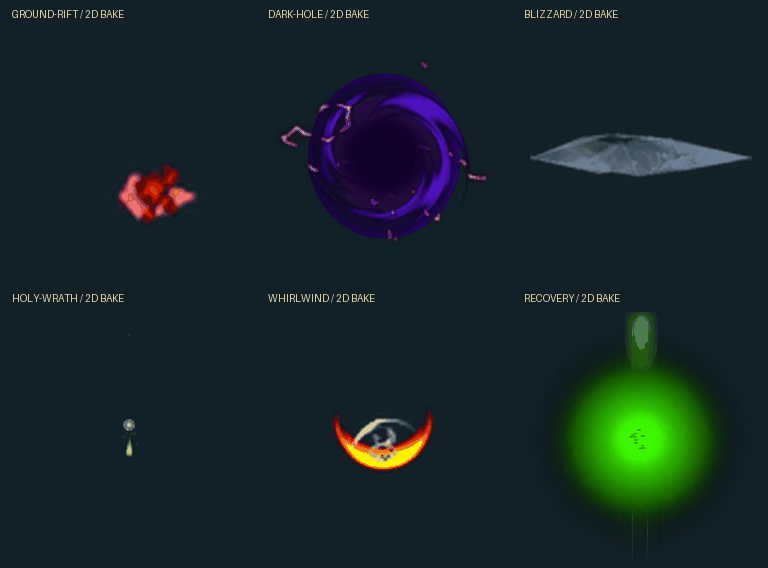

# 바르디안 VFX 추출·미리보기 도감

원본 프리팹 **633개**, 텍스처 **741개**, 메시 **121개**. 스킬 프리팹은 341종이며, 현재 연결용 공통 프리팹까지 **GIF 343개**를 제공합니다.

[웹 도감 — 검색 / 확대 / 개별 다운로드](https://holdem-coin-tavern.onrender.com/rpg/vfx/index.html) · [원본 추출 인덱스](../../../archive/rpg/vfx/manifest.json) · [현재 6개 스킬 연결 정보](../../../public/rpg/vfx/runtime/manifest.json)

## 먼저 알아둘 구분

- **원본 추출**: 텍스처 PNG, 프리팹 계층·Transform·파티클 모듈·머티리얼 typed-tree, 디코딩한 메시 정점·UV·삼각형입니다. 텍스처 원본에는 배경 제거·색 보정을 하지 않았습니다.
- **GIF**: 원본 설정을 제한적으로 해석한 **2D XY/평면 메시 근사 미리보기**입니다. Unity에서 녹화한 원본 이펙트 영상이 아닙니다.
- **웹 적용**: 이 미리보기를 256px 셀 × 32프레임 WebP로 베이크하여 현재 6개 웹 스킬에 연결했습니다. 피해/드롭/쿨다운 수치는 변경하지 않았습니다.
- 지원하지 않는 요소: 커스텀 셰이더의 디졸브·왜곡·UV 계산, 스크립트 기반 활성화, 3D 원근·회전, 트레일·서브 이미터·라이트·충돌·가중 곡선. 원본 데이터와 참조는 보존되지만 외부 셰이더·스크립트 의존성이 모두 포함된 Unity 재가져오기 패키지는 아닙니다.
- RGB로 투명도를 계산하는 일부 머티리얼은 **미리보기에서만** 균일한 가장자리 색을 키잉합니다. 메시 UV는 가장 넓은 로컬 평면에 투영하므로 원작과 형상이 달라질 수 있습니다.
- 2초, 32프레임, 이미터 최대48개, 이미터당 파티클 최대36개로 제한합니다. 루프·긴 연출의 전체 길이를 뜻하지 않습니다. 빈/부분 미리보기는 원본 이펙트가 비어 있다는 뜻이 아닙니다.

## 현재 6개 스킬 미리보기



## GIF를 하나씩 보기

- [01 — FX_Buff_Heal ~ FX_AutomatonGuardian_Skill4](gallery-01.md)
- [02 — FX_BattleDummy_Cast_01 ~ FX_BloodAbsorbing_01](gallery-02.md)
- [03 — FX_BloodAbsorbing_02 ~ FX_DarkDamage_01](gallery-03.md)
- [04 — FX_DarkHell_01 ~ FX_DarkSphereBurst_01](gallery-04.md)
- [05 — FX_DarkSphereBurst_Loop_01 ~ FX_DesertScorpion_Cast_01](gallery-05.md)
- [06 — FX_DesertScorpion_Skill1 ~ FX_EliasShield_01_Explode](gallery-06.md)
- [07 — FX_EliasShield_01_Loop ~ FX_FireBurstDamage02](gallery-07.md)
- [08 — FX_FireBurstDamage03 ~ FX_FreezeDamage01_L](gallery-08.md)
- [09 — FX_FreezeDamage01_S ~ FX_HolySpearDamage_01](gallery-09.md)
- [10 — FX_HolySpear_01 ~ FX_IceRock_01](gallery-10.md)
- [11 — FX_IceRock_02 ~ FX_LightningSpear_01](gallery-11.md)
- [12 — FX_LightningSpear_01_S ~ FX_NerissaQueen_Skill4_02](gallery-12.md)
- [13 — FX_NerissaQueen_VerticalDamage_01 ~ FX_RisingBlowDamage_01](gallery-13.md)
- [14 — FX_RisingBlowDamage_01_Small ~ FX_Slime_Projectile_Area_G](gallery-14.md)
- [15 — FX_Slime_Projectile_Area_R ~ FX_SpecterGoblin_Skill4_02](gallery-15.md)
- [16 — FX_StatueTrap01_Attack01 ~ FX_TornadoHit_02_GR](gallery-16.md)
- [17 — FX_TornadoHit_02_RE ~ FX_Whirlwind_03_E](gallery-17.md)
- [18 — FX_Whirlwind_03_L ~ FX_Whirlwind_Lightning_Damage 1](gallery-18.md)

## 현재 전투 연결

| 웹 스킬 | 원본 프리팹 | 연결 근거 |
|---|---|---|
| 회복 | `FX_Buff_Heal` | 프리팹 이름 일치 |
| 대지 균열 | `FX_GroundBreaking_01` | 주제 기반 대체 연결 |
| 서리 폭풍 | `FX_Blizzard_Projectile_01` | 프리팹 이름 일치 |
| 암흑 구체 | `FX_DarkHole_01` | 프리팹 이름 일치 |
| 빛의 심판 | `FX_HolyWrath_01` | 프리팹 이름 일치 |
| 회오리 | `FX_Whirlwind_01_L` | 프리팹 이름 일치 |

현재 웹의 6개 스킬은 원작 전체 스킬 목록을 그대로 재현한 것이 아닙니다. 원본 이름 일치는 스킬 DB GUID→프리팹의 완전한 연결 증명을 뜻하지 않습니다. 대지 균열은 GroundBreaking 공통 FX를 이용한 명시적 대체 연결입니다. 회오리는 종료용 `_E`가 아닌 본체 루프 `_L`을 사용합니다.

## 전투 연결 방식

서버 `HuntEngine`의 스킬 타격/회복 처리 순간에 시각 이벤트를 한 번 생성합니다. 이벤트는 월드 좌표·방향·생성/만료 시각만 가지며 2초 동안 스냅샷에 유지됩니다. 브라우저는 서버 경과시간으로 프레임을 선택하므로 같은 스냅샷을 받아도 재생을 다시 시작하지 않습니다. 이펙트 로드 실패는 사냥 진입이나 피해 정산을 중단하지 않습니다. 한 번에 최대24개만 렌더링하고 스테이지 변경 때 비웁니다.

## 폴더와 재현

```text
archive/rpg/vfx/manifest.json        전체 출처·오브젝트 ID·텍스처 해시
archive/rpg/vfx/prefabs/*.json.gz    원본 프리팹 typed-tree와 머티리얼
archive/rpg/vfx/textures/*.png       원본 디코딩 텍스처
archive/rpg/vfx/meshes/*.json        원본 메시 정점·UV·삼각형
public/rpg/vfx/previews/*.gif        개별 검토 GIF
public/rpg/vfx/runtime/*.webp        실제 웹 전투용 베이크
public/rpg/vfx/index.html            검색 가능한 도감
docs/rpg/vfx/gallery-*.md            GitHub에서 바로 보는 GIF 페이지
```

```sh
python -m pip install UnityPy==1.25.4 Pillow==13.0.0
python scripts/rpg/extract_vfx.py /path/to/fx_assets_all_1171c389019a2f69167c23b819ff61ea.bundle
python scripts/rpg/build_vfx_gallery.py
python scripts/rpg/check_vfx_assets.py
npm run test:rpg:vfx
```

원본 번들 SHA-256: `53d214852703cf536f383a876278ff9ba16a1ab8b611ba26733cca5db70b5360`. 원본 번들 파일 자체는 저장소에 중복 업로드하지 않았습니다.

## 검증 경계

파티클/메시 미리보기의 시각적 차이는 Unity 전용 셰이더와 스크립트를 완전히 복원한 결과로 오해하면 안 됩니다. 기본·통합 회귀 테스트와 타입 검사를 우선했습니다. 이번 변경은 표시 이벤트 추가이므로 별도 형식 검증 모델은 만들지 않았습니다.
