# VFX GIF 01 / 18

[목록으로](README.md) · [다음](gallery-02.md)

모두 원본 데이터로 만든 2D 근사 미리보기입니다. 각 GIF를 클릭하면 개별 파일을 열 수 있습니다.

## FX_Buff_Heal

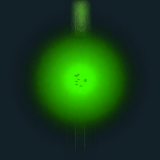

분류 `Common` · 파티클 5개 · 표시 프레임 16/32

원본 경로: `Assets/InHouse/Fxs/Common/Prefab/FX_Buff_Heal.prefab`

[GIF 파일](../../../public/rpg/vfx/previews/FX_Buff_Heal.gif) · [원본 프리팹 설정 gzip](../../../archive/rpg/vfx/prefabs/FX_Buff_Heal.json.gz)

## FX_GroundBreaking_01

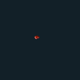

분류 `Common` · 파티클 9개 · 표시 프레임 28/32

원본 경로: `Assets/InHouse/Fxs/Common/Prefab/FX_GroundBreaking_01.prefab`

[GIF 파일](../../../public/rpg/vfx/previews/FX_GroundBreaking_01.gif) · [원본 프리팹 설정 gzip](../../../archive/rpg/vfx/prefabs/FX_GroundBreaking_01.json.gz)

## FX_ArmaSpider_Skill1_01

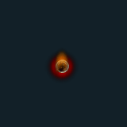

분류 `Skill` · 파티클 21개 · 표시 프레임 32/32

원본 경로: `Assets/InHouse/Fxs/Skill/Prefab/FX_ArmaSpider_Skill1_01.prefab`

[GIF 파일](../../../public/rpg/vfx/previews/FX_ArmaSpider_Skill1_01.gif) · [원본 프리팹 설정 gzip](../../../archive/rpg/vfx/prefabs/FX_ArmaSpider_Skill1_01.json.gz)

## FX_ArmaSpider_Skill1_02

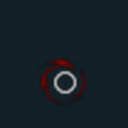

분류 `Skill` · 파티클 8개 · 표시 프레임 32/32

원본 경로: `Assets/InHouse/Fxs/Skill/Prefab/FX_ArmaSpider_Skill1_02.prefab`

[GIF 파일](../../../public/rpg/vfx/previews/FX_ArmaSpider_Skill1_02.gif) · [원본 프리팹 설정 gzip](../../../archive/rpg/vfx/prefabs/FX_ArmaSpider_Skill1_02.json.gz)

## FX_ArrowDamage_01

분류 `Skill` · 파티클 6개 · 표시 프레임 19/32

원본 경로: `Assets/InHouse/Fxs/Skill/Prefab/FX_ArrowDamage_01.prefab`

[GIF 파일](../../../public/rpg/vfx/previews/FX_ArrowDamage_01.gif) · [원본 프리팹 설정 gzip](../../../archive/rpg/vfx/prefabs/FX_ArrowDamage_01.json.gz)

## FX_ArrowDamage_01_R

분류 `Skill` · 파티클 6개 · 표시 프레임 19/32

원본 경로: `Assets/InHouse/Fxs/Skill/Prefab/FX_ArrowDamage_01_R.prefab`

[GIF 파일](../../../public/rpg/vfx/previews/FX_ArrowDamage_01_R.gif) · [원본 프리팹 설정 gzip](../../../archive/rpg/vfx/prefabs/FX_ArrowDamage_01_R.json.gz)

## FX_Arrow_Projectile_01

분류 `Skill` · 파티클 4개 · 표시 프레임 0/32

원본 경로: `Assets/InHouse/Fxs/Skill/Prefab/FX_Arrow_Projectile_01.prefab`

[GIF 파일](../../../public/rpg/vfx/previews/FX_Arrow_Projectile_01.gif) · [원본 프리팹 설정 gzip](../../../archive/rpg/vfx/prefabs/FX_Arrow_Projectile_01.json.gz)

## FX_Arrow_Projectile_02

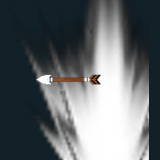

분류 `Skill` · 파티클 3개 · 표시 프레임 32/32

원본 경로: `Assets/InHouse/Fxs/Skill/Prefab/FX_Arrow_Projectile_02.prefab`

[GIF 파일](../../../public/rpg/vfx/previews/FX_Arrow_Projectile_02.gif) · [원본 프리팹 설정 gzip](../../../archive/rpg/vfx/prefabs/FX_Arrow_Projectile_02.json.gz)

## FX_Arrow_Projectile_03

분류 `Skill` · 파티클 3개 · 표시 프레임 16/32

원본 경로: `Assets/InHouse/Fxs/Skill/Prefab/FX_Arrow_Projectile_03.prefab`

[GIF 파일](../../../public/rpg/vfx/previews/FX_Arrow_Projectile_03.gif) · [원본 프리팹 설정 gzip](../../../archive/rpg/vfx/prefabs/FX_Arrow_Projectile_03.json.gz)

## FX_Artifact_RadianAegis_01

분류 `Skill` · 파티클 8개 · 표시 프레임 32/32

원본 경로: `Assets/InHouse/Fxs/Skill/Prefab/FX_Artifact_RadianAegis_01.prefab`

[GIF 파일](../../../public/rpg/vfx/previews/FX_Artifact_RadianAegis_01.gif) · [원본 프리팹 설정 gzip](../../../archive/rpg/vfx/prefabs/FX_Artifact_RadianAegis_01.json.gz)

## FX_Artifact_RadianAegis_Damage_01

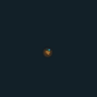

분류 `Skill` · 파티클 10개 · 표시 프레임 15/32

원본 경로: `Assets/InHouse/Fxs/Skill/Prefab/FX_Artifact_RadianAegis_Damage_01.prefab`

[GIF 파일](../../../public/rpg/vfx/previews/FX_Artifact_RadianAegis_Damage_01.gif) · [원본 프리팹 설정 gzip](../../../archive/rpg/vfx/prefabs/FX_Artifact_RadianAegis_Damage_01.json.gz)

## FX_Artifact_RadianAegis_End

분류 `Skill` · 파티클 26개 · 표시 프레임 32/32

원본 경로: `Assets/InHouse/Fxs/Skill/Prefab/FX_Artifact_RadianAegis_End.prefab`

[GIF 파일](../../../public/rpg/vfx/previews/FX_Artifact_RadianAegis_End.gif) · [원본 프리팹 설정 gzip](../../../archive/rpg/vfx/prefabs/FX_Artifact_RadianAegis_End.json.gz)

## FX_Artifact_RadianAegis_Loop

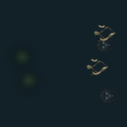

분류 `Skill` · 파티클 14개 · 표시 프레임 32/32

원본 경로: `Assets/InHouse/Fxs/Skill/Prefab/FX_Artifact_RadianAegis_Loop.prefab`

[GIF 파일](../../../public/rpg/vfx/previews/FX_Artifact_RadianAegis_Loop.gif) · [원본 프리팹 설정 gzip](../../../archive/rpg/vfx/prefabs/FX_Artifact_RadianAegis_Loop.json.gz)

## FX_AutomatonGuardian_Skill1

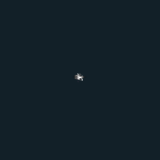

분류 `Skill` · 파티클 10개 · 표시 프레임 32/32

원본 경로: `Assets/InHouse/Fxs/Skill/Prefab/FX_AutomatonGuardian_Skill1.prefab`

[GIF 파일](../../../public/rpg/vfx/previews/FX_AutomatonGuardian_Skill1.gif) · [원본 프리팹 설정 gzip](../../../archive/rpg/vfx/prefabs/FX_AutomatonGuardian_Skill1.json.gz)

## FX_AutomatonGuardian_Skill1_Damage1

분류 `Skill` · 파티클 6개 · 표시 프레임 18/32

원본 경로: `Assets/InHouse/Fxs/Skill/Prefab/FX_AutomatonGuardian_Skill1_Damage1.prefab`

[GIF 파일](../../../public/rpg/vfx/previews/FX_AutomatonGuardian_Skill1_Damage1.gif) · [원본 프리팹 설정 gzip](../../../archive/rpg/vfx/prefabs/FX_AutomatonGuardian_Skill1_Damage1.json.gz)

## FX_AutomatonGuardian_Skill2

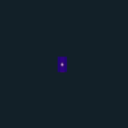

분류 `Skill` · 파티클 9개 · 표시 프레임 29/32

원본 경로: `Assets/InHouse/Fxs/Skill/Prefab/FX_AutomatonGuardian_Skill2.prefab`

[GIF 파일](../../../public/rpg/vfx/previews/FX_AutomatonGuardian_Skill2.gif) · [원본 프리팹 설정 gzip](../../../archive/rpg/vfx/prefabs/FX_AutomatonGuardian_Skill2.json.gz)

## FX_AutomatonGuardian_Skill2_Hit01

분류 `Skill` · 파티클 9개 · 표시 프레임 15/32

원본 경로: `Assets/InHouse/Fxs/Skill/Prefab/FX_AutomatonGuardian_Skill2_Hit01.prefab`

[GIF 파일](../../../public/rpg/vfx/previews/FX_AutomatonGuardian_Skill2_Hit01.gif) · [원본 프리팹 설정 gzip](../../../archive/rpg/vfx/prefabs/FX_AutomatonGuardian_Skill2_Hit01.json.gz)

## FX_AutomatonGuardian_Skill3

분류 `Skill` · 파티클 13개 · 표시 프레임 18/32

원본 경로: `Assets/InHouse/Fxs/Skill/Prefab/FX_AutomatonGuardian_Skill3.prefab`

[GIF 파일](../../../public/rpg/vfx/previews/FX_AutomatonGuardian_Skill3.gif) · [원본 프리팹 설정 gzip](../../../archive/rpg/vfx/prefabs/FX_AutomatonGuardian_Skill3.json.gz)

## FX_AutomatonGuardian_Skill3_Hit01

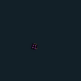

분류 `Skill` · 파티클 9개 · 표시 프레임 19/32

원본 경로: `Assets/InHouse/Fxs/Skill/Prefab/FX_AutomatonGuardian_Skill3_Hit01.prefab`

[GIF 파일](../../../public/rpg/vfx/previews/FX_AutomatonGuardian_Skill3_Hit01.gif) · [원본 프리팹 설정 gzip](../../../archive/rpg/vfx/prefabs/FX_AutomatonGuardian_Skill3_Hit01.json.gz)

## FX_AutomatonGuardian_Skill4

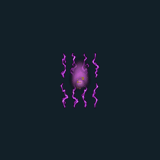

분류 `Skill` · 파티클 22개 · 표시 프레임 32/32

원본 경로: `Assets/InHouse/Fxs/Skill/Prefab/FX_AutomatonGuardian_Skill4.prefab`

[GIF 파일](../../../public/rpg/vfx/previews/FX_AutomatonGuardian_Skill4.gif) · [원본 프리팹 설정 gzip](../../../archive/rpg/vfx/prefabs/FX_AutomatonGuardian_Skill4.json.gz)

