# VFX GIF 02 / 18

[목록으로](README.md) · [이전](gallery-01.md) · [다음](gallery-03.md)

모두 원본 데이터로 만든 2D 근사 미리보기입니다. 각 GIF를 클릭하면 개별 파일을 열 수 있습니다.

## FX_BattleDummy_Cast_01

분류 `Skill` · 파티클 2개 · 표시 프레임 15/32

원본 경로: `Assets/InHouse/Fxs/Skill/Prefab/FX_BattleDummy_Cast_01.prefab`

[GIF 파일](../../../public/rpg/vfx/previews/FX_BattleDummy_Cast_01.gif) · [원본 프리팹 설정 gzip](../../../archive/rpg/vfx/prefabs/FX_BattleDummy_Cast_01.json.gz)

## FX_BattleDummy_Skill01

분류 `Skill` · 파티클 26개 · 표시 프레임 26/32

원본 경로: `Assets/InHouse/Fxs/Skill/Prefab/FX_BattleDummy_Skill01.prefab`

[GIF 파일](../../../public/rpg/vfx/previews/FX_BattleDummy_Skill01.gif) · [원본 프리팹 설정 gzip](../../../archive/rpg/vfx/prefabs/FX_BattleDummy_Skill01.json.gz)

## FX_BattleDummy_Skill04

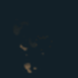

분류 `Skill` · 파티클 6개 · 표시 프레임 16/32

원본 경로: `Assets/InHouse/Fxs/Skill/Prefab/FX_BattleDummy_Skill04.prefab`

[GIF 파일](../../../public/rpg/vfx/previews/FX_BattleDummy_Skill04.gif) · [원본 프리팹 설정 gzip](../../../archive/rpg/vfx/prefabs/FX_BattleDummy_Skill04.json.gz)

## FX_BattleDummy_Skill04_1

분류 `Skill` · 파티클 9개 · 표시 프레임 16/32

원본 경로: `Assets/InHouse/Fxs/Skill/Prefab/FX_BattleDummy_Skill04_1.prefab`

[GIF 파일](../../../public/rpg/vfx/previews/FX_BattleDummy_Skill04_1.gif) · [원본 프리팹 설정 gzip](../../../archive/rpg/vfx/prefabs/FX_BattleDummy_Skill04_1.json.gz)

## FX_BattleDummy_Skill04_1_F

분류 `Skill` · 파티클 6개 · 표시 프레임 0/32

원본 경로: `Assets/InHouse/Fxs/Skill/Prefab/FX_BattleDummy_Skill04_1_F.prefab`

[GIF 파일](../../../public/rpg/vfx/previews/FX_BattleDummy_Skill04_1_F.gif) · [원본 프리팹 설정 gzip](../../../archive/rpg/vfx/prefabs/FX_BattleDummy_Skill04_1_F.json.gz)

## FX_BattleDummy_Skill1_Hit

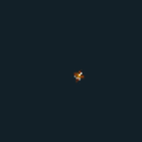

분류 `Skill` · 파티클 10개 · 표시 프레임 15/32

원본 경로: `Assets/InHouse/Fxs/Skill/Prefab/FX_BattleDummy_Skill1_Hit.prefab`

[GIF 파일](../../../public/rpg/vfx/previews/FX_BattleDummy_Skill1_Hit.gif) · [원본 프리팹 설정 gzip](../../../archive/rpg/vfx/prefabs/FX_BattleDummy_Skill1_Hit.json.gz)

## FX_BattleDummy_Skill1_Hit_L

분류 `Skill` · 파티클 16개 · 표시 프레임 20/32

원본 경로: `Assets/InHouse/Fxs/Skill/Prefab/FX_BattleDummy_Skill1_Hit_L.prefab`

[GIF 파일](../../../public/rpg/vfx/previews/FX_BattleDummy_Skill1_Hit_L.gif) · [원본 프리팹 설정 gzip](../../../archive/rpg/vfx/prefabs/FX_BattleDummy_Skill1_Hit_L.json.gz)

## FX_BattleDummy_Skill2

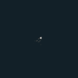

분류 `Skill` · 파티클 6개 · 표시 프레임 32/32

원본 경로: `Assets/InHouse/Fxs/Skill/Prefab/FX_BattleDummy_Skill2.prefab`

[GIF 파일](../../../public/rpg/vfx/previews/FX_BattleDummy_Skill2.gif) · [원본 프리팹 설정 gzip](../../../archive/rpg/vfx/prefabs/FX_BattleDummy_Skill2.json.gz)

## FX_BattleDummy_Skill2_1

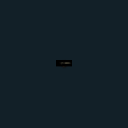

분류 `Skill` · 파티클 14개 · 표시 프레임 32/32

원본 경로: `Assets/InHouse/Fxs/Skill/Prefab/FX_BattleDummy_Skill2_1.prefab`

[GIF 파일](../../../public/rpg/vfx/previews/FX_BattleDummy_Skill2_1.gif) · [원본 프리팹 설정 gzip](../../../archive/rpg/vfx/prefabs/FX_BattleDummy_Skill2_1.json.gz)

## FX_BattleDummy_Skill2_1_Damage1

분류 `Skill` · 파티클 4개 · 표시 프레임 5/32

원본 경로: `Assets/InHouse/Fxs/Skill/Prefab/FX_BattleDummy_Skill2_1_Damage1.prefab`

[GIF 파일](../../../public/rpg/vfx/previews/FX_BattleDummy_Skill2_1_Damage1.gif) · [원본 프리팹 설정 gzip](../../../archive/rpg/vfx/prefabs/FX_BattleDummy_Skill2_1_Damage1.json.gz)

## FX_BattleDummy_Skill3

분류 `Skill` · 파티클 11개 · 표시 프레임 16/32

원본 경로: `Assets/InHouse/Fxs/Skill/Prefab/FX_BattleDummy_Skill3.prefab`

[GIF 파일](../../../public/rpg/vfx/previews/FX_BattleDummy_Skill3.gif) · [원본 프리팹 설정 gzip](../../../archive/rpg/vfx/prefabs/FX_BattleDummy_Skill3.json.gz)

## FX_BattleDummy_Skill3_Cast

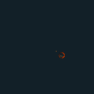

분류 `Skill` · 파티클 3개 · 표시 프레임 14/32

원본 경로: `Assets/InHouse/Fxs/Skill/Prefab/FX_BattleDummy_Skill3_Cast.prefab`

[GIF 파일](../../../public/rpg/vfx/previews/FX_BattleDummy_Skill3_Cast.gif) · [원본 프리팹 설정 gzip](../../../archive/rpg/vfx/prefabs/FX_BattleDummy_Skill3_Cast.json.gz)

## FX_BattleEdgeGround_01

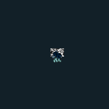

분류 `Skill` · 파티클 16개 · 표시 프레임 32/32

원본 경로: `Assets/InHouse/Fxs/Skill/Prefab/FX_BattleEdgeGround_01.prefab`

[GIF 파일](../../../public/rpg/vfx/previews/FX_BattleEdgeGround_01.gif) · [원본 프리팹 설정 gzip](../../../archive/rpg/vfx/prefabs/FX_BattleEdgeGround_01.json.gz)

## FX_BattleEdge_01_BL

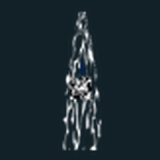

분류 `Skill` · 파티클 8개 · 표시 프레임 32/32

원본 경로: `Assets/InHouse/Fxs/Skill/Prefab/FX_BattleEdge_01_BL.prefab`

[GIF 파일](../../../public/rpg/vfx/previews/FX_BattleEdge_01_BL.gif) · [원본 프리팹 설정 gzip](../../../archive/rpg/vfx/prefabs/FX_BattleEdge_01_BL.json.gz)

## FX_BattleEdge_01_RE

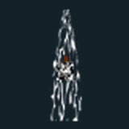

분류 `Skill` · 파티클 8개 · 표시 프레임 32/32

원본 경로: `Assets/InHouse/Fxs/Skill/Prefab/FX_BattleEdge_01_RE.prefab`

[GIF 파일](../../../public/rpg/vfx/previews/FX_BattleEdge_01_RE.gif) · [원본 프리팹 설정 gzip](../../../archive/rpg/vfx/prefabs/FX_BattleEdge_01_RE.json.gz)

## FX_BigWaveHit01

분류 `Skill` · 파티클 11개 · 표시 프레임 8/32

원본 경로: `Assets/InHouse/Fxs/Skill/Prefab/FX_BigWaveHit01.prefab`

[GIF 파일](../../../public/rpg/vfx/previews/FX_BigWaveHit01.gif) · [원본 프리팹 설정 gzip](../../../archive/rpg/vfx/prefabs/FX_BigWaveHit01.json.gz)

## FX_BigWave_01

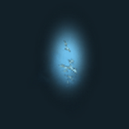

분류 `Skill` · 파티클 15개 · 표시 프레임 26/32

원본 경로: `Assets/InHouse/Fxs/Skill/Prefab/FX_BigWave_01.prefab`

[GIF 파일](../../../public/rpg/vfx/previews/FX_BigWave_01.gif) · [원본 프리팹 설정 gzip](../../../archive/rpg/vfx/prefabs/FX_BigWave_01.json.gz)

## FX_Blizzard_Projectile_01

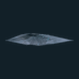

분류 `Skill` · 파티클 3개 · 표시 프레임 16/32

원본 경로: `Assets/InHouse/Fxs/Skill/Prefab/FX_Blizzard_Projectile_01.prefab`

[GIF 파일](../../../public/rpg/vfx/previews/FX_Blizzard_Projectile_01.gif) · [원본 프리팹 설정 gzip](../../../archive/rpg/vfx/prefabs/FX_Blizzard_Projectile_01.json.gz)

## FX_Blizzard_Projectile_02

분류 `Skill` · 파티클 4개 · 표시 프레임 16/32

원본 경로: `Assets/InHouse/Fxs/Skill/Prefab/FX_Blizzard_Projectile_02.prefab`

[GIF 파일](../../../public/rpg/vfx/previews/FX_Blizzard_Projectile_02.gif) · [원본 프리팹 설정 gzip](../../../archive/rpg/vfx/prefabs/FX_Blizzard_Projectile_02.json.gz)

## FX_BloodAbsorbing_01

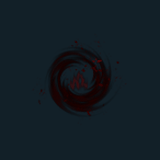

분류 `Skill` · 파티클 7개 · 표시 프레임 22/32

원본 경로: `Assets/InHouse/Fxs/Skill/Prefab/FX_BloodAbsorbing_01.prefab`

[GIF 파일](../../../public/rpg/vfx/previews/FX_BloodAbsorbing_01.gif) · [원본 프리팹 설정 gzip](../../../archive/rpg/vfx/prefabs/FX_BloodAbsorbing_01.json.gz)

