# VFX GIF 03 / 18

[목록으로](README.md) · [이전](gallery-02.md) · [다음](gallery-04.md)

모두 원본 데이터로 만든 2D 근사 미리보기입니다. 각 GIF를 클릭하면 개별 파일을 열 수 있습니다.

## FX_BloodAbsorbing_02

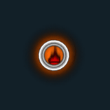

분류 `Skill` · 파티클 13개 · 표시 프레임 32/32

원본 경로: `Assets/InHouse/Fxs/Skill/Prefab/FX_BloodAbsorbing_02.prefab`

[GIF 파일](../../../public/rpg/vfx/previews/FX_BloodAbsorbing_02.gif) · [원본 프리팹 설정 gzip](../../../archive/rpg/vfx/prefabs/FX_BloodAbsorbing_02.json.gz)

## FX_BloodAbsorbing_cast

분류 `Skill` · 파티클 2개 · 표시 프레임 6/32

원본 경로: `Assets/InHouse/Fxs/Skill/Prefab/FX_BloodAbsorbing_cast.prefab`

[GIF 파일](../../../public/rpg/vfx/previews/FX_BloodAbsorbing_cast.gif) · [원본 프리팹 설정 gzip](../../../archive/rpg/vfx/prefabs/FX_BloodAbsorbing_cast.json.gz)

## FX_BloodHit01

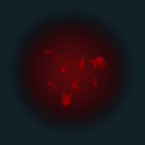

분류 `Skill` · 파티클 4개 · 표시 프레임 13/32

원본 경로: `Assets/InHouse/Fxs/Skill/Prefab/FX_BloodHit01.prefab`

[GIF 파일](../../../public/rpg/vfx/previews/FX_BloodHit01.gif) · [원본 프리팹 설정 gzip](../../../archive/rpg/vfx/prefabs/FX_BloodHit01.json.gz)

## FX_BloodHit02

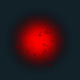

분류 `Skill` · 파티클 5개 · 표시 프레임 25/32

원본 경로: `Assets/InHouse/Fxs/Skill/Prefab/FX_BloodHit02.prefab`

[GIF 파일](../../../public/rpg/vfx/previews/FX_BloodHit02.gif) · [원본 프리팹 설정 gzip](../../../archive/rpg/vfx/prefabs/FX_BloodHit02.json.gz)

## FX_BoneArcher_AttackHit_01

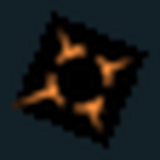

분류 `Skill` · 파티클 4개 · 표시 프레임 4/32

원본 경로: `Assets/InHouse/Fxs/Skill/Prefab/FX_BoneArcher_AttackHit_01.prefab`

[GIF 파일](../../../public/rpg/vfx/previews/FX_BoneArcher_AttackHit_01.gif) · [원본 프리팹 설정 gzip](../../../archive/rpg/vfx/prefabs/FX_BoneArcher_AttackHit_01.json.gz)

## FX_BoomerangHit_01

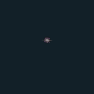

분류 `Skill` · 파티클 12개 · 표시 프레임 21/32

원본 경로: `Assets/InHouse/Fxs/Skill/Prefab/FX_BoomerangHit_01.prefab`

[GIF 파일](../../../public/rpg/vfx/previews/FX_BoomerangHit_01.gif) · [원본 프리팹 설정 gzip](../../../archive/rpg/vfx/prefabs/FX_BoomerangHit_01.json.gz)

## FX_Boomerang_01

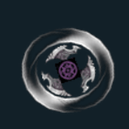

분류 `Skill` · 파티클 11개 · 표시 프레임 32/32

원본 경로: `Assets/InHouse/Fxs/Skill/Prefab/FX_Boomerang_01.prefab`

[GIF 파일](../../../public/rpg/vfx/previews/FX_Boomerang_01.gif) · [원본 프리팹 설정 gzip](../../../archive/rpg/vfx/prefabs/FX_Boomerang_01.json.gz)

## FX_CoreElementalExplosion_BL

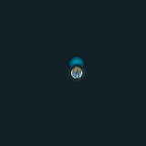

분류 `Skill` · 파티클 14개 · 표시 프레임 32/32

원본 경로: `Assets/InHouse/Fxs/Skill/Prefab/FX_CoreElementalExplosion_BL.prefab`

[GIF 파일](../../../public/rpg/vfx/previews/FX_CoreElementalExplosion_BL.gif) · [원본 프리팹 설정 gzip](../../../archive/rpg/vfx/prefabs/FX_CoreElementalExplosion_BL.json.gz)

## FX_CoreElementalExplosion_GE

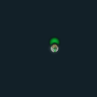

분류 `Skill` · 파티클 14개 · 표시 프레임 32/32

원본 경로: `Assets/InHouse/Fxs/Skill/Prefab/FX_CoreElementalExplosion_GE.prefab`

[GIF 파일](../../../public/rpg/vfx/previews/FX_CoreElementalExplosion_GE.gif) · [원본 프리팹 설정 gzip](../../../archive/rpg/vfx/prefabs/FX_CoreElementalExplosion_GE.json.gz)

## FX_CoreElementalExplosion_RE

분류 `Skill` · 파티클 14개 · 표시 프레임 32/32

원본 경로: `Assets/InHouse/Fxs/Skill/Prefab/FX_CoreElementalExplosion_RE.prefab`

[GIF 파일](../../../public/rpg/vfx/previews/FX_CoreElementalExplosion_RE.gif) · [원본 프리팹 설정 gzip](../../../archive/rpg/vfx/prefabs/FX_CoreElementalExplosion_RE.json.gz)

## FX_CorruptSeal_ProjectileDamage01

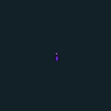

분류 `Skill` · 파티클 9개 · 표시 프레임 20/32

원본 경로: `Assets/InHouse/Fxs/Skill/Prefab/FX_CorruptSeal_ProjectileDamage01.prefab`

[GIF 파일](../../../public/rpg/vfx/previews/FX_CorruptSeal_ProjectileDamage01.gif) · [원본 프리팹 설정 gzip](../../../archive/rpg/vfx/prefabs/FX_CorruptSeal_ProjectileDamage01.json.gz)

## FX_CorruptSeal_Projectile_01

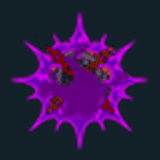

분류 `Skill` · 파티클 3개 · 표시 프레임 26/32

원본 경로: `Assets/InHouse/Fxs/Skill/Prefab/FX_CorruptSeal_Projectile_01.prefab`

[GIF 파일](../../../public/rpg/vfx/previews/FX_CorruptSeal_Projectile_01.gif) · [원본 프리팹 설정 gzip](../../../archive/rpg/vfx/prefabs/FX_CorruptSeal_Projectile_01.json.gz)

## FX_CounterBreakHit_01

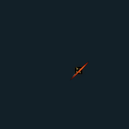

분류 `Skill` · 파티클 9개 · 표시 프레임 21/32

원본 경로: `Assets/InHouse/Fxs/Skill/Prefab/FX_CounterBreakHit_01.prefab`

[GIF 파일](../../../public/rpg/vfx/previews/FX_CounterBreakHit_01.gif) · [원본 프리팹 설정 gzip](../../../archive/rpg/vfx/prefabs/FX_CounterBreakHit_01.json.gz)

## FX_CounterBreak_01

분류 `Skill` · 파티클 12개 · 표시 프레임 18/32

원본 경로: `Assets/InHouse/Fxs/Skill/Prefab/FX_CounterBreak_01.prefab`

[GIF 파일](../../../public/rpg/vfx/previews/FX_CounterBreak_01.gif) · [원본 프리팹 설정 gzip](../../../archive/rpg/vfx/prefabs/FX_CounterBreak_01.json.gz)

## FX_CrimsonLightning_01

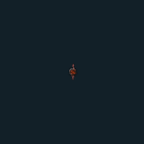

분류 `Skill` · 파티클 14개 · 표시 프레임 32/32

원본 경로: `Assets/InHouse/Fxs/Skill/Prefab/FX_CrimsonLightning_01.prefab`

[GIF 파일](../../../public/rpg/vfx/previews/FX_CrimsonLightning_01.gif) · [원본 프리팹 설정 gzip](../../../archive/rpg/vfx/prefabs/FX_CrimsonLightning_01.json.gz)

## FX_CrimsonLightning_Damage_01

분류 `Skill` · 파티클 4개 · 표시 프레임 5/32

원본 경로: `Assets/InHouse/Fxs/Skill/Prefab/FX_CrimsonLightning_Damage_01.prefab`

[GIF 파일](../../../public/rpg/vfx/previews/FX_CrimsonLightning_Damage_01.gif) · [원본 프리팹 설정 gzip](../../../archive/rpg/vfx/prefabs/FX_CrimsonLightning_Damage_01.json.gz)

## FX_CrossSword_01

분류 `Skill` · 파티클 1개 · 표시 프레임 32/32

원본 경로: `Assets/InHouse/Fxs/Skill/Prefab/FX_CrossSword_01.prefab`

[GIF 파일](../../../public/rpg/vfx/previews/FX_CrossSword_01.gif) · [원본 프리팹 설정 gzip](../../../archive/rpg/vfx/prefabs/FX_CrossSword_01.json.gz)

## FX_Dagger_Damage01

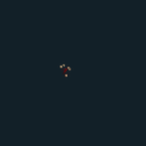

분류 `Skill` · 파티클 6개 · 표시 프레임 13/32

원본 경로: `Assets/InHouse/Fxs/Skill/Prefab/FX_Dagger_Damage01.prefab`

[GIF 파일](../../../public/rpg/vfx/previews/FX_Dagger_Damage01.gif) · [원본 프리팹 설정 gzip](../../../archive/rpg/vfx/prefabs/FX_Dagger_Damage01.json.gz)

## FX_Dagger_Projectile_01

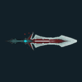

분류 `Skill` · 파티클 2개 · 표시 프레임 16/32

원본 경로: `Assets/InHouse/Fxs/Skill/Prefab/FX_Dagger_Projectile_01.prefab`

[GIF 파일](../../../public/rpg/vfx/previews/FX_Dagger_Projectile_01.gif) · [원본 프리팹 설정 gzip](../../../archive/rpg/vfx/prefabs/FX_Dagger_Projectile_01.json.gz)

## FX_DarkDamage_01

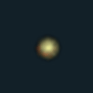

분류 `Skill` · 파티클 8개 · 표시 프레임 18/32

원본 경로: `Assets/InHouse/Fxs/Skill/Prefab/FX_DarkDamage_01.prefab`

[GIF 파일](../../../public/rpg/vfx/previews/FX_DarkDamage_01.gif) · [원본 프리팹 설정 gzip](../../../archive/rpg/vfx/prefabs/FX_DarkDamage_01.json.gz)

