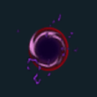
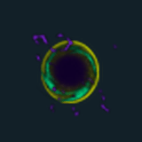
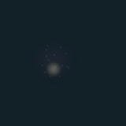
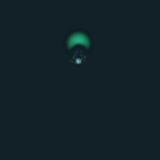
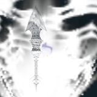
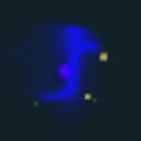
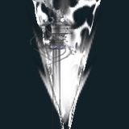
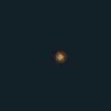
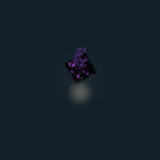

# VFX GIF 04 / 18

[목록으로](README.md) · [이전](gallery-03.md) · [다음](gallery-05.md)

모두 원본 데이터로 만든 2D 근사 미리보기입니다. 각 GIF를 클릭하면 개별 파일을 열 수 있습니다.

## FX_DarkHell_01

분류 `Skill` · 파티클 15개 · 표시 프레임 32/32

원본 경로: `Assets/InHouse/Fxs/Skill/Prefab/FX_DarkHell_01.prefab`

[GIF 파일](../../../public/rpg/vfx/previews/FX_DarkHell_01.gif) · [원본 프리팹 설정 gzip](../../../archive/rpg/vfx/prefabs/FX_DarkHell_01.json.gz)

## FX_DarkHell_02

분류 `Skill` · 파티클 16개 · 표시 프레임 26/32

원본 경로: `Assets/InHouse/Fxs/Skill/Prefab/FX_DarkHell_02.prefab`

[GIF 파일](../../../public/rpg/vfx/previews/FX_DarkHell_02.gif) · [원본 프리팹 설정 gzip](../../../archive/rpg/vfx/prefabs/FX_DarkHell_02.json.gz)

## FX_DarkHit01

분류 `Skill` · 파티클 4개 · 표시 프레임 25/32

원본 경로: `Assets/InHouse/Fxs/Skill/Prefab/FX_DarkHit01.prefab`

[GIF 파일](../../../public/rpg/vfx/previews/FX_DarkHit01.gif) · [원본 프리팹 설정 gzip](../../../archive/rpg/vfx/prefabs/FX_DarkHit01.json.gz)

## FX_DarkHole_01

분류 `Skill` · 파티클 12개 · 표시 프레임 18/32

원본 경로: `Assets/InHouse/Fxs/Skill/Prefab/FX_DarkHole_01.prefab`

[GIF 파일](../../../public/rpg/vfx/previews/FX_DarkHole_01.gif) · [원본 프리팹 설정 gzip](../../../archive/rpg/vfx/prefabs/FX_DarkHole_01.json.gz)

## FX_DarkHole_03 1

분류 `Skill` · 파티클 12개 · 표시 프레임 21/32

원본 경로: `Assets/InHouse/Fxs/Skill/Prefab/FX_DarkHole_03 1.prefab`

[GIF 파일](../../../public/rpg/vfx/previews/FX_DarkHole_03-1.gif) · [원본 프리팹 설정 gzip](../../../archive/rpg/vfx/prefabs/FX_DarkHole_03-1.json.gz)

## FX_DarkHole_03

분류 `Skill` · 파티클 12개 · 표시 프레임 21/32

원본 경로: `Assets/InHouse/Fxs/Skill/Prefab/FX_DarkHole_03.prefab`

[GIF 파일](../../../public/rpg/vfx/previews/FX_DarkHole_03.gif) · [원본 프리팹 설정 gzip](../../../archive/rpg/vfx/prefabs/FX_DarkHole_03.json.gz)

## FX_DarkHole_End_01

분류 `Skill` · 파티클 16개 · 표시 프레임 19/32

원본 경로: `Assets/InHouse/Fxs/Skill/Prefab/FX_DarkHole_End_01.prefab`

[GIF 파일](../../../public/rpg/vfx/previews/FX_DarkHole_End_01.gif) · [원본 프리팹 설정 gzip](../../../archive/rpg/vfx/prefabs/FX_DarkHole_End_01.json.gz)

## FX_DarkHole_End_03 1

분류 `Skill` · 파티클 26개 · 표시 프레임 32/32

원본 경로: `Assets/InHouse/Fxs/Skill/Prefab/FX_DarkHole_End_03 1.prefab`

[GIF 파일](../../../public/rpg/vfx/previews/FX_DarkHole_End_03-1.gif) · [원본 프리팹 설정 gzip](../../../archive/rpg/vfx/prefabs/FX_DarkHole_End_03-1.json.gz)

## FX_DarkHole_End_03

분류 `Skill` · 파티클 26개 · 표시 프레임 32/32

원본 경로: `Assets/InHouse/Fxs/Skill/Prefab/FX_DarkHole_End_03.prefab`

[GIF 파일](../../../public/rpg/vfx/previews/FX_DarkHole_End_03.gif) · [원본 프리팹 설정 gzip](../../../archive/rpg/vfx/prefabs/FX_DarkHole_End_03.json.gz)

## FX_DarkHole_Loop_01

분류 `Skill` · 파티클 11개 · 표시 프레임 18/32

원본 경로: `Assets/InHouse/Fxs/Skill/Prefab/FX_DarkHole_Loop_01.prefab`

[GIF 파일](../../../public/rpg/vfx/previews/FX_DarkHole_Loop_01.gif) · [원본 프리팹 설정 gzip](../../../archive/rpg/vfx/prefabs/FX_DarkHole_Loop_01.json.gz)

## FX_DarkHole_Projectile_01

분류 `Skill` · 파티클 10개 · 표시 프레임 22/32

원본 경로: `Assets/InHouse/Fxs/Skill/Prefab/FX_DarkHole_Projectile_01.prefab`

[GIF 파일](../../../public/rpg/vfx/previews/FX_DarkHole_Projectile_01.gif) · [원본 프리팹 설정 gzip](../../../archive/rpg/vfx/prefabs/FX_DarkHole_Projectile_01.json.gz)

## FX_DarkPillarHit_01

분류 `Skill` · 파티클 13개 · 표시 프레임 32/32

원본 경로: `Assets/InHouse/Fxs/Skill/Prefab/FX_DarkPillarHit_01.prefab`

[GIF 파일](../../../public/rpg/vfx/previews/FX_DarkPillarHit_01.gif) · [원본 프리팹 설정 gzip](../../../archive/rpg/vfx/prefabs/FX_DarkPillarHit_01.json.gz)

## FX_DarkShotDamage_01

분류 `Skill` · 파티클 10개 · 표시 프레임 9/32

원본 경로: `Assets/InHouse/Fxs/Skill/Prefab/FX_DarkShotDamage_01.prefab`

[GIF 파일](../../../public/rpg/vfx/previews/FX_DarkShotDamage_01.gif) · [원본 프리팹 설정 gzip](../../../archive/rpg/vfx/prefabs/FX_DarkShotDamage_01.json.gz)

## FX_DarkShotDamage_02

분류 `Skill` · 파티클 11개 · 표시 프레임 20/32

원본 경로: `Assets/InHouse/Fxs/Skill/Prefab/FX_DarkShotDamage_02.prefab`

[GIF 파일](../../../public/rpg/vfx/previews/FX_DarkShotDamage_02.gif) · [원본 프리팹 설정 gzip](../../../archive/rpg/vfx/prefabs/FX_DarkShotDamage_02.json.gz)

## FX_DarkShot_Projectile_01

분류 `Skill` · 파티클 5개 · 표시 프레임 32/32

원본 경로: `Assets/InHouse/Fxs/Skill/Prefab/FX_DarkShot_Projectile_01.prefab`

[GIF 파일](../../../public/rpg/vfx/previews/FX_DarkShot_Projectile_01.gif) · [원본 프리팹 설정 gzip](../../../archive/rpg/vfx/prefabs/FX_DarkShot_Projectile_01.json.gz)

## FX_DarkShot_Projectile_02

분류 `Skill` · 파티클 6개 · 표시 프레임 22/32

원본 경로: `Assets/InHouse/Fxs/Skill/Prefab/FX_DarkShot_Projectile_02.prefab`

[GIF 파일](../../../public/rpg/vfx/previews/FX_DarkShot_Projectile_02.gif) · [원본 프리팹 설정 gzip](../../../archive/rpg/vfx/prefabs/FX_DarkShot_Projectile_02.json.gz)

## FX_DarkShot_Projectile_03

분류 `Skill` · 파티클 4개 · 표시 프레임 32/32

원본 경로: `Assets/InHouse/Fxs/Skill/Prefab/FX_DarkShot_Projectile_03.prefab`

[GIF 파일](../../../public/rpg/vfx/previews/FX_DarkShot_Projectile_03.gif) · [원본 프리팹 설정 gzip](../../../archive/rpg/vfx/prefabs/FX_DarkShot_Projectile_03.json.gz)

## FX_DarkSpear_01

분류 `Skill` · 파티클 7개 · 표시 프레임 32/32

원본 경로: `Assets/InHouse/Fxs/Skill/Prefab/FX_DarkSpear_01.prefab`

[GIF 파일](../../../public/rpg/vfx/previews/FX_DarkSpear_01.gif) · [원본 프리팹 설정 gzip](../../../archive/rpg/vfx/prefabs/FX_DarkSpear_01.json.gz)

## FX_DarkSpear_Damage_01

분류 `Skill` · 파티클 15개 · 표시 프레임 20/32

원본 경로: `Assets/InHouse/Fxs/Skill/Prefab/FX_DarkSpear_Damage_01.prefab`

[GIF 파일](../../../public/rpg/vfx/previews/FX_DarkSpear_Damage_01.gif) · [원본 프리팹 설정 gzip](../../../archive/rpg/vfx/prefabs/FX_DarkSpear_Damage_01.json.gz)

## FX_DarkSphereBurst_01

분류 `Skill` · 파티클 25개 · 표시 프레임 19/32

원본 경로: `Assets/InHouse/Fxs/Skill/Prefab/FX_DarkSphereBurst_01.prefab`

[GIF 파일](../../../public/rpg/vfx/previews/FX_DarkSphereBurst_01.gif) · [원본 프리팹 설정 gzip](../../../archive/rpg/vfx/prefabs/FX_DarkSphereBurst_01.json.gz)

