# VFX GIF 05 / 18

[목록으로](README.md) · [이전](gallery-04.md) · [다음](gallery-06.md)

모두 원본 데이터로 만든 2D 근사 미리보기입니다. 각 GIF를 클릭하면 개별 파일을 열 수 있습니다.

## FX_DarkSphereBurst_Loop_01

분류 `Skill` · 파티클 9개 · 표시 프레임 18/32

원본 경로: `Assets/InHouse/Fxs/Skill/Prefab/FX_DarkSphereBurst_Loop_01.prefab`

[GIF 파일](../../../public/rpg/vfx/previews/FX_DarkSphereBurst_Loop_01.gif) · [원본 프리팹 설정 gzip](../../../archive/rpg/vfx/prefabs/FX_DarkSphereBurst_Loop_01.json.gz)

## FX_DashExplosion_01

분류 `Skill` · 파티클 21개 · 표시 프레임 19/32

원본 경로: `Assets/InHouse/Fxs/Skill/Prefab/FX_DashExplosion_01.prefab`

[GIF 파일](../../../public/rpg/vfx/previews/FX_DashExplosion_01.gif) · [원본 프리팹 설정 gzip](../../../archive/rpg/vfx/prefabs/FX_DashExplosion_01.json.gz)

## FX_Dash_01

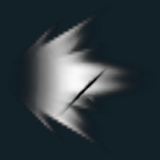

분류 `Skill` · 파티클 5개 · 표시 프레임 32/32

원본 경로: `Assets/InHouse/Fxs/Skill/Prefab/FX_Dash_01.prefab`

[GIF 파일](../../../public/rpg/vfx/previews/FX_Dash_01--3916502263098196861.gif) · [원본 프리팹 설정 gzip](../../../archive/rpg/vfx/prefabs/FX_Dash_01--3916502263098196861.json.gz)

## FX_Dash_03

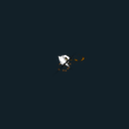

분류 `Skill` · 파티클 13개 · 표시 프레임 32/32

원본 경로: `Assets/InHouse/Fxs/Skill/Prefab/FX_Dash_03.prefab`

[GIF 파일](../../../public/rpg/vfx/previews/FX_Dash_03.gif) · [원본 프리팹 설정 gzip](../../../archive/rpg/vfx/prefabs/FX_Dash_03.json.gz)

## FX_DemonEye_01_Loop

분류 `Skill` · 파티클 4개 · 표시 프레임 32/32

원본 경로: `Assets/InHouse/Fxs/Skill/Prefab/FX_DemonEye_01_Loop.prefab`

[GIF 파일](../../../public/rpg/vfx/previews/FX_DemonEye_01_Loop.gif) · [원본 프리팹 설정 gzip](../../../archive/rpg/vfx/prefabs/FX_DemonEye_01_Loop.json.gz)

## FX_DemonEye_Skill1

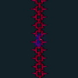

분류 `Skill` · 파티클 3개 · 표시 프레임 22/32

원본 경로: `Assets/InHouse/Fxs/Skill/Prefab/FX_DemonEye_Skill1.prefab`

[GIF 파일](../../../public/rpg/vfx/previews/FX_DemonEye_Skill1.gif) · [원본 프리팹 설정 gzip](../../../archive/rpg/vfx/prefabs/FX_DemonEye_Skill1.json.gz)

## FX_DemonEye_Skill2

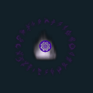

분류 `Skill` · 파티클 16개 · 표시 프레임 32/32

원본 경로: `Assets/InHouse/Fxs/Skill/Prefab/FX_DemonEye_Skill2.prefab`

[GIF 파일](../../../public/rpg/vfx/previews/FX_DemonEye_Skill2.gif) · [원본 프리팹 설정 gzip](../../../archive/rpg/vfx/prefabs/FX_DemonEye_Skill2.json.gz)

## FX_DemonEye_Skill2_Hit01

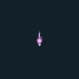

분류 `Skill` · 파티클 13개 · 표시 프레임 32/32

원본 경로: `Assets/InHouse/Fxs/Skill/Prefab/FX_DemonEye_Skill2_Hit01.prefab`

[GIF 파일](../../../public/rpg/vfx/previews/FX_DemonEye_Skill2_Hit01.gif) · [원본 프리팹 설정 gzip](../../../archive/rpg/vfx/prefabs/FX_DemonEye_Skill2_Hit01.json.gz)

## FX_DemonEye_Skill3_End

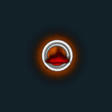

분류 `Skill` · 파티클 13개 · 표시 프레임 32/32

원본 경로: `Assets/InHouse/Fxs/Skill/Prefab/FX_DemonEye_Skill3_End.prefab`

[GIF 파일](../../../public/rpg/vfx/previews/FX_DemonEye_Skill3_End.gif) · [원본 프리팹 설정 gzip](../../../archive/rpg/vfx/prefabs/FX_DemonEye_Skill3_End.json.gz)

## FX_DemonEye_Skill3_Loop

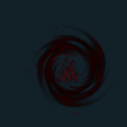

분류 `Skill` · 파티클 7개 · 표시 프레임 23/32

원본 경로: `Assets/InHouse/Fxs/Skill/Prefab/FX_DemonEye_Skill3_Loop.prefab`

[GIF 파일](../../../public/rpg/vfx/previews/FX_DemonEye_Skill3_Loop.gif) · [원본 프리팹 설정 gzip](../../../archive/rpg/vfx/prefabs/FX_DemonEye_Skill3_Loop.json.gz)

## FX_DemonEye_Skill3_spear_PU

분류 `Skill` · 파티클 14개 · 표시 프레임 32/32

원본 경로: `Assets/InHouse/Fxs/Skill/Prefab/FX_DemonEye_Skill3_spear_PU.prefab`

[GIF 파일](../../../public/rpg/vfx/previews/FX_DemonEye_Skill3_spear_PU.gif) · [원본 프리팹 설정 gzip](../../../archive/rpg/vfx/prefabs/FX_DemonEye_Skill3_spear_PU.json.gz)

## FX_DemonEye_Skill3_spear_YE

분류 `Skill` · 파티클 14개 · 표시 프레임 32/32

원본 경로: `Assets/InHouse/Fxs/Skill/Prefab/FX_DemonEye_Skill3_spear_YE.prefab`

[GIF 파일](../../../public/rpg/vfx/previews/FX_DemonEye_Skill3_spear_YE.gif) · [원본 프리팹 설정 gzip](../../../archive/rpg/vfx/prefabs/FX_DemonEye_Skill3_spear_YE.json.gz)

## FX_DesertScorpionKing_Cast_01

분류 `Skill` · 파티클 8개 · 표시 프레임 11/32

원본 경로: `Assets/InHouse/Fxs/Skill/Prefab/FX_DesertScorpionKing_Cast_01.prefab`

[GIF 파일](../../../public/rpg/vfx/previews/FX_DesertScorpionKing_Cast_01.gif) · [원본 프리팹 설정 gzip](../../../archive/rpg/vfx/prefabs/FX_DesertScorpionKing_Cast_01.json.gz)

## FX_DesertScorpionKing_Skill1

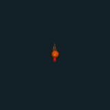

분류 `Skill` · 파티클 18개 · 표시 프레임 32/32

원본 경로: `Assets/InHouse/Fxs/Skill/Prefab/FX_DesertScorpionKing_Skill1.prefab`

[GIF 파일](../../../public/rpg/vfx/previews/FX_DesertScorpionKing_Skill1.gif) · [원본 프리팹 설정 gzip](../../../archive/rpg/vfx/prefabs/FX_DesertScorpionKing_Skill1.json.gz)

## FX_DesertScorpionKing_Skill2

분류 `Skill` · 파티클 11개 · 표시 프레임 32/32

원본 경로: `Assets/InHouse/Fxs/Skill/Prefab/FX_DesertScorpionKing_Skill2.prefab`

[GIF 파일](../../../public/rpg/vfx/previews/FX_DesertScorpionKing_Skill2.gif) · [원본 프리팹 설정 gzip](../../../archive/rpg/vfx/prefabs/FX_DesertScorpionKing_Skill2.json.gz)

## FX_DesertScorpionKing_Skill3

분류 `Skill` · 파티클 13개 · 표시 프레임 18/32

원본 경로: `Assets/InHouse/Fxs/Skill/Prefab/FX_DesertScorpionKing_Skill3.prefab`

[GIF 파일](../../../public/rpg/vfx/previews/FX_DesertScorpionKing_Skill3.gif) · [원본 프리팹 설정 gzip](../../../archive/rpg/vfx/prefabs/FX_DesertScorpionKing_Skill3.json.gz)

## FX_DesertScorpionKing_Skill3_Hit01

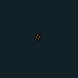

분류 `Skill` · 파티클 9개 · 표시 프레임 19/32

원본 경로: `Assets/InHouse/Fxs/Skill/Prefab/FX_DesertScorpionKing_Skill3_Hit01.prefab`

[GIF 파일](../../../public/rpg/vfx/previews/FX_DesertScorpionKing_Skill3_Hit01.gif) · [원본 프리팹 설정 gzip](../../../archive/rpg/vfx/prefabs/FX_DesertScorpionKing_Skill3_Hit01.json.gz)

## FX_DesertScorpionKing_Skill4

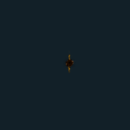

분류 `Skill` · 파티클 11개 · 표시 프레임 32/32

원본 경로: `Assets/InHouse/Fxs/Skill/Prefab/FX_DesertScorpionKing_Skill4.prefab`

[GIF 파일](../../../public/rpg/vfx/previews/FX_DesertScorpionKing_Skill4.gif) · [원본 프리팹 설정 gzip](../../../archive/rpg/vfx/prefabs/FX_DesertScorpionKing_Skill4.json.gz)

## FX_DesertScorpionKing_Skill4_E

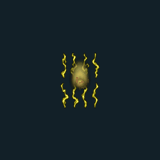

분류 `Skill` · 파티클 22개 · 표시 프레임 32/32

원본 경로: `Assets/InHouse/Fxs/Skill/Prefab/FX_DesertScorpionKing_Skill4_E.prefab`

[GIF 파일](../../../public/rpg/vfx/previews/FX_DesertScorpionKing_Skill4_E.gif) · [원본 프리팹 설정 gzip](../../../archive/rpg/vfx/prefabs/FX_DesertScorpionKing_Skill4_E.json.gz)

## FX_DesertScorpion_Cast_01

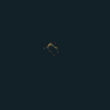

분류 `Skill` · 파티클 2개 · 표시 프레임 13/32

원본 경로: `Assets/InHouse/Fxs/Skill/Prefab/FX_DesertScorpion_Cast_01.prefab`

[GIF 파일](../../../public/rpg/vfx/previews/FX_DesertScorpion_Cast_01.gif) · [원본 프리팹 설정 gzip](../../../archive/rpg/vfx/prefabs/FX_DesertScorpion_Cast_01.json.gz)

