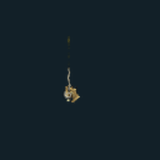
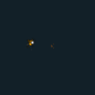
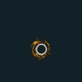
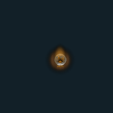
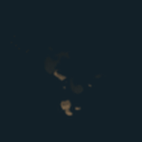
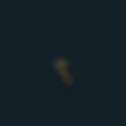
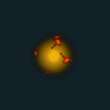
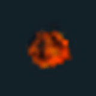
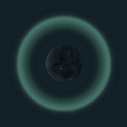

# VFX GIF 06 / 18

[목록으로](README.md) · [이전](gallery-05.md) · [다음](gallery-07.md)

모두 원본 데이터로 만든 2D 근사 미리보기입니다. 각 GIF를 클릭하면 개별 파일을 열 수 있습니다.

## FX_DesertScorpion_Skill1

분류 `Skill` · 파티클 10개 · 표시 프레임 32/32

원본 경로: `Assets/InHouse/Fxs/Skill/Prefab/FX_DesertScorpion_Skill1.prefab`

[GIF 파일](../../../public/rpg/vfx/previews/FX_DesertScorpion_Skill1.gif) · [원본 프리팹 설정 gzip](../../../archive/rpg/vfx/prefabs/FX_DesertScorpion_Skill1.json.gz)

## FX_DesertScorpion_Skill1_Damage

분류 `Skill` · 파티클 4개 · 표시 프레임 8/32

원본 경로: `Assets/InHouse/Fxs/Skill/Prefab/FX_DesertScorpion_Skill1_Damage.prefab`

[GIF 파일](../../../public/rpg/vfx/previews/FX_DesertScorpion_Skill1_Damage.gif) · [원본 프리팹 설정 gzip](../../../archive/rpg/vfx/prefabs/FX_DesertScorpion_Skill1_Damage.json.gz)

## FX_DesertScorpion_Skill2

분류 `Skill` · 파티클 9개 · 표시 프레임 32/32

원본 경로: `Assets/InHouse/Fxs/Skill/Prefab/FX_DesertScorpion_Skill2.prefab`

[GIF 파일](../../../public/rpg/vfx/previews/FX_DesertScorpion_Skill2.gif) · [원본 프리팹 설정 gzip](../../../archive/rpg/vfx/prefabs/FX_DesertScorpion_Skill2.json.gz)

## FX_DesertScorpion_Skill3_01

분류 `Skill` · 파티클 7개 · 표시 프레임 32/32

원본 경로: `Assets/InHouse/Fxs/Skill/Prefab/FX_DesertScorpion_Skill3_01.prefab`

[GIF 파일](../../../public/rpg/vfx/previews/FX_DesertScorpion_Skill3_01.gif) · [원본 프리팹 설정 gzip](../../../archive/rpg/vfx/prefabs/FX_DesertScorpion_Skill3_01.json.gz)

## FX_DesertScorpion_Skill3_02

분류 `Skill` · 파티클 18개 · 표시 프레임 32/32

원본 경로: `Assets/InHouse/Fxs/Skill/Prefab/FX_DesertScorpion_Skill3_02.prefab`

[GIF 파일](../../../public/rpg/vfx/previews/FX_DesertScorpion_Skill3_02.gif) · [원본 프리팹 설정 gzip](../../../archive/rpg/vfx/prefabs/FX_DesertScorpion_Skill3_02.json.gz)

## FX_DesertStinger_Skill1

분류 `Skill` · 파티클 17개 · 표시 프레임 20/32

원본 경로: `Assets/InHouse/Fxs/Skill/Prefab/FX_DesertStinger_Skill1.prefab`

[GIF 파일](../../../public/rpg/vfx/previews/FX_DesertStinger_Skill1.gif) · [원본 프리팹 설정 gzip](../../../archive/rpg/vfx/prefabs/FX_DesertStinger_Skill1.json.gz)

## FX_Dragon_Breath_01

분류 `Skill` · 파티클 1개 · 표시 프레임 25/32

원본 경로: `Assets/InHouse/Fxs/Skill/Prefab/FX_Dragon_Breath_01.prefab`

[GIF 파일](../../../public/rpg/vfx/previews/FX_Dragon_Breath_01.gif) · [원본 프리팹 설정 gzip](../../../archive/rpg/vfx/prefabs/FX_Dragon_Breath_01.json.gz)

## FX_Dragon_Breath_FireBurst_01 1

분류 `Skill` · 파티클 3개 · 표시 프레임 32/32

원본 경로: `Assets/InHouse/Fxs/Skill/Prefab/FX_Dragon_Breath_FireBurst_01 1.prefab`

[GIF 파일](../../../public/rpg/vfx/previews/FX_Dragon_Breath_FireBurst_01-1.gif) · [원본 프리팹 설정 gzip](../../../archive/rpg/vfx/prefabs/FX_Dragon_Breath_FireBurst_01-1.json.gz)

## FX_ElementalBallHit01_BL

분류 `Skill` · 파티클 3개 · 표시 프레임 26/32

원본 경로: `Assets/InHouse/Fxs/Skill/Prefab/FX_ElementalBallHit01_BL.prefab`

[GIF 파일](../../../public/rpg/vfx/previews/FX_ElementalBallHit01_BL.gif) · [원본 프리팹 설정 gzip](../../../archive/rpg/vfx/prefabs/FX_ElementalBallHit01_BL.json.gz)

## FX_ElementalBallHit01_GR

분류 `Skill` · 파티클 3개 · 표시 프레임 26/32

원본 경로: `Assets/InHouse/Fxs/Skill/Prefab/FX_ElementalBallHit01_GR.prefab`

[GIF 파일](../../../public/rpg/vfx/previews/FX_ElementalBallHit01_GR.gif) · [원본 프리팹 설정 gzip](../../../archive/rpg/vfx/prefabs/FX_ElementalBallHit01_GR.json.gz)

## FX_ElementalBallHit01_RE

분류 `Skill` · 파티클 4개 · 표시 프레임 26/32

원본 경로: `Assets/InHouse/Fxs/Skill/Prefab/FX_ElementalBallHit01_RE.prefab`

[GIF 파일](../../../public/rpg/vfx/previews/FX_ElementalBallHit01_RE.gif) · [원본 프리팹 설정 gzip](../../../archive/rpg/vfx/prefabs/FX_ElementalBallHit01_RE.json.gz)

## FX_ElementalBall_01_BL

분류 `Skill` · 파티클 4개 · 표시 프레임 16/32

원본 경로: `Assets/InHouse/Fxs/Skill/Prefab/FX_ElementalBall_01_BL.prefab`

[GIF 파일](../../../public/rpg/vfx/previews/FX_ElementalBall_01_BL.gif) · [원본 프리팹 설정 gzip](../../../archive/rpg/vfx/prefabs/FX_ElementalBall_01_BL.json.gz)

## FX_ElementalBall_01_GR

분류 `Skill` · 파티클 4개 · 표시 프레임 17/32

원본 경로: `Assets/InHouse/Fxs/Skill/Prefab/FX_ElementalBall_01_GR.prefab`

[GIF 파일](../../../public/rpg/vfx/previews/FX_ElementalBall_01_GR.gif) · [원본 프리팹 설정 gzip](../../../archive/rpg/vfx/prefabs/FX_ElementalBall_01_GR.json.gz)

## FX_ElementalBall_01_RE

분류 `Skill` · 파티클 5개 · 표시 프레임 17/32

원본 경로: `Assets/InHouse/Fxs/Skill/Prefab/FX_ElementalBall_01_RE.prefab`

[GIF 파일](../../../public/rpg/vfx/previews/FX_ElementalBall_01_RE.gif) · [원본 프리팹 설정 gzip](../../../archive/rpg/vfx/prefabs/FX_ElementalBall_01_RE.json.gz)

## FX_Elemental_StayLoop_BL

분류 `Skill` · 파티클 3개 · 표시 프레임 27/32

원본 경로: `Assets/InHouse/Fxs/Skill/Prefab/FX_Elemental_StayLoop_BL.prefab`

[GIF 파일](../../../public/rpg/vfx/previews/FX_Elemental_StayLoop_BL.gif) · [원본 프리팹 설정 gzip](../../../archive/rpg/vfx/prefabs/FX_Elemental_StayLoop_BL.json.gz)

## FX_Elemental_StayLoop_GE

분류 `Skill` · 파티클 3개 · 표시 프레임 27/32

원본 경로: `Assets/InHouse/Fxs/Skill/Prefab/FX_Elemental_StayLoop_GE.prefab`

[GIF 파일](../../../public/rpg/vfx/previews/FX_Elemental_StayLoop_GE.gif) · [원본 프리팹 설정 gzip](../../../archive/rpg/vfx/prefabs/FX_Elemental_StayLoop_GE.json.gz)

## FX_Elemental_StayLoop_RE

분류 `Skill` · 파티클 3개 · 표시 프레임 28/32

원본 경로: `Assets/InHouse/Fxs/Skill/Prefab/FX_Elemental_StayLoop_RE.prefab`

[GIF 파일](../../../public/rpg/vfx/previews/FX_Elemental_StayLoop_RE.gif) · [원본 프리팹 설정 gzip](../../../archive/rpg/vfx/prefabs/FX_Elemental_StayLoop_RE.json.gz)

## FX_EliasGroggy_01

분류 `Skill` · 파티클 3개 · 표시 프레임 0/32

원본 경로: `Assets/InHouse/Fxs/Skill/Prefab/FX_EliasGroggy_01.prefab`

[GIF 파일](../../../public/rpg/vfx/previews/FX_EliasGroggy_01.gif) · [원본 프리팹 설정 gzip](../../../archive/rpg/vfx/prefabs/FX_EliasGroggy_01.json.gz)

## FX_EliasShield_01_End

분류 `Skill` · 파티클 8개 · 표시 프레임 8/32

원본 경로: `Assets/InHouse/Fxs/Skill/Prefab/FX_EliasShield_01_End.prefab`

[GIF 파일](../../../public/rpg/vfx/previews/FX_EliasShield_01_End.gif) · [원본 프리팹 설정 gzip](../../../archive/rpg/vfx/prefabs/FX_EliasShield_01_End.json.gz)

## FX_EliasShield_01_Explode

분류 `Skill` · 파티클 9개 · 표시 프레임 17/32

원본 경로: `Assets/InHouse/Fxs/Skill/Prefab/FX_EliasShield_01_Explode.prefab`

[GIF 파일](../../../public/rpg/vfx/previews/FX_EliasShield_01_Explode.gif) · [원본 프리팹 설정 gzip](../../../archive/rpg/vfx/prefabs/FX_EliasShield_01_Explode.json.gz)

