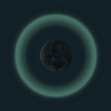
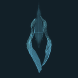
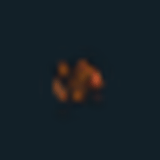
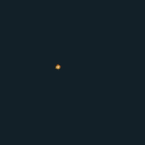

# VFX GIF 07 / 18

[목록으로](README.md) · [이전](gallery-06.md) · [다음](gallery-08.md)

모두 원본 데이터로 만든 2D 근사 미리보기입니다. 각 GIF를 클릭하면 개별 파일을 열 수 있습니다.

## FX_EliasShield_01_Loop

분류 `Skill` · 파티클 8개 · 표시 프레임 32/32

원본 경로: `Assets/InHouse/Fxs/Skill/Prefab/FX_EliasShield_01_Loop.prefab`

[GIF 파일](../../../public/rpg/vfx/previews/FX_EliasShield_01_Loop.gif) · [원본 프리팹 설정 gzip](../../../archive/rpg/vfx/prefabs/FX_EliasShield_01_Loop.json.gz)

## FX_EliasShield_01_Sart

분류 `Skill` · 파티클 6개 · 표시 프레임 10/32

원본 경로: `Assets/InHouse/Fxs/Skill/Prefab/FX_EliasShield_01_Sart.prefab`

[GIF 파일](../../../public/rpg/vfx/previews/FX_EliasShield_01_Sart.gif) · [원본 프리팹 설정 gzip](../../../archive/rpg/vfx/prefabs/FX_EliasShield_01_Sart.json.gz)

## FX_EliasSkill1Cast_01

분류 `Skill` · 파티클 5개 · 표시 프레임 8/32

원본 경로: `Assets/InHouse/Fxs/Skill/Prefab/FX_EliasSkill1Cast_01.prefab`

[GIF 파일](../../../public/rpg/vfx/previews/FX_EliasSkill1Cast_01.gif) · [원본 프리팹 설정 gzip](../../../archive/rpg/vfx/prefabs/FX_EliasSkill1Cast_01.json.gz)

## FX_EliasSkill1_01

분류 `Skill` · 파티클 17개 · 표시 프레임 32/32

원본 경로: `Assets/InHouse/Fxs/Skill/Prefab/FX_EliasSkill1_01.prefab`

[GIF 파일](../../../public/rpg/vfx/previews/FX_EliasSkill1_01.gif) · [원본 프리팹 설정 gzip](../../../archive/rpg/vfx/prefabs/FX_EliasSkill1_01.json.gz)

## FX_EliasSkill1_01_BK

분류 `Skill` · 파티클 16개 · 표시 프레임 32/32

원본 경로: `Assets/InHouse/Fxs/Skill/Prefab/FX_EliasSkill1_01_BK.prefab`

[GIF 파일](../../../public/rpg/vfx/previews/FX_EliasSkill1_01_BK.gif) · [원본 프리팹 설정 gzip](../../../archive/rpg/vfx/prefabs/FX_EliasSkill1_01_BK.json.gz)

## FX_EliasSkill2Cast_01

분류 `Skill` · 파티클 3개 · 표시 프레임 16/32

원본 경로: `Assets/InHouse/Fxs/Skill/Prefab/FX_EliasSkill2Cast_01.prefab`

[GIF 파일](../../../public/rpg/vfx/previews/FX_EliasSkill2Cast_01.gif) · [원본 프리팹 설정 gzip](../../../archive/rpg/vfx/prefabs/FX_EliasSkill2Cast_01.json.gz)

## FX_EliasSkill2_01

분류 `Skill` · 파티클 8개 · 표시 프레임 32/32

원본 경로: `Assets/InHouse/Fxs/Skill/Prefab/FX_EliasSkill2_01.prefab`

[GIF 파일](../../../public/rpg/vfx/previews/FX_EliasSkill2_01.gif) · [원본 프리팹 설정 gzip](../../../archive/rpg/vfx/prefabs/FX_EliasSkill2_01.json.gz)

## FX_EliasSkill3_01

분류 `Skill` · 파티클 9개 · 표시 프레임 29/32

원본 경로: `Assets/InHouse/Fxs/Skill/Prefab/FX_EliasSkill3_01.prefab`

[GIF 파일](../../../public/rpg/vfx/previews/FX_EliasSkill3_01.gif) · [원본 프리팹 설정 gzip](../../../archive/rpg/vfx/prefabs/FX_EliasSkill3_01.json.gz)

## FX_Elias_AttackHit01

분류 `Skill` · 파티클 9개 · 표시 프레임 15/32

원본 경로: `Assets/InHouse/Fxs/Skill/Prefab/FX_Elias_AttackHit01.prefab`

[GIF 파일](../../../public/rpg/vfx/previews/FX_Elias_AttackHit01.gif) · [원본 프리팹 설정 gzip](../../../archive/rpg/vfx/prefabs/FX_Elias_AttackHit01.json.gz)

## FX_Elias_Projectile_01

분류 `Skill` · 파티클 4개 · 표시 프레임 19/32

원본 경로: `Assets/InHouse/Fxs/Skill/Prefab/FX_Elias_Projectile_01.prefab`

[GIF 파일](../../../public/rpg/vfx/previews/FX_Elias_Projectile_01.gif) · [원본 프리팹 설정 gzip](../../../archive/rpg/vfx/prefabs/FX_Elias_Projectile_01.json.gz)

## FX_Elias_StayLoop

분류 `Skill` · 파티클 3개 · 표시 프레임 28/32

원본 경로: `Assets/InHouse/Fxs/Skill/Prefab/FX_Elias_StayLoop.prefab`

[GIF 파일](../../../public/rpg/vfx/previews/FX_Elias_StayLoop.gif) · [원본 프리팹 설정 gzip](../../../archive/rpg/vfx/prefabs/FX_Elias_StayLoop.json.gz)

## FX_ErvinSword3Hit_01

분류 `Skill` · 파티클 7개 · 표시 프레임 16/32

원본 경로: `Assets/InHouse/Fxs/Skill/Prefab/FX_ErvinSword3Hit_01.prefab`

[GIF 파일](../../../public/rpg/vfx/previews/FX_ErvinSword3Hit_01.gif) · [원본 프리팹 설정 gzip](../../../archive/rpg/vfx/prefabs/FX_ErvinSword3Hit_01.json.gz)

## FX_ErvinSword3Hit_01_Follow

분류 `Skill` · 파티클 7개 · 표시 프레임 32/32

원본 경로: `Assets/InHouse/Fxs/Skill/Prefab/FX_ErvinSword3Hit_01_Follow.prefab`

[GIF 파일](../../../public/rpg/vfx/previews/FX_ErvinSword3Hit_01_Follow.gif) · [원본 프리팹 설정 gzip](../../../archive/rpg/vfx/prefabs/FX_ErvinSword3Hit_01_Follow.json.gz)

## FX_FireBall_01

분류 `Skill` · 파티클 5개 · 표시 프레임 16/32

원본 경로: `Assets/InHouse/Fxs/Skill/Prefab/FX_FireBall_01.prefab`

[GIF 파일](../../../public/rpg/vfx/previews/FX_FireBall_01.gif) · [원본 프리팹 설정 gzip](../../../archive/rpg/vfx/prefabs/FX_FireBall_01.json.gz)

## FX_FireBall_horizontal_01

분류 `Skill` · 파티클 7개 · 표시 프레임 25/32

원본 경로: `Assets/InHouse/Fxs/Skill/Prefab/FX_FireBall_horizontal_01.prefab`

[GIF 파일](../../../public/rpg/vfx/previews/FX_FireBall_horizontal_01.gif) · [원본 프리팹 설정 gzip](../../../archive/rpg/vfx/prefabs/FX_FireBall_horizontal_01.json.gz)

## FX_FireBall_horizontal_02

분류 `Skill` · 파티클 9개 · 표시 프레임 14/32

원본 경로: `Assets/InHouse/Fxs/Skill/Prefab/FX_FireBall_horizontal_02.prefab`

[GIF 파일](../../../public/rpg/vfx/previews/FX_FireBall_horizontal_02.gif) · [원본 프리팹 설정 gzip](../../../archive/rpg/vfx/prefabs/FX_FireBall_horizontal_02.json.gz)

## FX_FireBall_horizontal_03

분류 `Skill` · 파티클 7개 · 표시 프레임 32/32

원본 경로: `Assets/InHouse/Fxs/Skill/Prefab/FX_FireBall_horizontal_03.prefab`

[GIF 파일](../../../public/rpg/vfx/previews/FX_FireBall_horizontal_03.gif) · [원본 프리팹 설정 gzip](../../../archive/rpg/vfx/prefabs/FX_FireBall_horizontal_03.json.gz)

## FX_FireBall_vertical_01

분류 `Skill` · 파티클 5개 · 표시 프레임 17/32

원본 경로: `Assets/InHouse/Fxs/Skill/Prefab/FX_FireBall_vertical_01.prefab`

[GIF 파일](../../../public/rpg/vfx/previews/FX_FireBall_vertical_01.gif) · [원본 프리팹 설정 gzip](../../../archive/rpg/vfx/prefabs/FX_FireBall_vertical_01.json.gz)

## FX_FireBurstDamage01

분류 `Skill` · 파티클 7개 · 표시 프레임 17/32

원본 경로: `Assets/InHouse/Fxs/Skill/Prefab/FX_FireBurstDamage01.prefab`

[GIF 파일](../../../public/rpg/vfx/previews/FX_FireBurstDamage01.gif) · [원본 프리팹 설정 gzip](../../../archive/rpg/vfx/prefabs/FX_FireBurstDamage01.json.gz)

## FX_FireBurstDamage02

분류 `Skill` · 파티클 8개 · 표시 프레임 16/32

원본 경로: `Assets/InHouse/Fxs/Skill/Prefab/FX_FireBurstDamage02.prefab`

[GIF 파일](../../../public/rpg/vfx/previews/FX_FireBurstDamage02.gif) · [원본 프리팹 설정 gzip](../../../archive/rpg/vfx/prefabs/FX_FireBurstDamage02.json.gz)

