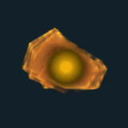
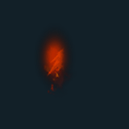
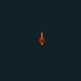
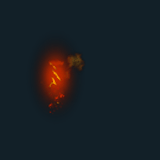
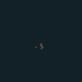
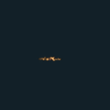

# VFX GIF 08 / 18

[목록으로](README.md) · [이전](gallery-07.md) · [다음](gallery-09.md)

모두 원본 데이터로 만든 2D 근사 미리보기입니다. 각 GIF를 클릭하면 개별 파일을 열 수 있습니다.

## FX_FireBurstDamage03

분류 `Skill` · 파티클 8개 · 표시 프레임 18/32

원본 경로: `Assets/InHouse/Fxs/Skill/Prefab/FX_FireBurstDamage03.prefab`

[GIF 파일](../../../public/rpg/vfx/previews/FX_FireBurstDamage03.gif) · [원본 프리팹 설정 gzip](../../../archive/rpg/vfx/prefabs/FX_FireBurstDamage03.json.gz)

## FX_FireBurstFX01

분류 `Skill` · 파티클 8개 · 표시 프레임 0/32

원본 경로: `Assets/InHouse/Fxs/Skill/Prefab/FX_FireBurstFX01.prefab`

[GIF 파일](../../../public/rpg/vfx/previews/FX_FireBurstFX01.gif) · [원본 프리팹 설정 gzip](../../../archive/rpg/vfx/prefabs/FX_FireBurstFX01.json.gz)

## FX_FireBurstHit01

분류 `Skill` · 파티클 7개 · 표시 프레임 26/32

원본 경로: `Assets/InHouse/Fxs/Skill/Prefab/FX_FireBurstHit01.prefab`

[GIF 파일](../../../public/rpg/vfx/previews/FX_FireBurstHit01.gif) · [원본 프리팹 설정 gzip](../../../archive/rpg/vfx/prefabs/FX_FireBurstHit01.json.gz)

## FX_FireHell_01

분류 `Skill` · 파티클 23개 · 표시 프레임 32/32

원본 경로: `Assets/InHouse/Fxs/Skill/Prefab/FX_FireHell_01.prefab`

[GIF 파일](../../../public/rpg/vfx/previews/FX_FireHell_01.gif) · [원본 프리팹 설정 gzip](../../../archive/rpg/vfx/prefabs/FX_FireHell_01.json.gz)

## FX_FireHit01

분류 `Skill` · 파티클 4개 · 표시 프레임 26/32

원본 경로: `Assets/InHouse/Fxs/Skill/Prefab/FX_FireHit01.prefab`

[GIF 파일](../../../public/rpg/vfx/previews/FX_FireHit01.gif) · [원본 프리팹 설정 gzip](../../../archive/rpg/vfx/prefabs/FX_FireHit01.json.gz)

## FX_FireHit02

분류 `Skill` · 파티클 7개 · 표시 프레임 30/32

원본 경로: `Assets/InHouse/Fxs/Skill/Prefab/FX_FireHit02.prefab`

[GIF 파일](../../../public/rpg/vfx/previews/FX_FireHit02.gif) · [원본 프리팹 설정 gzip](../../../archive/rpg/vfx/prefabs/FX_FireHit02.json.gz)

## FX_FireHit03

분류 `Skill` · 파티클 6개 · 표시 프레임 26/32

원본 경로: `Assets/InHouse/Fxs/Skill/Prefab/FX_FireHit03.prefab`

[GIF 파일](../../../public/rpg/vfx/previews/FX_FireHit03.gif) · [원본 프리팹 설정 gzip](../../../archive/rpg/vfx/prefabs/FX_FireHit03.json.gz)

## FX_FirePillarHit_01

분류 `Skill` · 파티클 12개 · 표시 프레임 32/32

원본 경로: `Assets/InHouse/Fxs/Skill/Prefab/FX_FirePillarHit_01.prefab`

[GIF 파일](../../../public/rpg/vfx/previews/FX_FirePillarHit_01.gif) · [원본 프리팹 설정 gzip](../../../archive/rpg/vfx/prefabs/FX_FirePillarHit_01.json.gz)

## FX_FirePillarHit_02

분류 `Skill` · 파티클 13개 · 표시 프레임 32/32

원본 경로: `Assets/InHouse/Fxs/Skill/Prefab/FX_FirePillarHit_02.prefab`

[GIF 파일](../../../public/rpg/vfx/previews/FX_FirePillarHit_02.gif) · [원본 프리팹 설정 gzip](../../../archive/rpg/vfx/prefabs/FX_FirePillarHit_02.json.gz)

## FX_FireRing_01

분류 `Skill` · 파티클 15개 · 표시 프레임 32/32

원본 경로: `Assets/InHouse/Fxs/Skill/Prefab/FX_FireRing_01.prefab`

[GIF 파일](../../../public/rpg/vfx/previews/FX_FireRing_01.gif) · [원본 프리팹 설정 gzip](../../../archive/rpg/vfx/prefabs/FX_FireRing_01.json.gz)

## FX_FireRing_Cast_01

분류 `Skill` · 파티클 9개 · 표시 프레임 16/32

원본 경로: `Assets/InHouse/Fxs/Skill/Prefab/FX_FireRing_Cast_01.prefab`

[GIF 파일](../../../public/rpg/vfx/previews/FX_FireRing_Cast_01.gif) · [원본 프리팹 설정 gzip](../../../archive/rpg/vfx/prefabs/FX_FireRing_Cast_01.json.gz)

## FX_FireSword_Damage01

분류 `Skill` · 파티클 6개 · 표시 프레임 13/32

원본 경로: `Assets/InHouse/Fxs/Skill/Prefab/FX_FireSword_Damage01.prefab`

[GIF 파일](../../../public/rpg/vfx/previews/FX_FireSword_Damage01.gif) · [원본 프리팹 설정 gzip](../../../archive/rpg/vfx/prefabs/FX_FireSword_Damage01.json.gz)

## FX_FireSword_Projectile_01

분류 `Skill` · 파티클 6개 · 표시 프레임 24/32

원본 경로: `Assets/InHouse/Fxs/Skill/Prefab/FX_FireSword_Projectile_01.prefab`

[GIF 파일](../../../public/rpg/vfx/previews/FX_FireSword_Projectile_01.gif) · [원본 프리팹 설정 gzip](../../../archive/rpg/vfx/prefabs/FX_FireSword_Projectile_01.json.gz)

## FX_FlashSlash_01

분류 `Skill` · 파티클 8개 · 표시 프레임 21/32

원본 경로: `Assets/InHouse/Fxs/Skill/Prefab/FX_FlashSlash_01.prefab`

[GIF 파일](../../../public/rpg/vfx/previews/FX_FlashSlash_01.gif) · [원본 프리팹 설정 gzip](../../../archive/rpg/vfx/prefabs/FX_FlashSlash_01.json.gz)

## FX_FlashSlash_Damage01

분류 `Skill` · 파티클 15개 · 표시 프레임 16/32

원본 경로: `Assets/InHouse/Fxs/Skill/Prefab/FX_FlashSlash_Damage01.prefab`

[GIF 파일](../../../public/rpg/vfx/previews/FX_FlashSlash_Damage01.gif) · [원본 프리팹 설정 gzip](../../../archive/rpg/vfx/prefabs/FX_FlashSlash_Damage01.json.gz)

## FX_FortressGuardHit_01

분류 `Skill` · 파티클 7개 · 표시 프레임 18/32

원본 경로: `Assets/InHouse/Fxs/Skill/Prefab/FX_FortressGuardHit_01.prefab`

[GIF 파일](../../../public/rpg/vfx/previews/FX_FortressGuardHit_01.gif) · [원본 프리팹 설정 gzip](../../../archive/rpg/vfx/prefabs/FX_FortressGuardHit_01.json.gz)

## FX_FortressGuard_Cast

분류 `Skill` · 파티클 9개 · 표시 프레임 20/32

원본 경로: `Assets/InHouse/Fxs/Skill/Prefab/FX_FortressGuard_Cast.prefab`

[GIF 파일](../../../public/rpg/vfx/previews/FX_FortressGuard_Cast.gif) · [원본 프리팹 설정 gzip](../../../archive/rpg/vfx/prefabs/FX_FortressGuard_Cast.json.gz)

## FX_FortressGuard_End

분류 `Skill` · 파티클 16개 · 표시 프레임 21/32

원본 경로: `Assets/InHouse/Fxs/Skill/Prefab/FX_FortressGuard_End.prefab`

[GIF 파일](../../../public/rpg/vfx/previews/FX_FortressGuard_End.gif) · [원본 프리팹 설정 gzip](../../../archive/rpg/vfx/prefabs/FX_FortressGuard_End.json.gz)

## FX_FortressGuard_Loop

분류 `Skill` · 파티클 7개 · 표시 프레임 16/32

원본 경로: `Assets/InHouse/Fxs/Skill/Prefab/FX_FortressGuard_Loop.prefab`

[GIF 파일](../../../public/rpg/vfx/previews/FX_FortressGuard_Loop.gif) · [원본 프리팹 설정 gzip](../../../archive/rpg/vfx/prefabs/FX_FortressGuard_Loop.json.gz)

## FX_FreezeDamage01_L

분류 `Skill` · 파티클 3개 · 표시 프레임 32/32

원본 경로: `Assets/InHouse/Fxs/Skill/Prefab/FX_FreezeDamage01_L.prefab`

[GIF 파일](../../../public/rpg/vfx/previews/FX_FreezeDamage01_L.gif) · [원본 프리팹 설정 gzip](../../../archive/rpg/vfx/prefabs/FX_FreezeDamage01_L.json.gz)

