# VFX GIF 09 / 18

[목록으로](README.md) · [이전](gallery-08.md) · [다음](gallery-10.md)

모두 원본 데이터로 만든 2D 근사 미리보기입니다. 각 GIF를 클릭하면 개별 파일을 열 수 있습니다.

## FX_FreezeDamage01_S

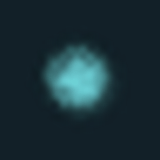

분류 `Skill` · 파티클 4개 · 표시 프레임 6/32

원본 경로: `Assets/InHouse/Fxs/Skill/Prefab/FX_FreezeDamage01_S.prefab`

[GIF 파일](../../../public/rpg/vfx/previews/FX_FreezeDamage01_S.gif) · [원본 프리팹 설정 gzip](../../../archive/rpg/vfx/prefabs/FX_FreezeDamage01_S.json.gz)

## FX_FrostBreakDamage01_E

분류 `Skill` · 파티클 8개 · 표시 프레임 32/32

원본 경로: `Assets/InHouse/Fxs/Skill/Prefab/FX_FrostBreakDamage01_E.prefab`

[GIF 파일](../../../public/rpg/vfx/previews/FX_FrostBreakDamage01_E.gif) · [원본 프리팹 설정 gzip](../../../archive/rpg/vfx/prefabs/FX_FrostBreakDamage01_E.json.gz)

## FX_FrostBreakDamage01_S

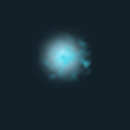

분류 `Skill` · 파티클 4개 · 표시 프레임 23/32

원본 경로: `Assets/InHouse/Fxs/Skill/Prefab/FX_FrostBreakDamage01_S.prefab`

[GIF 파일](../../../public/rpg/vfx/previews/FX_FrostBreakDamage01_S.gif) · [원본 프리팹 설정 gzip](../../../archive/rpg/vfx/prefabs/FX_FrostBreakDamage01_S.json.gz)

## FX_FrostBreakDamage02

분류 `Skill` · 파티클 5개 · 표시 프레임 23/32

원본 경로: `Assets/InHouse/Fxs/Skill/Prefab/FX_FrostBreakDamage02.prefab`

[GIF 파일](../../../public/rpg/vfx/previews/FX_FrostBreakDamage02.gif) · [원본 프리팹 설정 gzip](../../../archive/rpg/vfx/prefabs/FX_FrostBreakDamage02.json.gz)

## FX_FuryGuardDamage_01

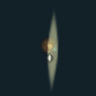

분류 `Skill` · 파티클 9개 · 표시 프레임 32/32

원본 경로: `Assets/InHouse/Fxs/Skill/Prefab/FX_FuryGuardDamage_01.prefab`

[GIF 파일](../../../public/rpg/vfx/previews/FX_FuryGuardDamage_01.gif) · [원본 프리팹 설정 gzip](../../../archive/rpg/vfx/prefabs/FX_FuryGuardDamage_01.json.gz)

## FX_FuryGuard_01

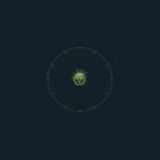

분류 `Skill` · 파티클 56개 · 표시 프레임 32/32

원본 경로: `Assets/InHouse/Fxs/Skill/Prefab/FX_FuryGuard_01.prefab`

[GIF 파일](../../../public/rpg/vfx/previews/FX_FuryGuard_01.gif) · [원본 프리팹 설정 gzip](../../../archive/rpg/vfx/prefabs/FX_FuryGuard_01.json.gz)

## FX_FuryGuard_02

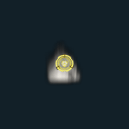

분류 `Skill` · 파티클 18개 · 표시 프레임 32/32

원본 경로: `Assets/InHouse/Fxs/Skill/Prefab/FX_FuryGuard_02.prefab`

[GIF 파일](../../../public/rpg/vfx/previews/FX_FuryGuard_02.gif) · [원본 프리팹 설정 gzip](../../../archive/rpg/vfx/prefabs/FX_FuryGuard_02.json.gz)

## FX_GoldenGoblin_StayLoop

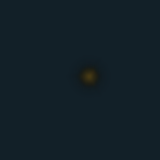

분류 `Skill` · 파티클 3개 · 표시 프레임 26/32

원본 경로: `Assets/InHouse/Fxs/Skill/Prefab/FX_GoldenGoblin_StayLoop.prefab`

[GIF 파일](../../../public/rpg/vfx/previews/FX_GoldenGoblin_StayLoop.gif) · [원본 프리팹 설정 gzip](../../../archive/rpg/vfx/prefabs/FX_GoldenGoblin_StayLoop.json.gz)

## FX_Golem_Gold_Skill1

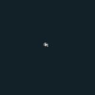

분류 `Skill` · 파티클 12개 · 표시 프레임 32/32

원본 경로: `Assets/InHouse/Fxs/Skill/Prefab/FX_Golem_Gold_Skill1.prefab`

[GIF 파일](../../../public/rpg/vfx/previews/FX_Golem_Gold_Skill1.gif) · [원본 프리팹 설정 gzip](../../../archive/rpg/vfx/prefabs/FX_Golem_Gold_Skill1.json.gz)

## FX_Golem_Gold_Skill1_Damage1

분류 `Skill` · 파티클 6개 · 표시 프레임 18/32

원본 경로: `Assets/InHouse/Fxs/Skill/Prefab/FX_Golem_Gold_Skill1_Damage1.prefab`

[GIF 파일](../../../public/rpg/vfx/previews/FX_Golem_Gold_Skill1_Damage1.gif) · [원본 프리팹 설정 gzip](../../../archive/rpg/vfx/prefabs/FX_Golem_Gold_Skill1_Damage1.json.gz)

## FX_GraveKnightSkeleton_Skill1

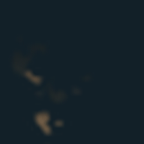

분류 `Skill` · 파티클 7개 · 표시 프레임 16/32

원본 경로: `Assets/InHouse/Fxs/Skill/Prefab/FX_GraveKnightSkeleton_Skill1.prefab`

[GIF 파일](../../../public/rpg/vfx/previews/FX_GraveKnightSkeleton_Skill1.gif) · [원본 프리팹 설정 gzip](../../../archive/rpg/vfx/prefabs/FX_GraveKnightSkeleton_Skill1.json.gz)

## FX_GuardianGoblinBuff_Skill2

분류 `Skill` · 파티클 11개 · 표시 프레임 28/32

원본 경로: `Assets/InHouse/Fxs/Skill/Prefab/FX_GuardianGoblinBuff_Skill2.prefab`

[GIF 파일](../../../public/rpg/vfx/previews/FX_GuardianGoblinBuff_Skill2.gif) · [원본 프리팹 설정 gzip](../../../archive/rpg/vfx/prefabs/FX_GuardianGoblinBuff_Skill2.json.gz)

## FX_GuardianGoblin_Skill1

분류 `Skill` · 파티클 7개 · 표시 프레임 32/32

원본 경로: `Assets/InHouse/Fxs/Skill/Prefab/FX_GuardianGoblin_Skill1.prefab`

[GIF 파일](../../../public/rpg/vfx/previews/FX_GuardianGoblin_Skill1.gif) · [원본 프리팹 설정 gzip](../../../archive/rpg/vfx/prefabs/FX_GuardianGoblin_Skill1.json.gz)

## FX_GuardianGoblin_Skill3_1

분류 `Skill` · 파티클 24개 · 표시 프레임 16/32

원본 경로: `Assets/InHouse/Fxs/Skill/Prefab/FX_GuardianGoblin_Skill3_1.prefab`

[GIF 파일](../../../public/rpg/vfx/previews/FX_GuardianGoblin_Skill3_1.gif) · [원본 프리팹 설정 gzip](../../../archive/rpg/vfx/prefabs/FX_GuardianGoblin_Skill3_1.json.gz)

## FX_GuardianGoblin_Skill3_2

분류 `Skill` · 파티클 14개 · 표시 프레임 18/32

원본 경로: `Assets/InHouse/Fxs/Skill/Prefab/FX_GuardianGoblin_Skill3_2.prefab`

[GIF 파일](../../../public/rpg/vfx/previews/FX_GuardianGoblin_Skill3_2.gif) · [원본 프리팹 설정 gzip](../../../archive/rpg/vfx/prefabs/FX_GuardianGoblin_Skill3_2.json.gz)

## FX_HeavenlyAxe01

분류 `Skill` · 파티클 23개 · 표시 프레임 32/32

원본 경로: `Assets/InHouse/Fxs/Skill/Prefab/FX_HeavenlyAxe01.prefab`

[GIF 파일](../../../public/rpg/vfx/previews/FX_HeavenlyAxe01.gif) · [원본 프리팹 설정 gzip](../../../archive/rpg/vfx/prefabs/FX_HeavenlyAxe01.json.gz)

## FX_HeavenlyAxe_Hit01

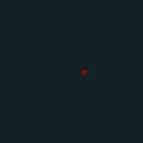

분류 `Skill` · 파티클 9개 · 표시 프레임 29/32

원본 경로: `Assets/InHouse/Fxs/Skill/Prefab/FX_HeavenlyAxe_Hit01.prefab`

[GIF 파일](../../../public/rpg/vfx/previews/FX_HeavenlyAxe_Hit01.gif) · [원본 프리팹 설정 gzip](../../../archive/rpg/vfx/prefabs/FX_HeavenlyAxe_Hit01.json.gz)

## FX_HolyShotDamage_01

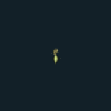

분류 `Skill` · 파티클 11개 · 표시 프레임 19/32

원본 경로: `Assets/InHouse/Fxs/Skill/Prefab/FX_HolyShotDamage_01.prefab`

[GIF 파일](../../../public/rpg/vfx/previews/FX_HolyShotDamage_01.gif) · [원본 프리팹 설정 gzip](../../../archive/rpg/vfx/prefabs/FX_HolyShotDamage_01.json.gz)

## FX_HolyShot_Projectile_01

분류 `Skill` · 파티클 6개 · 표시 프레임 32/32

원본 경로: `Assets/InHouse/Fxs/Skill/Prefab/FX_HolyShot_Projectile_01.prefab`

[GIF 파일](../../../public/rpg/vfx/previews/FX_HolyShot_Projectile_01.gif) · [원본 프리팹 설정 gzip](../../../archive/rpg/vfx/prefabs/FX_HolyShot_Projectile_01.json.gz)

## FX_HolySpearDamage_01

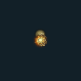

분류 `Skill` · 파티클 24개 · 표시 프레임 32/32

원본 경로: `Assets/InHouse/Fxs/Skill/Prefab/FX_HolySpearDamage_01.prefab`

[GIF 파일](../../../public/rpg/vfx/previews/FX_HolySpearDamage_01.gif) · [원본 프리팹 설정 gzip](../../../archive/rpg/vfx/prefabs/FX_HolySpearDamage_01.json.gz)

