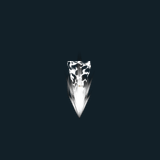
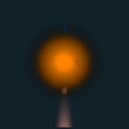
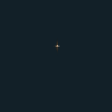
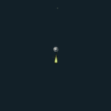
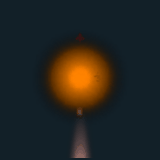
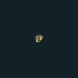
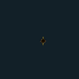
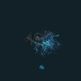

# VFX GIF 10 / 18

[목록으로](README.md) · [이전](gallery-09.md) · [다음](gallery-11.md)

모두 원본 데이터로 만든 2D 근사 미리보기입니다. 각 GIF를 클릭하면 개별 파일을 열 수 있습니다.

## FX_HolySpear_01

분류 `Skill` · 파티클 5개 · 표시 프레임 32/32

원본 경로: `Assets/InHouse/Fxs/Skill/Prefab/FX_HolySpear_01.prefab`

[GIF 파일](../../../public/rpg/vfx/previews/FX_HolySpear_01.gif) · [원본 프리팹 설정 gzip](../../../archive/rpg/vfx/prefabs/FX_HolySpear_01.json.gz)

## FX_HolySword_01

분류 `Skill` · 파티클 28개 · 표시 프레임 32/32

원본 경로: `Assets/InHouse/Fxs/Skill/Prefab/FX_HolySword_01.prefab`

[GIF 파일](../../../public/rpg/vfx/previews/FX_HolySword_01.gif) · [원본 프리팹 설정 gzip](../../../archive/rpg/vfx/prefabs/FX_HolySword_01.json.gz)

## FX_HolySword_Buff_BL

분류 `Skill` · 파티클 13개 · 표시 프레임 28/32

원본 경로: `Assets/InHouse/Fxs/Skill/Prefab/FX_HolySword_Buff_BL.prefab`

[GIF 파일](../../../public/rpg/vfx/previews/FX_HolySword_Buff_BL.gif) · [원본 프리팹 설정 gzip](../../../archive/rpg/vfx/prefabs/FX_HolySword_Buff_BL.json.gz)

## FX_HolySword_Damage_01

분류 `Skill` · 파티클 19개 · 표시 프레임 30/32

원본 경로: `Assets/InHouse/Fxs/Skill/Prefab/FX_HolySword_Damage_01.prefab`

[GIF 파일](../../../public/rpg/vfx/previews/FX_HolySword_Damage_01.gif) · [원본 프리팹 설정 gzip](../../../archive/rpg/vfx/prefabs/FX_HolySword_Damage_01.json.gz)

## FX_HolySword_Projectile_01

분류 `Skill` · 파티클 12개 · 표시 프레임 19/32

원본 경로: `Assets/InHouse/Fxs/Skill/Prefab/FX_HolySword_Projectile_01.prefab`

[GIF 파일](../../../public/rpg/vfx/previews/FX_HolySword_Projectile_01.gif) · [원본 프리팹 설정 gzip](../../../archive/rpg/vfx/prefabs/FX_HolySword_Projectile_01.json.gz)

## FX_HolyWrath_01

분류 `Skill` · 파티클 5개 · 표시 프레임 32/32

원본 경로: `Assets/InHouse/Fxs/Skill/Prefab/FX_HolyWrath_01.prefab`

[GIF 파일](../../../public/rpg/vfx/previews/FX_HolyWrath_01.gif) · [원본 프리팹 설정 gzip](../../../archive/rpg/vfx/prefabs/FX_HolyWrath_01.json.gz)

## FX_HolyWrath_Buff_RE

분류 `Skill` · 파티클 13개 · 표시 프레임 29/32

원본 경로: `Assets/InHouse/Fxs/Skill/Prefab/FX_HolyWrath_Buff_RE.prefab`

[GIF 파일](../../../public/rpg/vfx/previews/FX_HolyWrath_Buff_RE.gif) · [원본 프리팹 설정 gzip](../../../archive/rpg/vfx/prefabs/FX_HolyWrath_Buff_RE.json.gz)

## FX_HolyWrath_Damage_01

분류 `Skill` · 파티클 8개 · 표시 프레임 32/32

원본 경로: `Assets/InHouse/Fxs/Skill/Prefab/FX_HolyWrath_Damage_01.prefab`

[GIF 파일](../../../public/rpg/vfx/previews/FX_HolyWrath_Damage_01.gif) · [원본 프리팹 설정 gzip](../../../archive/rpg/vfx/prefabs/FX_HolyWrath_Damage_01.json.gz)

## FX_HolyWrath_Damage_Long_01

분류 `Skill` · 파티클 9개 · 표시 프레임 32/32

원본 경로: `Assets/InHouse/Fxs/Skill/Prefab/FX_HolyWrath_Damage_Long_01.prefab`

[GIF 파일](../../../public/rpg/vfx/previews/FX_HolyWrath_Damage_Long_01.gif) · [원본 프리팹 설정 gzip](../../../archive/rpg/vfx/prefabs/FX_HolyWrath_Damage_Long_01.json.gz)

## FX_IceArrow_Damage01

분류 `Skill` · 파티클 5개 · 표시 프레임 11/32

원본 경로: `Assets/InHouse/Fxs/Skill/Prefab/FX_IceArrow_Damage01.prefab`

[GIF 파일](../../../public/rpg/vfx/previews/FX_IceArrow_Damage01.gif) · [원본 프리팹 설정 gzip](../../../archive/rpg/vfx/prefabs/FX_IceArrow_Damage01.json.gz)

## FX_IceArrow_Damage01_BK

분류 `Skill` · 파티클 12개 · 표시 프레임 24/32

원본 경로: `Assets/InHouse/Fxs/Skill/Prefab/FX_IceArrow_Damage01_BK.prefab`

[GIF 파일](../../../public/rpg/vfx/previews/FX_IceArrow_Damage01_BK.gif) · [원본 프리팹 설정 gzip](../../../archive/rpg/vfx/prefabs/FX_IceArrow_Damage01_BK.json.gz)

## FX_IceArrow_Projectile_01

분류 `Skill` · 파티클 3개 · 표시 프레임 32/32

원본 경로: `Assets/InHouse/Fxs/Skill/Prefab/FX_IceArrow_Projectile_01.prefab`

[GIF 파일](../../../public/rpg/vfx/previews/FX_IceArrow_Projectile_01.gif) · [원본 프리팹 설정 gzip](../../../archive/rpg/vfx/prefabs/FX_IceArrow_Projectile_01.json.gz)

## FX_IceArrow_Projectile_02

분류 `Skill` · 파티클 3개 · 표시 프레임 32/32

원본 경로: `Assets/InHouse/Fxs/Skill/Prefab/FX_IceArrow_Projectile_02.prefab`

[GIF 파일](../../../public/rpg/vfx/previews/FX_IceArrow_Projectile_02.gif) · [원본 프리팹 설정 gzip](../../../archive/rpg/vfx/prefabs/FX_IceArrow_Projectile_02.json.gz)

## FX_IceDamage_01

분류 `Skill` · 파티클 7개 · 표시 프레임 19/32

원본 경로: `Assets/InHouse/Fxs/Skill/Prefab/FX_IceDamage_01.prefab`

[GIF 파일](../../../public/rpg/vfx/previews/FX_IceDamage_01.gif) · [원본 프리팹 설정 gzip](../../../archive/rpg/vfx/prefabs/FX_IceDamage_01.json.gz)

## FX_IceDamage_02

분류 `Skill` · 파티클 10개 · 표시 프레임 19/32

원본 경로: `Assets/InHouse/Fxs/Skill/Prefab/FX_IceDamage_02.prefab`

[GIF 파일](../../../public/rpg/vfx/previews/FX_IceDamage_02.gif) · [원본 프리팹 설정 gzip](../../../archive/rpg/vfx/prefabs/FX_IceDamage_02.json.gz)

## FX_IceLandFinal_01

분류 `Skill` · 파티클 13개 · 표시 프레임 32/32

원본 경로: `Assets/InHouse/Fxs/Skill/Prefab/FX_IceLandFinal_01.prefab`

[GIF 파일](../../../public/rpg/vfx/previews/FX_IceLandFinal_01.gif) · [원본 프리팹 설정 gzip](../../../archive/rpg/vfx/prefabs/FX_IceLandFinal_01.json.gz)

## FX_IceLand_01

분류 `Skill` · 파티클 13개 · 표시 프레임 32/32

원본 경로: `Assets/InHouse/Fxs/Skill/Prefab/FX_IceLand_01.prefab`

[GIF 파일](../../../public/rpg/vfx/previews/FX_IceLand_01.gif) · [원본 프리팹 설정 gzip](../../../archive/rpg/vfx/prefabs/FX_IceLand_01.json.gz)

## FX_IceRing_01

분류 `Skill` · 파티클 7개 · 표시 프레임 32/32

원본 경로: `Assets/InHouse/Fxs/Skill/Prefab/FX_IceRing_01.prefab`

[GIF 파일](../../../public/rpg/vfx/previews/FX_IceRing_01.gif) · [원본 프리팹 설정 gzip](../../../archive/rpg/vfx/prefabs/FX_IceRing_01.json.gz)

## FX_IceRing_Cast_01

분류 `Skill` · 파티클 7개 · 표시 프레임 16/32

원본 경로: `Assets/InHouse/Fxs/Skill/Prefab/FX_IceRing_Cast_01.prefab`

[GIF 파일](../../../public/rpg/vfx/previews/FX_IceRing_Cast_01.gif) · [원본 프리팹 설정 gzip](../../../archive/rpg/vfx/prefabs/FX_IceRing_Cast_01.json.gz)

## FX_IceRock_01

분류 `Skill` · 파티클 5개 · 표시 프레임 24/32

원본 경로: `Assets/InHouse/Fxs/Skill/Prefab/FX_IceRock_01.prefab`

[GIF 파일](../../../public/rpg/vfx/previews/FX_IceRock_01.gif) · [원본 프리팹 설정 gzip](../../../archive/rpg/vfx/prefabs/FX_IceRock_01.json.gz)

