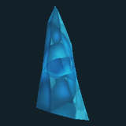
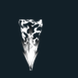
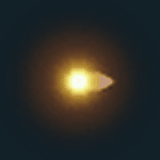
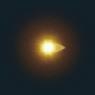
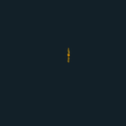
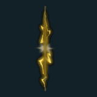
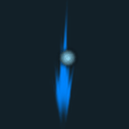
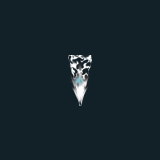

# VFX GIF 11 / 18

[목록으로](README.md) · [이전](gallery-10.md) · [다음](gallery-12.md)

모두 원본 데이터로 만든 2D 근사 미리보기입니다. 각 GIF를 클릭하면 개별 파일을 열 수 있습니다.

## FX_IceRock_02

분류 `Skill` · 파티클 5개 · 표시 프레임 24/32

원본 경로: `Assets/InHouse/Fxs/Skill/Prefab/FX_IceRock_02.prefab`

[GIF 파일](../../../public/rpg/vfx/previews/FX_IceRock_02.gif) · [원본 프리팹 설정 gzip](../../../archive/rpg/vfx/prefabs/FX_IceRock_02.json.gz)

## FX_IceRock_03

분류 `Skill` · 파티클 5개 · 표시 프레임 24/32

원본 경로: `Assets/InHouse/Fxs/Skill/Prefab/FX_IceRock_03.prefab`

[GIF 파일](../../../public/rpg/vfx/previews/FX_IceRock_03.gif) · [원본 프리팹 설정 gzip](../../../archive/rpg/vfx/prefabs/FX_IceRock_03.json.gz)

## FX_IceRock_04

분류 `Skill` · 파티클 5개 · 표시 프레임 24/32

원본 경로: `Assets/InHouse/Fxs/Skill/Prefab/FX_IceRock_04.prefab`

[GIF 파일](../../../public/rpg/vfx/previews/FX_IceRock_04.gif) · [원본 프리팹 설정 gzip](../../../archive/rpg/vfx/prefabs/FX_IceRock_04.json.gz)

## FX_IceRock_05

분류 `Skill` · 파티클 5개 · 표시 프레임 24/32

원본 경로: `Assets/InHouse/Fxs/Skill/Prefab/FX_IceRock_05.prefab`

[GIF 파일](../../../public/rpg/vfx/previews/FX_IceRock_05.gif) · [원본 프리팹 설정 gzip](../../../archive/rpg/vfx/prefabs/FX_IceRock_05.json.gz)

## FX_IceSpear01

분류 `Skill` · 파티클 5개 · 표시 프레임 32/32

원본 경로: `Assets/InHouse/Fxs/Skill/Prefab/FX_IceSpear01.prefab`

[GIF 파일](../../../public/rpg/vfx/previews/FX_IceSpear01.gif) · [원본 프리팹 설정 gzip](../../../archive/rpg/vfx/prefabs/FX_IceSpear01.json.gz)

## FX_KaelSkill2

분류 `Skill` · 파티클 17개 · 표시 프레임 24/32

원본 경로: `Assets/InHouse/Fxs/Skill/Prefab/FX_KaelSkill2.prefab`

[GIF 파일](../../../public/rpg/vfx/previews/FX_KaelSkill2.gif) · [원본 프리팹 설정 gzip](../../../archive/rpg/vfx/prefabs/FX_KaelSkill2.json.gz)

## FX_KaelSkill2_Fllow

분류 `Skill` · 파티클 17개 · 표시 프레임 32/32

원본 경로: `Assets/InHouse/Fxs/Skill/Prefab/FX_KaelSkill2_Fllow.prefab`

[GIF 파일](../../../public/rpg/vfx/previews/FX_KaelSkill2_Fllow.gif) · [원본 프리팹 설정 gzip](../../../archive/rpg/vfx/prefabs/FX_KaelSkill2_Fllow.json.gz)

## FX_KaelSpear3Hit_01

분류 `Skill` · 파티클 4개 · 표시 프레임 32/32

원본 경로: `Assets/InHouse/Fxs/Skill/Prefab/FX_KaelSpear3Hit_01.prefab`

[GIF 파일](../../../public/rpg/vfx/previews/FX_KaelSpear3Hit_01.gif) · [원본 프리팹 설정 gzip](../../../archive/rpg/vfx/prefabs/FX_KaelSpear3Hit_01.json.gz)

## FX_Kael_Skill2_S

분류 `Skill` · 파티클 10개 · 표시 프레임 32/32

원본 경로: `Assets/InHouse/Fxs/Skill/Prefab/FX_Kael_Skill2_S.prefab`

[GIF 파일](../../../public/rpg/vfx/previews/FX_Kael_Skill2_S.gif) · [원본 프리팹 설정 gzip](../../../archive/rpg/vfx/prefabs/FX_Kael_Skill2_S.json.gz)

## FX_LageMuckling_skill1

분류 `Skill` · 파티클 16개 · 표시 프레임 20/32

원본 경로: `Assets/InHouse/Fxs/Skill/Prefab/FX_LageMuckling_skill1.prefab`

[GIF 파일](../../../public/rpg/vfx/previews/FX_LageMuckling_skill1.gif) · [원본 프리팹 설정 gzip](../../../archive/rpg/vfx/prefabs/FX_LageMuckling_skill1.json.gz)

## FX_LaserDamage_01

분류 `Skill` · 파티클 3개 · 표시 프레임 8/32

원본 경로: `Assets/InHouse/Fxs/Skill/Prefab/FX_LaserDamage_01.prefab`

[GIF 파일](../../../public/rpg/vfx/previews/FX_LaserDamage_01.gif) · [원본 프리팹 설정 gzip](../../../archive/rpg/vfx/prefabs/FX_LaserDamage_01.json.gz)

## FX_LaserDamage_02

분류 `Skill` · 파티클 4개 · 표시 프레임 8/32

원본 경로: `Assets/InHouse/Fxs/Skill/Prefab/FX_LaserDamage_02.prefab`

[GIF 파일](../../../public/rpg/vfx/previews/FX_LaserDamage_02.gif) · [원본 프리팹 설정 gzip](../../../archive/rpg/vfx/prefabs/FX_LaserDamage_02.json.gz)

## FX_Laser_01

분류 `Skill` · 파티클 5개 · 표시 프레임 29/32

원본 경로: `Assets/InHouse/Fxs/Skill/Prefab/FX_Laser_01.prefab`

[GIF 파일](../../../public/rpg/vfx/previews/FX_Laser_01.gif) · [원본 프리팹 설정 gzip](../../../archive/rpg/vfx/prefabs/FX_Laser_01.json.gz)

## FX_Laser_02

분류 `Skill` · 파티클 7개 · 표시 프레임 9/32

원본 경로: `Assets/InHouse/Fxs/Skill/Prefab/FX_Laser_02.prefab`

[GIF 파일](../../../public/rpg/vfx/previews/FX_Laser_02.gif) · [원본 프리팹 설정 gzip](../../../archive/rpg/vfx/prefabs/FX_Laser_02.json.gz)

## FX_LightningDamage_01 1

분류 `Skill` · 파티클 8개 · 표시 프레임 8/32

원본 경로: `Assets/InHouse/Fxs/Skill/Prefab/FX_LightningDamage_01 1.prefab`

[GIF 파일](../../../public/rpg/vfx/previews/FX_LightningDamage_01-1.gif) · [원본 프리팹 설정 gzip](../../../archive/rpg/vfx/prefabs/FX_LightningDamage_01-1.json.gz)

## FX_LightningDamage_01

분류 `Skill` · 파티클 8개 · 표시 프레임 8/32

원본 경로: `Assets/InHouse/Fxs/Skill/Prefab/FX_LightningDamage_01.prefab`

[GIF 파일](../../../public/rpg/vfx/previews/FX_LightningDamage_01.gif) · [원본 프리팹 설정 gzip](../../../archive/rpg/vfx/prefabs/FX_LightningDamage_01.json.gz)

## FX_LightningDamage_01_YE

분류 `Skill` · 파티클 8개 · 표시 프레임 13/32

원본 경로: `Assets/InHouse/Fxs/Skill/Prefab/FX_LightningDamage_01_YE.prefab`

[GIF 파일](../../../public/rpg/vfx/previews/FX_LightningDamage_01_YE.gif) · [원본 프리팹 설정 gzip](../../../archive/rpg/vfx/prefabs/FX_LightningDamage_01_YE.json.gz)

## FX_LightningDamage_02

분류 `Skill` · 파티클 7개 · 표시 프레임 12/32

원본 경로: `Assets/InHouse/Fxs/Skill/Prefab/FX_LightningDamage_02.prefab`

[GIF 파일](../../../public/rpg/vfx/previews/FX_LightningDamage_02.gif) · [원본 프리팹 설정 gzip](../../../archive/rpg/vfx/prefabs/FX_LightningDamage_02.json.gz)

## FX_LightningDamage_02_YE

분류 `Skill` · 파티클 7개 · 표시 프레임 6/32

원본 경로: `Assets/InHouse/Fxs/Skill/Prefab/FX_LightningDamage_02_YE.prefab`

[GIF 파일](../../../public/rpg/vfx/previews/FX_LightningDamage_02_YE.gif) · [원본 프리팹 설정 gzip](../../../archive/rpg/vfx/prefabs/FX_LightningDamage_02_YE.json.gz)

## FX_LightningSpear_01

분류 `Skill` · 파티클 9개 · 표시 프레임 32/32

원본 경로: `Assets/InHouse/Fxs/Skill/Prefab/FX_LightningSpear_01.prefab`

[GIF 파일](../../../public/rpg/vfx/previews/FX_LightningSpear_01.gif) · [원본 프리팹 설정 gzip](../../../archive/rpg/vfx/prefabs/FX_LightningSpear_01.json.gz)

