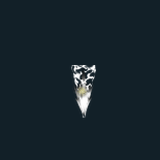
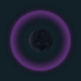
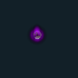

# VFX GIF 12 / 18

[목록으로](README.md) · [이전](gallery-11.md) · [다음](gallery-13.md)

모두 원본 데이터로 만든 2D 근사 미리보기입니다. 각 GIF를 클릭하면 개별 파일을 열 수 있습니다.

## FX_LightningSpear_01_S

분류 `Skill` · 파티클 1개 · 표시 프레임 32/32

원본 경로: `Assets/InHouse/Fxs/Skill/Prefab/FX_LightningSpear_01_S.prefab`

[GIF 파일](../../../public/rpg/vfx/previews/FX_LightningSpear_01_S.gif) · [원본 프리팹 설정 gzip](../../../archive/rpg/vfx/prefabs/FX_LightningSpear_01_S.json.gz)

## FX_LightningSpear_01_S_P

분류 `Skill` · 파티클 1개 · 표시 프레임 32/32

원본 경로: `Assets/InHouse/Fxs/Skill/Prefab/FX_LightningSpear_01_S_P.prefab`

[GIF 파일](../../../public/rpg/vfx/previews/FX_LightningSpear_01_S_P.gif) · [원본 프리팹 설정 gzip](../../../archive/rpg/vfx/prefabs/FX_LightningSpear_01_S_P.json.gz)

## FX_LightningSpear_01_S_P_YE

분류 `Skill` · 파티클 1개 · 표시 프레임 32/32

원본 경로: `Assets/InHouse/Fxs/Skill/Prefab/FX_LightningSpear_01_S_P_YE.prefab`

[GIF 파일](../../../public/rpg/vfx/previews/FX_LightningSpear_01_S_P_YE.gif) · [원본 프리팹 설정 gzip](../../../archive/rpg/vfx/prefabs/FX_LightningSpear_01_S_P_YE.json.gz)

## FX_LightningSpear_01_S_YE

분류 `Skill` · 파티클 1개 · 표시 프레임 32/32

원본 경로: `Assets/InHouse/Fxs/Skill/Prefab/FX_LightningSpear_01_S_YE.prefab`

[GIF 파일](../../../public/rpg/vfx/previews/FX_LightningSpear_01_S_YE.gif) · [원본 프리팹 설정 gzip](../../../archive/rpg/vfx/prefabs/FX_LightningSpear_01_S_YE.json.gz)

## FX_LightningSpear_01_YE

분류 `Skill` · 파티클 9개 · 표시 프레임 32/32

원본 경로: `Assets/InHouse/Fxs/Skill/Prefab/FX_LightningSpear_01_YE.prefab`

[GIF 파일](../../../public/rpg/vfx/previews/FX_LightningSpear_01_YE.gif) · [원본 프리팹 설정 gzip](../../../archive/rpg/vfx/prefabs/FX_LightningSpear_01_YE.json.gz)

## FX_MagicShield_01_End

분류 `Skill` · 파티클 8개 · 표시 프레임 8/32

원본 경로: `Assets/InHouse/Fxs/Skill/Prefab/FX_MagicShield_01_End.prefab`

[GIF 파일](../../../public/rpg/vfx/previews/FX_MagicShield_01_End.gif) · [원본 프리팹 설정 gzip](../../../archive/rpg/vfx/prefabs/FX_MagicShield_01_End.json.gz)

## FX_MagicShield_01_Explode

분류 `Skill` · 파티클 9개 · 표시 프레임 18/32

원본 경로: `Assets/InHouse/Fxs/Skill/Prefab/FX_MagicShield_01_Explode.prefab`

[GIF 파일](../../../public/rpg/vfx/previews/FX_MagicShield_01_Explode.gif) · [원본 프리팹 설정 gzip](../../../archive/rpg/vfx/prefabs/FX_MagicShield_01_Explode.json.gz)

## FX_MagicShield_01_Loop

분류 `Skill` · 파티클 8개 · 표시 프레임 32/32

원본 경로: `Assets/InHouse/Fxs/Skill/Prefab/FX_MagicShield_01_Loop.prefab`

[GIF 파일](../../../public/rpg/vfx/previews/FX_MagicShield_01_Loop.gif) · [원본 프리팹 설정 gzip](../../../archive/rpg/vfx/prefabs/FX_MagicShield_01_Loop.json.gz)

## FX_MagicShield_01_Sart

분류 `Skill` · 파티클 6개 · 표시 프레임 10/32

원본 경로: `Assets/InHouse/Fxs/Skill/Prefab/FX_MagicShield_01_Sart.prefab`

[GIF 파일](../../../public/rpg/vfx/previews/FX_MagicShield_01_Sart.gif) · [원본 프리팹 설정 gzip](../../../archive/rpg/vfx/prefabs/FX_MagicShield_01_Sart.json.gz)

## FX_Magister_Skill2

분류 `Skill` · 파티클 11개 · 표시 프레임 32/32

원본 경로: `Assets/InHouse/Fxs/Skill/Prefab/FX_Magister_Skill2.prefab`

[GIF 파일](../../../public/rpg/vfx/previews/FX_Magister_Skill2.gif) · [원본 프리팹 설정 gzip](../../../archive/rpg/vfx/prefabs/FX_Magister_Skill2.json.gz)

## FX_Magister_Skill2_all

분류 `Skill` · 파티클 11개 · 표시 프레임 32/32

원본 경로: `Assets/InHouse/Fxs/Skill/Prefab/FX_Magister_Skill2_all.prefab`

[GIF 파일](../../../public/rpg/vfx/previews/FX_Magister_Skill2_all.gif) · [원본 프리팹 설정 gzip](../../../archive/rpg/vfx/prefabs/FX_Magister_Skill2_all.json.gz)

## FX_Magister_Skill2_cast

분류 `Skill` · 파티클 11개 · 표시 프레임 6/32

원본 경로: `Assets/InHouse/Fxs/Skill/Prefab/FX_Magister_Skill2_cast.prefab`

[GIF 파일](../../../public/rpg/vfx/previews/FX_Magister_Skill2_cast.gif) · [원본 프리팹 설정 gzip](../../../archive/rpg/vfx/prefabs/FX_Magister_Skill2_cast.json.gz)

## FX_NerissaQueen_Cast_01

분류 `Skill` · 파티클 3개 · 표시 프레임 12/32

원본 경로: `Assets/InHouse/Fxs/Skill/Prefab/FX_NerissaQueen_Cast_01.prefab`

[GIF 파일](../../../public/rpg/vfx/previews/FX_NerissaQueen_Cast_01.gif) · [원본 프리팹 설정 gzip](../../../archive/rpg/vfx/prefabs/FX_NerissaQueen_Cast_01.json.gz)

## FX_NerissaQueen_ProjectileDamage01

분류 `Skill` · 파티클 11개 · 표시 프레임 19/32

원본 경로: `Assets/InHouse/Fxs/Skill/Prefab/FX_NerissaQueen_ProjectileDamage01.prefab`

[GIF 파일](../../../public/rpg/vfx/previews/FX_NerissaQueen_ProjectileDamage01.gif) · [원본 프리팹 설정 gzip](../../../archive/rpg/vfx/prefabs/FX_NerissaQueen_ProjectileDamage01.json.gz)

## FX_NerissaQueen_Projectile_01

분류 `Skill` · 파티클 3개 · 표시 프레임 29/32

원본 경로: `Assets/InHouse/Fxs/Skill/Prefab/FX_NerissaQueen_Projectile_01.prefab`

[GIF 파일](../../../public/rpg/vfx/previews/FX_NerissaQueen_Projectile_01.gif) · [원본 프리팹 설정 gzip](../../../archive/rpg/vfx/prefabs/FX_NerissaQueen_Projectile_01.json.gz)

## FX_NerissaQueen_Skill1_1

분류 `Skill` · 파티클 23개 · 표시 프레임 16/32

원본 경로: `Assets/InHouse/Fxs/Skill/Prefab/FX_NerissaQueen_Skill1_1.prefab`

[GIF 파일](../../../public/rpg/vfx/previews/FX_NerissaQueen_Skill1_1.gif) · [원본 프리팹 설정 gzip](../../../archive/rpg/vfx/prefabs/FX_NerissaQueen_Skill1_1.json.gz)

## FX_NerissaQueen_Skill1_2

분류 `Skill` · 파티클 23개 · 표시 프레임 16/32

원본 경로: `Assets/InHouse/Fxs/Skill/Prefab/FX_NerissaQueen_Skill1_2.prefab`

[GIF 파일](../../../public/rpg/vfx/previews/FX_NerissaQueen_Skill1_2.gif) · [원본 프리팹 설정 gzip](../../../archive/rpg/vfx/prefabs/FX_NerissaQueen_Skill1_2.json.gz)

## FX_NerissaQueen_Skill2

분류 `Skill` · 파티클 9개 · 표시 프레임 32/32

원본 경로: `Assets/InHouse/Fxs/Skill/Prefab/FX_NerissaQueen_Skill2.prefab`

[GIF 파일](../../../public/rpg/vfx/previews/FX_NerissaQueen_Skill2.gif) · [원본 프리팹 설정 gzip](../../../archive/rpg/vfx/prefabs/FX_NerissaQueen_Skill2.json.gz)

## FX_NerissaQueen_Skill4_01

분류 `Skill` · 파티클 9개 · 표시 프레임 32/32

원본 경로: `Assets/InHouse/Fxs/Skill/Prefab/FX_NerissaQueen_Skill4_01.prefab`

[GIF 파일](../../../public/rpg/vfx/previews/FX_NerissaQueen_Skill4_01.gif) · [원본 프리팹 설정 gzip](../../../archive/rpg/vfx/prefabs/FX_NerissaQueen_Skill4_01.json.gz)

## FX_NerissaQueen_Skill4_02

분류 `Skill` · 파티클 20개 · 표시 프레임 32/32

원본 경로: `Assets/InHouse/Fxs/Skill/Prefab/FX_NerissaQueen_Skill4_02.prefab`

[GIF 파일](../../../public/rpg/vfx/previews/FX_NerissaQueen_Skill4_02.gif) · [원본 프리팹 설정 gzip](../../../archive/rpg/vfx/prefabs/FX_NerissaQueen_Skill4_02.json.gz)

