# VFX GIF 13 / 18

[목록으로](README.md) · [이전](gallery-12.md) · [다음](gallery-14.md)

모두 원본 데이터로 만든 2D 근사 미리보기입니다. 각 GIF를 클릭하면 개별 파일을 열 수 있습니다.

## FX_NerissaQueen_VerticalDamage_01

분류 `Skill` · 파티클 5개 · 표시 프레임 16/32

원본 경로: `Assets/InHouse/Fxs/Skill/Prefab/FX_NerissaQueen_VerticalDamage_01.prefab`

[GIF 파일](../../../public/rpg/vfx/previews/FX_NerissaQueen_VerticalDamage_01.gif) · [원본 프리팹 설정 gzip](../../../archive/rpg/vfx/prefabs/FX_NerissaQueen_VerticalDamage_01.json.gz)

## FX_NightmawBatDash_01

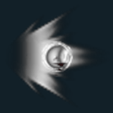

분류 `Skill` · 파티클 6개 · 표시 프레임 32/32

원본 경로: `Assets/InHouse/Fxs/Skill/Prefab/FX_NightmawBatDash_01.prefab`

[GIF 파일](../../../public/rpg/vfx/previews/FX_NightmawBatDash_01.gif) · [원본 프리팹 설정 gzip](../../../archive/rpg/vfx/prefabs/FX_NightmawBatDash_01.json.gz)

## FX_NightmawBatSkill03_01

분류 `Skill` · 파티클 4개 · 표시 프레임 7/32

원본 경로: `Assets/InHouse/Fxs/Skill/Prefab/FX_NightmawBatSkill03_01.prefab`

[GIF 파일](../../../public/rpg/vfx/previews/FX_NightmawBatSkill03_01.gif) · [원본 프리팹 설정 gzip](../../../archive/rpg/vfx/prefabs/FX_NightmawBatSkill03_01.json.gz)

## FX_NightmawBatSkill03_02

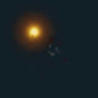

분류 `Skill` · 파티클 20개 · 표시 프레임 30/32

원본 경로: `Assets/InHouse/Fxs/Skill/Prefab/FX_NightmawBatSkill03_02.prefab`

[GIF 파일](../../../public/rpg/vfx/previews/FX_NightmawBatSkill03_02.gif) · [원본 프리팹 설정 gzip](../../../archive/rpg/vfx/prefabs/FX_NightmawBatSkill03_02.json.gz)

## FX_OutlawSword3Hit_01

분류 `Skill` · 파티클 7개 · 표시 프레임 16/32

원본 경로: `Assets/InHouse/Fxs/Skill/Prefab/FX_OutlawSword3Hit_01.prefab`

[GIF 파일](../../../public/rpg/vfx/previews/FX_OutlawSword3Hit_01.gif) · [원본 프리팹 설정 gzip](../../../archive/rpg/vfx/prefabs/FX_OutlawSword3Hit_01.json.gz)

## FX_OutlawSword3Hit_01_Follow

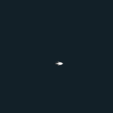

분류 `Skill` · 파티클 7개 · 표시 프레임 32/32

원본 경로: `Assets/InHouse/Fxs/Skill/Prefab/FX_OutlawSword3Hit_01_Follow.prefab`

[GIF 파일](../../../public/rpg/vfx/previews/FX_OutlawSword3Hit_01_Follow.gif) · [원본 프리팹 설정 gzip](../../../archive/rpg/vfx/prefabs/FX_OutlawSword3Hit_01_Follow.json.gz)

## FX_PoisonCloud_01

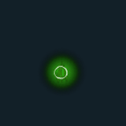

분류 `Skill` · 파티클 12개 · 표시 프레임 32/32

원본 경로: `Assets/InHouse/Fxs/Skill/Prefab/FX_PoisonCloud_01.prefab`

[GIF 파일](../../../public/rpg/vfx/previews/FX_PoisonCloud_01.gif) · [원본 프리팹 설정 gzip](../../../archive/rpg/vfx/prefabs/FX_PoisonCloud_01.json.gz)

## FX_PoisonCloud_02_E

분류 `Skill` · 파티클 4개 · 표시 프레임 24/32

원본 경로: `Assets/InHouse/Fxs/Skill/Prefab/FX_PoisonCloud_02_E.prefab`

[GIF 파일](../../../public/rpg/vfx/previews/FX_PoisonCloud_02_E.gif) · [원본 프리팹 설정 gzip](../../../archive/rpg/vfx/prefabs/FX_PoisonCloud_02_E.json.gz)

## FX_PoisonCloud_02_L

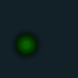

분류 `Skill` · 파티클 5개 · 표시 프레임 32/32

원본 경로: `Assets/InHouse/Fxs/Skill/Prefab/FX_PoisonCloud_02_L.prefab`

[GIF 파일](../../../public/rpg/vfx/previews/FX_PoisonCloud_02_L.gif) · [원본 프리팹 설정 gzip](../../../archive/rpg/vfx/prefabs/FX_PoisonCloud_02_L.json.gz)

## FX_PoisonCloud_02_S

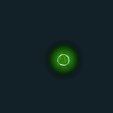

분류 `Skill` · 파티클 5개 · 표시 프레임 32/32

원본 경로: `Assets/InHouse/Fxs/Skill/Prefab/FX_PoisonCloud_02_S.prefab`

[GIF 파일](../../../public/rpg/vfx/previews/FX_PoisonCloud_02_S.gif) · [원본 프리팹 설정 gzip](../../../archive/rpg/vfx/prefabs/FX_PoisonCloud_02_S.json.gz)

## FX_PoisonHit01

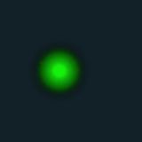

분류 `Skill` · 파티클 4개 · 표시 프레임 16/32

원본 경로: `Assets/InHouse/Fxs/Skill/Prefab/FX_PoisonHit01.prefab`

[GIF 파일](../../../public/rpg/vfx/previews/FX_PoisonHit01.gif) · [원본 프리팹 설정 gzip](../../../archive/rpg/vfx/prefabs/FX_PoisonHit01.json.gz)

## FX_PrimeElementalCast_BL

분류 `Skill` · 파티클 3개 · 표시 프레임 11/32

원본 경로: `Assets/InHouse/Fxs/Skill/Prefab/FX_PrimeElementalCast_BL.prefab`

[GIF 파일](../../../public/rpg/vfx/previews/FX_PrimeElementalCast_BL.gif) · [원본 프리팹 설정 gzip](../../../archive/rpg/vfx/prefabs/FX_PrimeElementalCast_BL.json.gz)

## FX_PrimeElementalCast_GR

분류 `Skill` · 파티클 3개 · 표시 프레임 16/32

원본 경로: `Assets/InHouse/Fxs/Skill/Prefab/FX_PrimeElementalCast_GR.prefab`

[GIF 파일](../../../public/rpg/vfx/previews/FX_PrimeElementalCast_GR.gif) · [원본 프리팹 설정 gzip](../../../archive/rpg/vfx/prefabs/FX_PrimeElementalCast_GR.json.gz)

## FX_PrimeElementalCast_RE

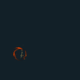

분류 `Skill` · 파티클 3개 · 표시 프레임 12/32

원본 경로: `Assets/InHouse/Fxs/Skill/Prefab/FX_PrimeElementalCast_RE.prefab`

[GIF 파일](../../../public/rpg/vfx/previews/FX_PrimeElementalCast_RE.gif) · [원본 프리팹 설정 gzip](../../../archive/rpg/vfx/prefabs/FX_PrimeElementalCast_RE.json.gz)

## FX_PrimeElementalDash_BL

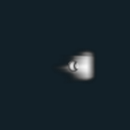

분류 `Skill` · 파티클 7개 · 표시 프레임 32/32

원본 경로: `Assets/InHouse/Fxs/Skill/Prefab/FX_PrimeElementalDash_BL.prefab`

[GIF 파일](../../../public/rpg/vfx/previews/FX_PrimeElementalDash_BL.gif) · [원본 프리팹 설정 gzip](../../../archive/rpg/vfx/prefabs/FX_PrimeElementalDash_BL.json.gz)

## FX_PrimeElementalDash_GR

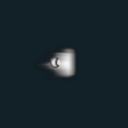

분류 `Skill` · 파티클 7개 · 표시 프레임 32/32

원본 경로: `Assets/InHouse/Fxs/Skill/Prefab/FX_PrimeElementalDash_GR.prefab`

[GIF 파일](../../../public/rpg/vfx/previews/FX_PrimeElementalDash_GR.gif) · [원본 프리팹 설정 gzip](../../../archive/rpg/vfx/prefabs/FX_PrimeElementalDash_GR.json.gz)

## FX_PrimeElementalDash_RE

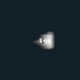

분류 `Skill` · 파티클 7개 · 표시 프레임 32/32

원본 경로: `Assets/InHouse/Fxs/Skill/Prefab/FX_PrimeElementalDash_RE.prefab`

[GIF 파일](../../../public/rpg/vfx/previews/FX_PrimeElementalDash_RE.gif) · [원본 프리팹 설정 gzip](../../../archive/rpg/vfx/prefabs/FX_PrimeElementalDash_RE.json.gz)

## FX_PulseHit_01

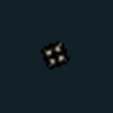

분류 `Skill` · 파티클 8개 · 표시 프레임 15/32

원본 경로: `Assets/InHouse/Fxs/Skill/Prefab/FX_PulseHit_01.prefab`

[GIF 파일](../../../public/rpg/vfx/previews/FX_PulseHit_01.gif) · [원본 프리팹 설정 gzip](../../../archive/rpg/vfx/prefabs/FX_PulseHit_01.json.gz)

## FX_Pulse_Projectile_01

분류 `Skill` · 파티클 5개 · 표시 프레임 32/32

원본 경로: `Assets/InHouse/Fxs/Skill/Prefab/FX_Pulse_Projectile_01.prefab`

[GIF 파일](../../../public/rpg/vfx/previews/FX_Pulse_Projectile_01.gif) · [원본 프리팹 설정 gzip](../../../archive/rpg/vfx/prefabs/FX_Pulse_Projectile_01.json.gz)

## FX_RisingBlowDamage_01

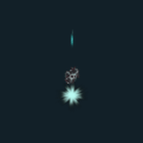

분류 `Skill` · 파티클 10개 · 표시 프레임 32/32

원본 경로: `Assets/InHouse/Fxs/Skill/Prefab/FX_RisingBlowDamage_01.prefab`

[GIF 파일](../../../public/rpg/vfx/previews/FX_RisingBlowDamage_01.gif) · [원본 프리팹 설정 gzip](../../../archive/rpg/vfx/prefabs/FX_RisingBlowDamage_01.json.gz)

