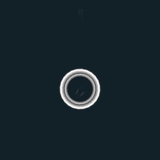
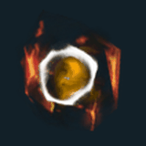
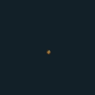
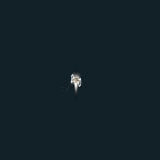
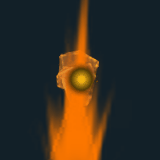
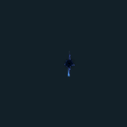
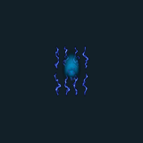
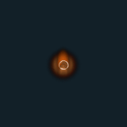

# VFX GIF 14 / 18

[목록으로](README.md) · [이전](gallery-13.md) · [다음](gallery-15.md)

모두 원본 데이터로 만든 2D 근사 미리보기입니다. 각 GIF를 클릭하면 개별 파일을 열 수 있습니다.

## FX_RisingBlowDamage_01_Small

분류 `Skill` · 파티클 4개 · 표시 프레임 8/32

원본 경로: `Assets/InHouse/Fxs/Skill/Prefab/FX_RisingBlowDamage_01_Small.prefab`

[GIF 파일](../../../public/rpg/vfx/previews/FX_RisingBlowDamage_01_Small.gif) · [원본 프리팹 설정 gzip](../../../archive/rpg/vfx/prefabs/FX_RisingBlowDamage_01_Small.json.gz)

## FX_RisingBlow_01_Cast

분류 `Skill` · 파티클 18개 · 표시 프레임 32/32

원본 경로: `Assets/InHouse/Fxs/Skill/Prefab/FX_RisingBlow_01_Cast.prefab`

[GIF 파일](../../../public/rpg/vfx/previews/FX_RisingBlow_01_Cast.gif) · [원본 프리팹 설정 gzip](../../../archive/rpg/vfx/prefabs/FX_RisingBlow_01_Cast.json.gz)

## FX_RockMeteoArea_01

분류 `Skill` · 파티클 13개 · 표시 프레임 32/32

원본 경로: `Assets/InHouse/Fxs/Skill/Prefab/FX_RockMeteoArea_01.prefab`

[GIF 파일](../../../public/rpg/vfx/previews/FX_RockMeteoArea_01.gif) · [원본 프리팹 설정 gzip](../../../archive/rpg/vfx/prefabs/FX_RockMeteoArea_01.json.gz)

## FX_RockMeteo_01

분류 `Skill` · 파티클 6개 · 표시 프레임 32/32

원본 경로: `Assets/InHouse/Fxs/Skill/Prefab/FX_RockMeteo_01.prefab`

[GIF 파일](../../../public/rpg/vfx/previews/FX_RockMeteo_01.gif) · [원본 프리팹 설정 gzip](../../../archive/rpg/vfx/prefabs/FX_RockMeteo_01.json.gz)

## FX_Shield_Cast_01

분류 `Skill` · 파티클 7개 · 표시 프레임 32/32

원본 경로: `Assets/InHouse/Fxs/Skill/Prefab/FX_Shield_Cast_01.prefab`

[GIF 파일](../../../public/rpg/vfx/previews/FX_Shield_Cast_01.gif) · [원본 프리팹 설정 gzip](../../../archive/rpg/vfx/prefabs/FX_Shield_Cast_01.json.gz)

## FX_Shield_Damage_01

분류 `Skill` · 파티클 10개 · 표시 프레임 15/32

원본 경로: `Assets/InHouse/Fxs/Skill/Prefab/FX_Shield_Damage_01.prefab`

[GIF 파일](../../../public/rpg/vfx/previews/FX_Shield_Damage_01.gif) · [원본 프리팹 설정 gzip](../../../archive/rpg/vfx/prefabs/FX_Shield_Damage_01.json.gz)

## FX_Shield_Projectile_01

분류 `Skill` · 파티클 11개 · 표시 프레임 32/32

원본 경로: `Assets/InHouse/Fxs/Skill/Prefab/FX_Shield_Projectile_01.prefab`

[GIF 파일](../../../public/rpg/vfx/previews/FX_Shield_Projectile_01.gif) · [원본 프리팹 설정 gzip](../../../archive/rpg/vfx/prefabs/FX_Shield_Projectile_01.json.gz)

## FX_ShockBlast_Hit_01

분류 `Skill` · 파티클 7개 · 표시 프레임 17/32

원본 경로: `Assets/InHouse/Fxs/Skill/Prefab/FX_ShockBlast_Hit_01.prefab`

[GIF 파일](../../../public/rpg/vfx/previews/FX_ShockBlast_Hit_01.gif) · [원본 프리팹 설정 gzip](../../../archive/rpg/vfx/prefabs/FX_ShockBlast_Hit_01.json.gz)

## FX_ShockBlast_Hit_02

분류 `Skill` · 파티클 6개 · 표시 프레임 26/32

원본 경로: `Assets/InHouse/Fxs/Skill/Prefab/FX_ShockBlast_Hit_02.prefab`

[GIF 파일](../../../public/rpg/vfx/previews/FX_ShockBlast_Hit_02.gif) · [원본 프리팹 설정 gzip](../../../archive/rpg/vfx/prefabs/FX_ShockBlast_Hit_02.json.gz)

## FX_ShockBlast_Projectile_01

분류 `Skill` · 파티클 6개 · 표시 프레임 18/32

원본 경로: `Assets/InHouse/Fxs/Skill/Prefab/FX_ShockBlast_Projectile_01.prefab`

[GIF 파일](../../../public/rpg/vfx/previews/FX_ShockBlast_Projectile_01.gif) · [원본 프리팹 설정 gzip](../../../archive/rpg/vfx/prefabs/FX_ShockBlast_Projectile_01.json.gz)

## FX_SkyJudge_01

분류 `Skill` · 파티클 19개 · 표시 프레임 32/32

원본 경로: `Assets/InHouse/Fxs/Skill/Prefab/FX_SkyJudge_01.prefab`

[GIF 파일](../../../public/rpg/vfx/previews/FX_SkyJudge_01.gif) · [원본 프리팹 설정 gzip](../../../archive/rpg/vfx/prefabs/FX_SkyJudge_01.json.gz)

## FX_SkyJudge_01_Cast

분류 `Skill` · 파티클 4개 · 표시 프레임 12/32

원본 경로: `Assets/InHouse/Fxs/Skill/Prefab/FX_SkyJudge_01_Cast.prefab`

[GIF 파일](../../../public/rpg/vfx/previews/FX_SkyJudge_01_Cast.gif) · [원본 프리팹 설정 gzip](../../../archive/rpg/vfx/prefabs/FX_SkyJudge_01_Cast.json.gz)

## FX_SkyJudge_01_E

분류 `Skill` · 파티클 22개 · 표시 프레임 32/32

원본 경로: `Assets/InHouse/Fxs/Skill/Prefab/FX_SkyJudge_01_E.prefab`

[GIF 파일](../../../public/rpg/vfx/previews/FX_SkyJudge_01_E.gif) · [원본 프리팹 설정 gzip](../../../archive/rpg/vfx/prefabs/FX_SkyJudge_01_E.json.gz)

## FX_SlimeBuffCast_01

분류 `Skill` · 파티클 11개 · 표시 프레임 32/32

원본 경로: `Assets/InHouse/Fxs/Skill/Prefab/FX_SlimeBuffCast_01.prefab`

[GIF 파일](../../../public/rpg/vfx/previews/FX_SlimeBuffCast_01.gif) · [원본 프리팹 설정 gzip](../../../archive/rpg/vfx/prefabs/FX_SlimeBuffCast_01.json.gz)

## FX_Slime_Area_01

분류 `Skill` · 파티클 10개 · 표시 프레임 32/32

원본 경로: `Assets/InHouse/Fxs/Skill/Prefab/FX_Slime_Area_01.prefab`

[GIF 파일](../../../public/rpg/vfx/previews/FX_Slime_Area_01.gif) · [원본 프리팹 설정 gzip](../../../archive/rpg/vfx/prefabs/FX_Slime_Area_01.json.gz)

## FX_Slime_ProjectileDamage01_B

분류 `Skill` · 파티클 4개 · 표시 프레임 8/32

원본 경로: `Assets/InHouse/Fxs/Skill/Prefab/FX_Slime_ProjectileDamage01_B.prefab`

[GIF 파일](../../../public/rpg/vfx/previews/FX_Slime_ProjectileDamage01_B.gif) · [원본 프리팹 설정 gzip](../../../archive/rpg/vfx/prefabs/FX_Slime_ProjectileDamage01_B.json.gz)

## FX_Slime_ProjectileDamage01_G

분류 `Skill` · 파티클 4개 · 표시 프레임 8/32

원본 경로: `Assets/InHouse/Fxs/Skill/Prefab/FX_Slime_ProjectileDamage01_G.prefab`

[GIF 파일](../../../public/rpg/vfx/previews/FX_Slime_ProjectileDamage01_G.gif) · [원본 프리팹 설정 gzip](../../../archive/rpg/vfx/prefabs/FX_Slime_ProjectileDamage01_G.json.gz)

## FX_Slime_ProjectileDamage01_R

분류 `Skill` · 파티클 4개 · 표시 프레임 8/32

원본 경로: `Assets/InHouse/Fxs/Skill/Prefab/FX_Slime_ProjectileDamage01_R.prefab`

[GIF 파일](../../../public/rpg/vfx/previews/FX_Slime_ProjectileDamage01_R.gif) · [원본 프리팹 설정 gzip](../../../archive/rpg/vfx/prefabs/FX_Slime_ProjectileDamage01_R.json.gz)

## FX_Slime_Projectile_Area_B

분류 `Skill` · 파티클 9개 · 표시 프레임 26/32

원본 경로: `Assets/InHouse/Fxs/Skill/Prefab/FX_Slime_Projectile_Area_B.prefab`

[GIF 파일](../../../public/rpg/vfx/previews/FX_Slime_Projectile_Area_B.gif) · [원본 프리팹 설정 gzip](../../../archive/rpg/vfx/prefabs/FX_Slime_Projectile_Area_B.json.gz)

## FX_Slime_Projectile_Area_G

분류 `Skill` · 파티클 9개 · 표시 프레임 24/32

원본 경로: `Assets/InHouse/Fxs/Skill/Prefab/FX_Slime_Projectile_Area_G.prefab`

[GIF 파일](../../../public/rpg/vfx/previews/FX_Slime_Projectile_Area_G.gif) · [원본 프리팹 설정 gzip](../../../archive/rpg/vfx/prefabs/FX_Slime_Projectile_Area_G.json.gz)

