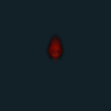
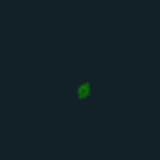
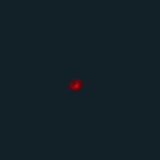
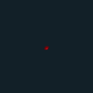
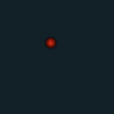
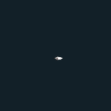

# VFX GIF 15 / 18

[목록으로](README.md) · [이전](gallery-14.md) · [다음](gallery-16.md)

모두 원본 데이터로 만든 2D 근사 미리보기입니다. 각 GIF를 클릭하면 개별 파일을 열 수 있습니다.

## FX_Slime_Projectile_Area_R

분류 `Skill` · 파티클 9개 · 표시 프레임 23/32

원본 경로: `Assets/InHouse/Fxs/Skill/Prefab/FX_Slime_Projectile_Area_R.prefab`

[GIF 파일](../../../public/rpg/vfx/previews/FX_Slime_Projectile_Area_R.gif) · [원본 프리팹 설정 gzip](../../../archive/rpg/vfx/prefabs/FX_Slime_Projectile_Area_R.json.gz)

## FX_Slime_Projectile_L_B

분류 `Skill` · 파티클 3개 · 표시 프레임 30/32

원본 경로: `Assets/InHouse/Fxs/Skill/Prefab/FX_Slime_Projectile_L_B.prefab`

[GIF 파일](../../../public/rpg/vfx/previews/FX_Slime_Projectile_L_B.gif) · [원본 프리팹 설정 gzip](../../../archive/rpg/vfx/prefabs/FX_Slime_Projectile_L_B.json.gz)

## FX_Slime_Projectile_L_G

분류 `Skill` · 파티클 3개 · 표시 프레임 30/32

원본 경로: `Assets/InHouse/Fxs/Skill/Prefab/FX_Slime_Projectile_L_G.prefab`

[GIF 파일](../../../public/rpg/vfx/previews/FX_Slime_Projectile_L_G.gif) · [원본 프리팹 설정 gzip](../../../archive/rpg/vfx/prefabs/FX_Slime_Projectile_L_G.json.gz)

## FX_Slime_Projectile_L_R

분류 `Skill` · 파티클 3개 · 표시 프레임 29/32

원본 경로: `Assets/InHouse/Fxs/Skill/Prefab/FX_Slime_Projectile_L_R.prefab`

[GIF 파일](../../../public/rpg/vfx/previews/FX_Slime_Projectile_L_R.gif) · [원본 프리팹 설정 gzip](../../../archive/rpg/vfx/prefabs/FX_Slime_Projectile_L_R.json.gz)

## FX_Slime_Projectile_S_B

분류 `Skill` · 파티클 3개 · 표시 프레임 30/32

원본 경로: `Assets/InHouse/Fxs/Skill/Prefab/FX_Slime_Projectile_S_B.prefab`

[GIF 파일](../../../public/rpg/vfx/previews/FX_Slime_Projectile_S_B.gif) · [원본 프리팹 설정 gzip](../../../archive/rpg/vfx/prefabs/FX_Slime_Projectile_S_B.json.gz)

## FX_Slime_Projectile_S_G

분류 `Skill` · 파티클 3개 · 표시 프레임 29/32

원본 경로: `Assets/InHouse/Fxs/Skill/Prefab/FX_Slime_Projectile_S_G.prefab`

[GIF 파일](../../../public/rpg/vfx/previews/FX_Slime_Projectile_S_G.gif) · [원본 프리팹 설정 gzip](../../../archive/rpg/vfx/prefabs/FX_Slime_Projectile_S_G.json.gz)

## FX_Slime_Projectile_S_R

분류 `Skill` · 파티클 3개 · 표시 프레임 29/32

원본 경로: `Assets/InHouse/Fxs/Skill/Prefab/FX_Slime_Projectile_S_R.prefab`

[GIF 파일](../../../public/rpg/vfx/previews/FX_Slime_Projectile_S_R.gif) · [원본 프리팹 설정 gzip](../../../archive/rpg/vfx/prefabs/FX_Slime_Projectile_S_R.json.gz)

## FX_Slime_Spawn_01_B

분류 `Skill` · 파티클 2개 · 표시 프레임 10/32

원본 경로: `Assets/InHouse/Fxs/Skill/Prefab/FX_Slime_Spawn_01_B.prefab`

[GIF 파일](../../../public/rpg/vfx/previews/FX_Slime_Spawn_01_B.gif) · [원본 프리팹 설정 gzip](../../../archive/rpg/vfx/prefabs/FX_Slime_Spawn_01_B.json.gz)

## FX_Slime_Spawn_01_G

분류 `Skill` · 파티클 2개 · 표시 프레임 10/32

원본 경로: `Assets/InHouse/Fxs/Skill/Prefab/FX_Slime_Spawn_01_G.prefab`

[GIF 파일](../../../public/rpg/vfx/previews/FX_Slime_Spawn_01_G.gif) · [원본 프리팹 설정 gzip](../../../archive/rpg/vfx/prefabs/FX_Slime_Spawn_01_G.json.gz)

## FX_Slime_Spawn_01_R

분류 `Skill` · 파티클 2개 · 표시 프레임 10/32

원본 경로: `Assets/InHouse/Fxs/Skill/Prefab/FX_Slime_Spawn_01_R.prefab`

[GIF 파일](../../../public/rpg/vfx/previews/FX_Slime_Spawn_01_R.gif) · [원본 프리팹 설정 gzip](../../../archive/rpg/vfx/prefabs/FX_Slime_Spawn_01_R.json.gz)

## FX_Slime_VerticalDamage_01_B

분류 `Skill` · 파티클 9개 · 표시 프레임 20/32

원본 경로: `Assets/InHouse/Fxs/Skill/Prefab/FX_Slime_VerticalDamage_01_B.prefab`

[GIF 파일](../../../public/rpg/vfx/previews/FX_Slime_VerticalDamage_01_B.gif) · [원본 프리팹 설정 gzip](../../../archive/rpg/vfx/prefabs/FX_Slime_VerticalDamage_01_B.json.gz)

## FX_Slime_VerticalDamage_01_G

분류 `Skill` · 파티클 8개 · 표시 프레임 26/32

원본 경로: `Assets/InHouse/Fxs/Skill/Prefab/FX_Slime_VerticalDamage_01_G.prefab`

[GIF 파일](../../../public/rpg/vfx/previews/FX_Slime_VerticalDamage_01_G.gif) · [원본 프리팹 설정 gzip](../../../archive/rpg/vfx/prefabs/FX_Slime_VerticalDamage_01_G.json.gz)

## FX_Slime_VerticalDamage_01_R

분류 `Skill` · 파티클 8개 · 표시 프레임 24/32

원본 경로: `Assets/InHouse/Fxs/Skill/Prefab/FX_Slime_VerticalDamage_01_R.prefab`

[GIF 파일](../../../public/rpg/vfx/previews/FX_Slime_VerticalDamage_01_R.gif) · [원본 프리팹 설정 gzip](../../../archive/rpg/vfx/prefabs/FX_Slime_VerticalDamage_01_R.json.gz)

## FX_SpecterGoblin_Skill1_01

분류 `Skill` · 파티클 12개 · 표시 프레임 32/32

원본 경로: `Assets/InHouse/Fxs/Skill/Prefab/FX_SpecterGoblin_Skill1_01.prefab`

[GIF 파일](../../../public/rpg/vfx/previews/FX_SpecterGoblin_Skill1_01.gif) · [원본 프리팹 설정 gzip](../../../archive/rpg/vfx/prefabs/FX_SpecterGoblin_Skill1_01.json.gz)

## FX_SpecterGoblin_Skill2_01

분류 `Skill` · 파티클 28개 · 표시 프레임 18/32

원본 경로: `Assets/InHouse/Fxs/Skill/Prefab/FX_SpecterGoblin_Skill2_01.prefab`

[GIF 파일](../../../public/rpg/vfx/previews/FX_SpecterGoblin_Skill2_01.gif) · [원본 프리팹 설정 gzip](../../../archive/rpg/vfx/prefabs/FX_SpecterGoblin_Skill2_01.json.gz)

## FX_SpecterGoblin_Skill3_01

분류 `Skill` · 파티클 2개 · 표시 프레임 16/32

원본 경로: `Assets/InHouse/Fxs/Skill/Prefab/FX_SpecterGoblin_Skill3_01.prefab`

[GIF 파일](../../../public/rpg/vfx/previews/FX_SpecterGoblin_Skill3_01.gif) · [원본 프리팹 설정 gzip](../../../archive/rpg/vfx/prefabs/FX_SpecterGoblin_Skill3_01.json.gz)

## FX_SpecterGoblin_Skill3_Damage01

분류 `Skill` · 파티클 6개 · 표시 프레임 12/32

원본 경로: `Assets/InHouse/Fxs/Skill/Prefab/FX_SpecterGoblin_Skill3_Damage01.prefab`

[GIF 파일](../../../public/rpg/vfx/previews/FX_SpecterGoblin_Skill3_Damage01.gif) · [원본 프리팹 설정 gzip](../../../archive/rpg/vfx/prefabs/FX_SpecterGoblin_Skill3_Damage01.json.gz)

## FX_SpecterGoblin_Skill3_Damage02

분류 `Skill` · 파티클 2개 · 표시 프레임 16/32

원본 경로: `Assets/InHouse/Fxs/Skill/Prefab/FX_SpecterGoblin_Skill3_Damage02.prefab`

[GIF 파일](../../../public/rpg/vfx/previews/FX_SpecterGoblin_Skill3_Damage02.gif) · [원본 프리팹 설정 gzip](../../../archive/rpg/vfx/prefabs/FX_SpecterGoblin_Skill3_Damage02.json.gz)

## FX_SpecterGoblin_Skill4_01

분류 `Skill` · 파티클 9개 · 표시 프레임 32/32

원본 경로: `Assets/InHouse/Fxs/Skill/Prefab/FX_SpecterGoblin_Skill4_01.prefab`

[GIF 파일](../../../public/rpg/vfx/previews/FX_SpecterGoblin_Skill4_01.gif) · [원본 프리팹 설정 gzip](../../../archive/rpg/vfx/prefabs/FX_SpecterGoblin_Skill4_01.json.gz)

## FX_SpecterGoblin_Skill4_02

분류 `Skill` · 파티클 26개 · 표시 프레임 32/32

원본 경로: `Assets/InHouse/Fxs/Skill/Prefab/FX_SpecterGoblin_Skill4_02.prefab`

[GIF 파일](../../../public/rpg/vfx/previews/FX_SpecterGoblin_Skill4_02.gif) · [원본 프리팹 설정 gzip](../../../archive/rpg/vfx/prefabs/FX_SpecterGoblin_Skill4_02.json.gz)

