# VFX GIF 16 / 18

[목록으로](README.md) · [이전](gallery-15.md) · [다음](gallery-17.md)

모두 원본 데이터로 만든 2D 근사 미리보기입니다. 각 GIF를 클릭하면 개별 파일을 열 수 있습니다.

## FX_StatueTrap01_Attack01

분류 `Skill` · 파티클 9개 · 표시 프레임 30/32

원본 경로: `Assets/InHouse/Fxs/Skill/Prefab/FX_StatueTrap01_Attack01.prefab`

[GIF 파일](../../../public/rpg/vfx/previews/FX_StatueTrap01_Attack01.gif) · [원본 프리팹 설정 gzip](../../../archive/rpg/vfx/prefabs/FX_StatueTrap01_Attack01.json.gz)

## FX_StatueTrap01_Attack01_Hit

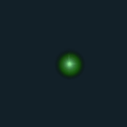

분류 `Skill` · 파티클 9개 · 표시 프레임 11/32

원본 경로: `Assets/InHouse/Fxs/Skill/Prefab/FX_StatueTrap01_Attack01_Hit.prefab`

[GIF 파일](../../../public/rpg/vfx/previews/FX_StatueTrap01_Attack01_Hit.gif) · [원본 프리팹 설정 gzip](../../../archive/rpg/vfx/prefabs/FX_StatueTrap01_Attack01_Hit.json.gz)

## FX_StonePunchDamage01

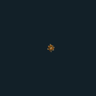

분류 `Skill` · 파티클 13개 · 표시 프레임 19/32

원본 경로: `Assets/InHouse/Fxs/Skill/Prefab/FX_StonePunchDamage01.prefab`

[GIF 파일](../../../public/rpg/vfx/previews/FX_StonePunchDamage01.gif) · [원본 프리팹 설정 gzip](../../../archive/rpg/vfx/prefabs/FX_StonePunchDamage01.json.gz)

## FX_StonePunch_01

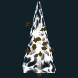

분류 `Skill` · 파티클 4개 · 표시 프레임 32/32

원본 경로: `Assets/InHouse/Fxs/Skill/Prefab/FX_StonePunch_01.prefab`

[GIF 파일](../../../public/rpg/vfx/previews/FX_StonePunch_01.gif) · [원본 프리팹 설정 gzip](../../../archive/rpg/vfx/prefabs/FX_StonePunch_01.json.gz)

## FX_StonePunch_03

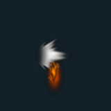

분류 `Skill` · 파티클 16개 · 표시 프레임 32/32

원본 경로: `Assets/InHouse/Fxs/Skill/Prefab/FX_StonePunch_03.prefab`

[GIF 파일](../../../public/rpg/vfx/previews/FX_StonePunch_03.gif) · [원본 프리팹 설정 gzip](../../../archive/rpg/vfx/prefabs/FX_StonePunch_03.json.gz)

## FX_StoneSpearAttack_01

분류 `Skill` · 파티클 3개 · 표시 프레임 32/32

원본 경로: `Assets/InHouse/Fxs/Skill/Prefab/FX_StoneSpearAttack_01.prefab`

[GIF 파일](../../../public/rpg/vfx/previews/FX_StoneSpearAttack_01.gif) · [원본 프리팹 설정 gzip](../../../archive/rpg/vfx/prefabs/FX_StoneSpearAttack_01.json.gz)

## FX_StoneSpearDamage01

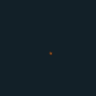

분류 `Skill` · 파티클 7개 · 표시 프레임 23/32

원본 경로: `Assets/InHouse/Fxs/Skill/Prefab/FX_StoneSpearDamage01.prefab`

[GIF 파일](../../../public/rpg/vfx/previews/FX_StoneSpearDamage01.gif) · [원본 프리팹 설정 gzip](../../../archive/rpg/vfx/prefabs/FX_StoneSpearDamage01.json.gz)

## FX_StoneWake

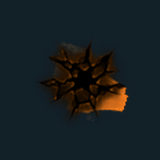

분류 `Skill` · 파티클 9개 · 표시 프레임 32/32

원본 경로: `Assets/InHouse/Fxs/Skill/Prefab/FX_StoneWake.prefab`

[GIF 파일](../../../public/rpg/vfx/previews/FX_StoneWake.gif) · [원본 프리팹 설정 gzip](../../../archive/rpg/vfx/prefabs/FX_StoneWake.json.gz)

## FX_StoneWake_Cast_01

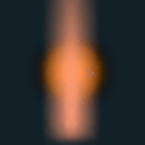

분류 `Skill` · 파티클 7개 · 표시 프레임 17/32

원본 경로: `Assets/InHouse/Fxs/Skill/Prefab/FX_StoneWake_Cast_01.prefab`

[GIF 파일](../../../public/rpg/vfx/previews/FX_StoneWake_Cast_01.gif) · [원본 프리팹 설정 gzip](../../../archive/rpg/vfx/prefabs/FX_StoneWake_Cast_01.json.gz)

## FX_Stone_ProjectileDamage01

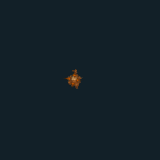

분류 `Skill` · 파티클 6개 · 표시 프레임 17/32

원본 경로: `Assets/InHouse/Fxs/Skill/Prefab/FX_Stone_ProjectileDamage01.prefab`

[GIF 파일](../../../public/rpg/vfx/previews/FX_Stone_ProjectileDamage01.gif) · [원본 프리팹 설정 gzip](../../../archive/rpg/vfx/prefabs/FX_Stone_ProjectileDamage01.json.gz)

## FX_Stone_ProjectileDamage02

분류 `Skill` · 파티클 6개 · 표시 프레임 19/32

원본 경로: `Assets/InHouse/Fxs/Skill/Prefab/FX_Stone_ProjectileDamage02.prefab`

[GIF 파일](../../../public/rpg/vfx/previews/FX_Stone_ProjectileDamage02.gif) · [원본 프리팹 설정 gzip](../../../archive/rpg/vfx/prefabs/FX_Stone_ProjectileDamage02.json.gz)

## FX_Stone_Projectile_Area_01_R

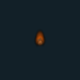

분류 `Skill` · 파티클 13개 · 표시 프레임 29/32

원본 경로: `Assets/InHouse/Fxs/Skill/Prefab/FX_Stone_Projectile_Area_01_R.prefab`

[GIF 파일](../../../public/rpg/vfx/previews/FX_Stone_Projectile_Area_01_R.gif) · [원본 프리팹 설정 gzip](../../../archive/rpg/vfx/prefabs/FX_Stone_Projectile_Area_01_R.json.gz)

## FX_Stone_Projectile_L

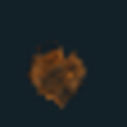

분류 `Skill` · 파티클 5개 · 표시 프레임 29/32

원본 경로: `Assets/InHouse/Fxs/Skill/Prefab/FX_Stone_Projectile_L.prefab`

[GIF 파일](../../../public/rpg/vfx/previews/FX_Stone_Projectile_L.gif) · [원본 프리팹 설정 gzip](../../../archive/rpg/vfx/prefabs/FX_Stone_Projectile_L.json.gz)

## FX_Stone_Projectile_S

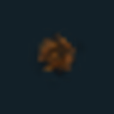

분류 `Skill` · 파티클 3개 · 표시 프레임 17/32

원본 경로: `Assets/InHouse/Fxs/Skill/Prefab/FX_Stone_Projectile_S.prefab`

[GIF 파일](../../../public/rpg/vfx/previews/FX_Stone_Projectile_S.gif) · [원본 프리팹 설정 gzip](../../../archive/rpg/vfx/prefabs/FX_Stone_Projectile_S.json.gz)

## FX_StrikerGoblin_Skill1

분류 `Skill` · 파티클 9개 · 표시 프레임 32/32

원본 경로: `Assets/InHouse/Fxs/Skill/Prefab/FX_StrikerGoblin_Skill1.prefab`

[GIF 파일](../../../public/rpg/vfx/previews/FX_StrikerGoblin_Skill1.gif) · [원본 프리팹 설정 gzip](../../../archive/rpg/vfx/prefabs/FX_StrikerGoblin_Skill1.json.gz)

## FX_StrikerGoblin_Skill2

분류 `Skill` · 파티클 11개 · 표시 프레임 30/32

원본 경로: `Assets/InHouse/Fxs/Skill/Prefab/FX_StrikerGoblin_Skill2.prefab`

[GIF 파일](../../../public/rpg/vfx/previews/FX_StrikerGoblin_Skill2.gif) · [원본 프리팹 설정 gzip](../../../archive/rpg/vfx/prefabs/FX_StrikerGoblin_Skill2.json.gz)

## FX_TornadoHit_01

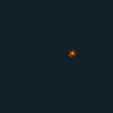

분류 `Skill` · 파티클 6개 · 표시 프레임 22/32

원본 경로: `Assets/InHouse/Fxs/Skill/Prefab/FX_TornadoHit_01.prefab`

[GIF 파일](../../../public/rpg/vfx/previews/FX_TornadoHit_01.gif) · [원본 프리팹 설정 gzip](../../../archive/rpg/vfx/prefabs/FX_TornadoHit_01.json.gz)

## FX_TornadoHit_02

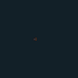

분류 `Skill` · 파티클 6개 · 표시 프레임 22/32

원본 경로: `Assets/InHouse/Fxs/Skill/Prefab/FX_TornadoHit_02.prefab`

[GIF 파일](../../../public/rpg/vfx/previews/FX_TornadoHit_02.gif) · [원본 프리팹 설정 gzip](../../../archive/rpg/vfx/prefabs/FX_TornadoHit_02.json.gz)

## FX_TornadoHit_02_BL

분류 `Skill` · 파티클 6개 · 표시 프레임 18/32

원본 경로: `Assets/InHouse/Fxs/Skill/Prefab/FX_TornadoHit_02_BL.prefab`

[GIF 파일](../../../public/rpg/vfx/previews/FX_TornadoHit_02_BL.gif) · [원본 프리팹 설정 gzip](../../../archive/rpg/vfx/prefabs/FX_TornadoHit_02_BL.json.gz)

## FX_TornadoHit_02_GR

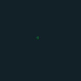

분류 `Skill` · 파티클 6개 · 표시 프레임 22/32

원본 경로: `Assets/InHouse/Fxs/Skill/Prefab/FX_TornadoHit_02_GR.prefab`

[GIF 파일](../../../public/rpg/vfx/previews/FX_TornadoHit_02_GR.gif) · [원본 프리팹 설정 gzip](../../../archive/rpg/vfx/prefabs/FX_TornadoHit_02_GR.json.gz)

