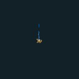

# VFX GIF 18 / 18

[목록으로](README.md) · [이전](gallery-17.md)

모두 원본 데이터로 만든 2D 근사 미리보기입니다. 각 GIF를 클릭하면 개별 파일을 열 수 있습니다.

## FX_Whirlwind_03_L

분류 `Skill` · 파티클 7개 · 표시 프레임 32/32

원본 경로: `Assets/InHouse/Fxs/Skill/Prefab/FX_Whirlwind_03_L.prefab`

[GIF 파일](../../../public/rpg/vfx/previews/FX_Whirlwind_03_L.gif) · [원본 프리팹 설정 gzip](../../../archive/rpg/vfx/prefabs/FX_Whirlwind_03_L.json.gz)

## FX_Whirlwind_Lightning_01

분류 `Skill` · 파티클 10개 · 표시 프레임 32/32

원본 경로: `Assets/InHouse/Fxs/Skill/Prefab/FX_Whirlwind_Lightning_01.prefab`

[GIF 파일](../../../public/rpg/vfx/previews/FX_Whirlwind_Lightning_01.gif) · [원본 프리팹 설정 gzip](../../../archive/rpg/vfx/prefabs/FX_Whirlwind_Lightning_01.json.gz)

## FX_Whirlwind_Lightning_Damage 1

분류 `Skill` · 파티클 4개 · 표시 프레임 8/32

원본 경로: `Assets/InHouse/Fxs/Skill/Prefab/FX_Whirlwind_Lightning_Damage 1.prefab`

[GIF 파일](../../../public/rpg/vfx/previews/FX_Whirlwind_Lightning_Damage-1.gif) · [원본 프리팹 설정 gzip](../../../archive/rpg/vfx/prefabs/FX_Whirlwind_Lightning_Damage-1.json.gz)

