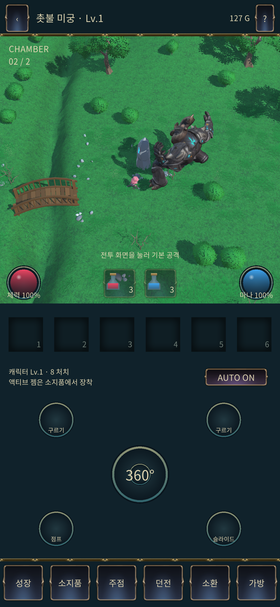

# 전투 안정화 빌드·배포 검증 — 2026-11-07

## 완료된 결과

- **PASS — Unity 적용:** 실제 `G:/new_project/IslandGame`의 Runtime 수정 8개가 소스 커밋 `7adb404f47ea73383f26651a8eaaa261ed4bc823` 및 manifest와 일치한다. 컴파일 실패 없음, Play 종료, 씬 dirty 없음, Profiler 꺼짐. 테스트 전 계정·쿠키·서버 설정과 Game View 크기를 복원했다. CLI beta.16 유지.
- **PASS — 회귀:** [GitHub 전체 회귀 검사](https://github.com/mist2finer-spec/holdem_coin/actions/runs/42380740590) 성공. Unity 실제 화면 검사는 68초·4,033프레임·6개 항목 모두 통과했다. [구현·실측·미검증 경계](COMBAT_STABILITY_20261107_KO.md)를 함께 확인한다.
- **PASS — Android 빌드:** Unity BuildPipeline 결과 `Succeeded`, 약 430초, 오류 0, 경고 1(기존 `IslandApp.lastDeal` 미사용 필드). ARM64 / IL2CPP OptimizeSpeed / Development·Debugging·Profiler 연결 모두 꺼짐.
- **PASS — APK 파일:** 패키지 `com.mist2finer.islandgame.dev`, 버전 `0.1.0-test.20261107.1`, versionCode `2026110701`. 기존 개발용 패키지·서명을 유지했다. ZIP 무결성, IL2CPP/Unity 라이브러리, 시작 Activity, 서명, 16KB ZIP 정렬, INTERNET 권한 검사 통과.
- **PASS — APK 공개 테스트 배포:** [GitHub 테스트 릴리스](https://github.com/mist2finer-spec/holdem_coin/releases/tag/unity-combat-stability-20261107.1). APK 100,482,614 bytes. GitHub asset digest와 로컬 SHA-256이 일치한다. 스토어 등록이나 휴대폰 설치 완료를 의미하지 않는다.

[APK 다운로드](https://github.com/mist2finer-spec/holdem_coin/releases/download/unity-combat-stability-20261107.1/IslandGame-Combat-Stability-20261107.apk)

SHA-256: `6cf0f554799b1f4fd9ec5b7a79ad0a00d1dfaa976c819b0f1dd325d877b75996`

로컬 APK: `G:/new_project/IslandGame/Builds/Android/IslandGame-Combat-Stability-20261107.apk`

## main·Render 상태

**승인 대기:** 자동 승인 검토가 main 푸시를 거부했다. 사유는 “GitHub 푸시 요청은 있지만 기본 main 반영까지 명시적 승인이 없다”는 판단이다. 사용자에게 검증된 커밋의 main 반영 및 Test place 자동 배포 승인을 요청했다. 우회 실행하지 않았다.

확인 시점 main은 `a2be2d9087b7e478f3988581b1fedba3875cf857`, Render Test place의 `holdem-coin-tavern`은 기존 `ffde9d1a33b1931c3aa09fe72bc5ef7f4df8213c` / `dep-dbn9bdm8bjmc73a1gq2g`가 live다. 서버 변경 코드는 `fix/combat-stability-20261107`에 푸시되어 있다. 새 ACK·쿠키 변경의 운영 배포 및 운영 재검증은 아직 완료되지 않았다. APK는 구 서버의 ACK 생략에 대응하는 표시 fallback을 포함한다.

승인 후 순서: 검증 소스 커밋을 main으로 fast-forward → 기존 자동 배포를 LIVE까지 확인 → `/api/release`의 리비전과 `/healthz` 확인 → 새 격리 게스트로 실제 훈련 전투·ACK·tick 쿠키 생략 및 Editor 통신 확인 → 배포 기록 갱신. 중복 수동 Render 배포를 생성하지 않는다.

## 검증 자료와 남은 범위

`verification/combat-stability-20261107`에 빌드 요약, APK 검사, CI, 소스 해시, 네트워크 손실, 렌더 실측, 실제 화면 결과와 대표 캡처를 보관했다. 전체 Profiler 원본은 `C:/Users/SHK/island-combat-stability-20261107/combat-editor-profiler-20261107.zip`에 별도로 보관한다. 5초 캡처 오버헤드는 수치 비교에 포함하지 않았다.

**UNAVAILABLE:** 연결된 ADB 기기가 없어 Android 실기 FPS·GPU·발열·10~15분 연속 플레이는 미검증이다. Editor 진단 p95 18.76ms와 드물게 40ms 프레임이 남았으므로 지속적인 60FPS를 달성했다고 주장하지 않는다. 아트 및 사용자 체감의 최종 승인은 별도다.
