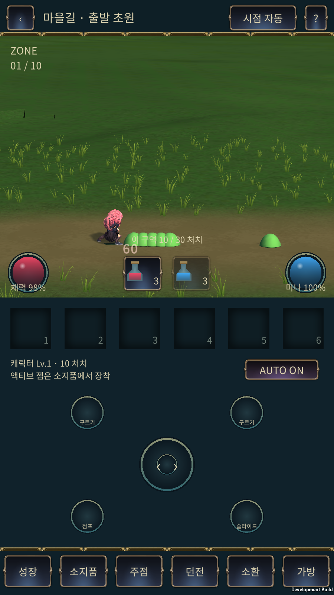
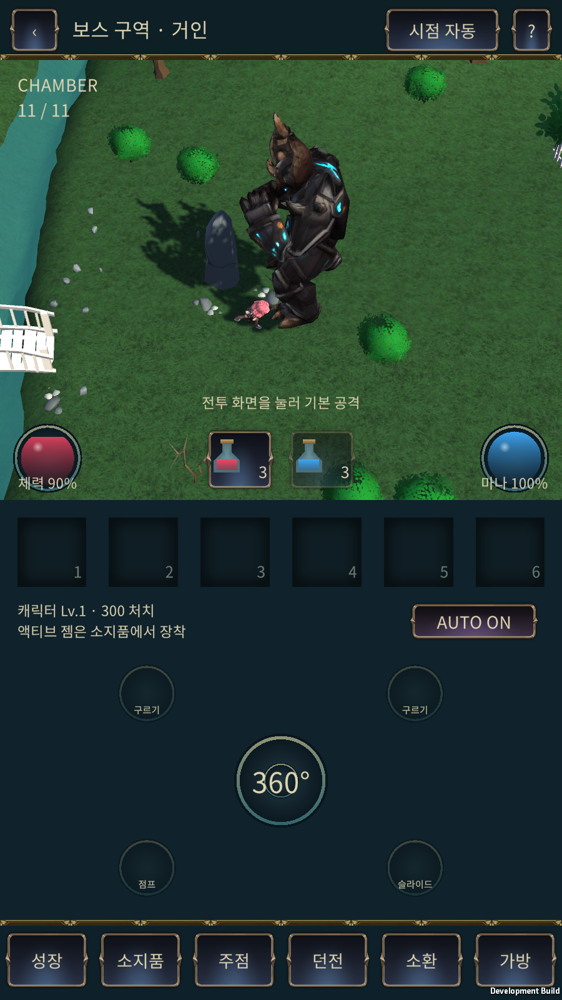
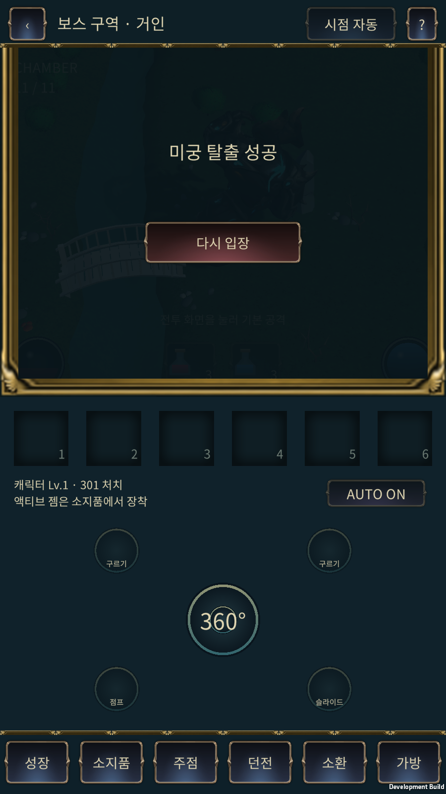

# 일반 공격 접촉 · 보스 연결 · 점프/회피 인계 — 2026-11-09 UTC

작업 기준 `7f47d56`(슬라임/가림 수정), 그 부모 스트리밍 `b1bd9ad`, main `b0b822f`. 브랜치 `codex/mount-contact-boss-20261109`. 실제 Unity `G:/new_project/IslandGame`, 서버 체크아웃 `G:/new_project/holdem-mount-stream-20261108`. 운영 서버 교체·Render 배포·main 병합은 하지 않았다.

## 결과와 변경 목록

| 요청 | 구현 |
|---|---|
| 일반 공격 시점 | 서버의 검 선분+반경과 적 캡슐이 실제 접촉한 순간에 피해. 각 attackId의 hitIds로 같은 적 중복 피해 차단. 스킬의 기존 별도 타격 규칙 유지 |
| 좌향 공격 | 화면의 측면 미러와 서버의 180도 회전에서 깊이축이 달랐던 문제 수정. 측면은 검 로컬 X를 깊이 반전으로 매핑 |
| 표시 동기 | 확정 snapshot을 약160ms 지연 보간. 검 포즈·적 위치·HP·피해 숫자·섬광이 같은 contactAt을 사용. 기존 최대450ms 공격 외삽과 적 위치의 추가 Lerp 지연 제거 |
| 보스 위치 | **일반 10구역의 30마리를 모두 처치하고 오른쪽 출구에 도달하면 보스 구역(표시11/11)**. 기존 거인 모델·전투·Nature 맵 사용 |
| 보스 전환 | 서버 boss-loading → Unity 기존 Mount 씬 해제·보스 근처 환경 준비 → readyBoss → 전투 공개. 대기 중 AI/전투 시간 정지 |
| 시점 | 일반1~10은 측면·레인, 살아 있는 보스 방은 쿼터·평면. 기존 보스 처치 후 측면 복귀 유지 |
| 회피 | 회피 도중 몸통·정적 물체를 넘을 수 있음. 끝점이 벽이면 이동 경로의 빈 지점으로 복귀 |
| 점프 | 최고 발높이1m, 캐릭터 몸 높이1.3m 기준 수직/수평 겹침 검사. 낮은 슬라임을 넘고, 높이2m 물체와 높이 미정 물체는 통과하지 않음 |
| 착지 | 겹치는 몬스터를 필요한 거리만 밀며 최대.85m 제한. 경계·다른 몸통·벽과 이동 중 벽 통과를 검사. 후보 실패는 좌표를 변경하지 않는 방식으로 처리 |
| 기존 수정 | 슬라임1.15m/s·.31m 높이·.125m 반경, 일반 몸통 충돌, 9구역 전경 디더 유지 |
| 문서 | 사용자 PDF 바이트 그대로 보관, PR #9 원문2개 통합, 참고 영상6프레임/화면색 표본, 별도 에셋 담당 인계 |

[에셋 담당 시작 문서](assets/video-style/ASSET_AGENT_HANDOFF_20261109_KO.md). **이번에는 신규 에셋을 제작/반입하지 않았다.** 영상 스타일의 완성된 마을·풀·HUD로 바뀐 결과가 아니다.

## 보스 구역 계약

Mount wrapper의 `room=10`, `map.zone=10`, `routeZone=10`, `routeStage=boss`, `roomKind=boss`이다. 재사용한 UnityBossEngine 내부 방 번호는 `room=1`이다. 따라서 화면 구역 번호는 `routeZone+1`을 사용한다. 'room1이므로 전체 경로2구역'으로 해석하면 안 된다. 맵의 environment가 바뀌면 NativeBattle이 같은 sessionId여도 환경을 재구축한다.

보스는 이번 Mount 테스트에서 HP1800이며 기존 독립 보스 테스트의 높은 훈련 HP는 유지한다. 플레이어 HP·마나/물약·쿨다운·장착스킬 상태를 넘긴다. 훈련 경로는 영구 골드·아이템 정산을 변경하지 않는다. readyBoss는 재전송 digest에 포함되므로 같은 sequence에서 값만 바꿔 보낸 요청은 거부한다.

`Battle3DView.BossEnvironmentReady`는 기존 Terrain, 보스/플레이어, 주변38m 청크, Mount 씬0개를 확인한다. 서버가 준비를 받기 전에는 화면 암전과 전투 대기를 유지한다. 새 에셋 로더나 Addressables 시스템으로 갈아끼우지 않았다.

## 접촉 시점의 원인과 검증 범위

처음 의심했던 애니메이션 리타이밍은 추출 도구와 실행 코드가 같은 수식을 썼다. 실제 문제는 미확정 시간의 표시 외삽, 적의 이중 보간, 왼쪽 측면의 좌표 미러 차이였다. 모델·원본 클립·무기 본을 바꾸지 않았다.

`CombatSnapshotBuffer`는 최대12개 상태를 보관하며 session/routeStage/room이 바뀌면 초기화한다. 확정된 마지막 시간 이후로 피해를 예측하지 않는다. 일반 공격·HP·숫자에 같은 표시 상태를 전달한다. 약160ms의 표시 지연이 있으므로 네트워크 왕복이 이를 넘거나 응답이 끊기면 확인된 시점에서 멈추거나 늦게 표시될 수 있다. 모든 네트워크에서 지연0이라는 보장은 아니다. 일반 이동의 기존 입력 예측은 유지하되 공격/도약 중에는 권위 경로를 사용한다.

서버에서 같은 공격이 여러 적과 접촉하면 적마다1회 들어갈 수 있다. 한 번 피해가 들어간 적에 대해서는 다음 attackId 전까지 추가 피해가 없다. 이것을 '전체 공격에서 적1마리만 맞음'으로 바꾸지 않는다.

## 코드·검사 — PASS

- 서버 회귀 **56/56**: 일반10구역300처치, 최대6마리, 측면 고정, 속도·몸통, 빗나감/중복 공격, 낮은 몸통 점프·높은 장애물 차단·착지 밀림·벽/경계 보호·보스 준비/처치, 인증/순서/동일재전송/readyBoss 변조/영구경제 보호.
- TypeScript RPG 검사 PASS. Unity compile 오류0.
- 실행 중 실제 검 본을 공격3종×좌우×31시점=**186포즈**로 서버 프로파일과 비교. 최대끝점오차 `2.81154541e-7m`. 이는 샘플링된 접촉 구간의 포즈 비교이며 모든 프레임의 네트워크 측정이 아니다.
- 표시 버퍼45회 검사에서 피해 선반영0. 추가로 응답 정지·시간 단조증가·일시정지·보스 시간 초기화 확인.
- Unity Play에서 보스 active, QuarterView, 환경 준비true, Mount 씬0개, 현재 Console 오류0 확인. 도구가 누적 보관한 이전 오류 수치와 현재 Console은 구분했다.

재현: 저장소 의존성 설치 후 `node --import tsx --test scripts/rpg/test-unity-boss.ts scripts/rpg/test-unity-boss-route.ts scripts/rpg/test-boss-contact.ts scripts/rpg/test-combat-view-contract.ts scripts/rpg/test-mount-sunday.ts scripts/rpg/test-mount-route.ts scripts/rpg/test-mount-traversal.ts`, `npm run check:rpg`. 이 PC는 기존 설치 의존성의 TSX loader와 NODE_PATH를 지정했다. 실행 로그에 전체 테스트명이 있다.

## Android 확인

최종 결과와 APK 해시는 아래 자동 수집 부록에 기록한다. 초기 `.1`에서 일반 접촉16회/잘못된 포즈0/최대15.6ms, 점프·회피 실터치 통과를 확인했으나, 보스 지형이 Android에서 보이지 않아 최종본으로 채택하지 않았다.

Terrain이 Resources에서만 로드되던 경로의 빌드 의존성을 보존하도록 `RuntimeTerrainBuildSupport`가 빌드용 Island 씬에만 비활성 Terrain 참조를 넣는다. 저장된 사용자 씬을 변경하지 않는다. 기존 KeepTerrain 재질의 인스턴싱 변형도 유지한다. Unity의 [인스턴싱 변형 제거 규칙](https://docs.unity3d.com/es/current/Manual/class-GraphicsSettings.html)을 근거로 조사했고, 최종 판단은 재빌드한 실제 화면으로 한다.

테스트 서버는 메모리 저장소·격리 계정이다. `18108`은 정상 시작, `18110`은 10구역 끝에서 시작하는 보스 전환 fixture, `18111`은 슬라임1마리/자동공격off인 조작 fixture다. fixture는 제품 엔진의 구역 건너뛰기 기능으로 추가하지 않았다. BlueStacks는 `emulator-5554`,900×1600. 기기가 보고한 OnePlus/Adreno 명칭을 실제 휴대폰 측정으로 해석하지 않는다.

## 다음 에이전트의 적용 순서

1. 이 브랜치의 서버와 [Unity 증분 패치](client-source-snapshot/2026-11-09-contact-boss/README_KO.md)를 함께 대조한다. 기존 사용자 수정과 해시가 다르면 병합한다. 전체 프로젝트 덮어쓰기 금지.
2. 빌드 지원 Editor 코드와 KeepTerrain 설정까지 반영한다. 보스 모델만 나타나고 바닥이 사라지는 APK를 통과 처리하지 않는다.
3. 정상 시작으로 일반10구역 → 보스까지 장시간 기기 완주, 재입장, 로드 실패/복구, 응답 유실/긴 RTT, 중첩 착지 상황을 확대 검증한다. 서버 가속 완주와 Android 짧은 fixture 검증을 구분한다.
4. 실제 폰2대에서20분, p95/p99, 메모리, 발열, 배터리를 측정한다. 현재 BlueStacks 수치만으로 모바일 예산을 늘리지 않는다.
5. 아트 담당은 별도 통합 문서의 HUD·팔레트·천막/화로 검토 계획을 따른다. 에셋 제작 재개 지시 전까지 신규 자산을 추가하지 않는다.

남은 위험/미검증: 실제 휴대폰, 오디오 청취, 다양한 통신조건의 장시간 접촉 판독, 모든 구역 물체별 높이 예술적 검수, 극단적으로 꽉 찬 공간의 착지 UX. 높이를 모르는 장애물은 보수적으로 점프로 넘지 못한다. 영상과 같은 환경 미술 완성·미술 최종 승인은 이번 범위가 아니다.

## 최종 빌드·실제 화면 결과 — PASS

- APK **0.1.0-test.20261109.2 / 2026110902**, ARM64 IL2CPP Development. 빌드 오류0, 경고1(`IslandApp.lastDeal` 기존 미사용 필드 CS0414). ZIP 무결성·서명·16KB ZIP 정렬 PASS.
- 파일 `G:\new_project\IslandGame\Builds\Android\IslandGame-ContactBoss-20261109.apk`, **135,039,884 bytes**, SHA-256 `919a3c14295ba6579442bc3296816f721697ac1c7b78a707a533381d65092fc4`. `.1`의 지형 누락 수정 후 다시 빌드·업데이트 설치한 최종본이다.
- 일반 구역 30.7초: 확정 일반 공격 접촉 **16회**, 공격 ID/활성 포즈 불일치 **0회**, contactAt 대비 효과 표시 최대 **28.9ms**. 준비15초 제외 평균 **59.87FPS**, p95 **16.67ms**, 오류0, 지면 미검출0, Mount 씬 최대2.
- 보스 fixture: 마지막 일반 구역 로드 → boss-loading → Mount 씬0 → QuarterView → 기존 지형/보스 표시 → 자동 전투 처치완료 `won`. 약 **71.9초** 관찰, 전투 시뮬레이션67.72초. 오류 **0**, 지면 미검출 **0**. 최종 보스 화면의 지형·다리·나무·플레이어·거인을 직접 확인했다.
- 최종 APK에서 점프 버튼·방향 전환·회피 버튼을 실제 ADB 터치로 눌러 살아 있는 슬라임을 양 방향으로 넘는 것을 재확인했다. 상세 좌표·모션 시계열은 android-jump/android-dodge.json. 높은 벽과 제한된 착지 공간 검사는 서버 자동검사이며 모든 현장 물체를 직접 뛰어넘어 검수한 것은 아니다.
- 최종 성능 수치는 짧은 BlueStacks 기능 관찰이다. Android10구역 실시간 연속 완주·폰2대·20분 부하·사운드 확인은 미실행이다.

[원시 검사 결과](contact-boss-20261109). 로그의 `totalSizeBytes`는 Unity BuildReport 전체 산출물 크기이며 다운로드 APK 크기는 위의 실제 파일 bytes를 사용한다.
