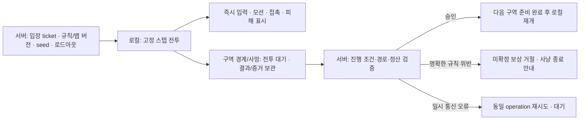

# 전투 권한 방향 정정 — 로컬 전투·구역 경계 서버 검증

2026-11-09. 현재 소스와 기존 합의의 차이를 정리한다. **이 문서는 목표 구조를 바로잡은 것이며 마을길/보스의 로컬 이관 구현 완료를 뜻하지 않는다.** 최신 성능 구조 문서에서 서버 실시간 판정을 유지할 계약처럼 쓴 부분은 이 문서로 정정한다.

## 1. 기존 지침은 이미 있었다

- [2026-11-05 Stage Sync](STAGE_SYNC_20261105_KO.md): 일반 미궁(`/api/rpg/rogue`)은 이동·AI·공격·충돌·피격·스킬 등을 로컬 worker에서20ms 고정 스텝으로 실행하고, 전투 중 combat tick HTTP는0회. 입장과 구역 경계/사망·장비 변경 등에서 서버와 통신한다. 보스 체험과 성장 사냥은 당시 적용 대상에서 제외됐다.
- [2026-11-07 안정화 지시서 M2](../../unity/IslandGame/RPG_COMBAT_STABILIZATION_20261107_KO.md): 싱글 RPG의 입력·이동·회피·공격·몬스터 AI·피격은 로컬 전투, 계정·장비 소유·입장·영구 정산은 현재 서버가 담당하는 방향이 명시돼 있다. **서버/호스팅 유지와 매 타격 서버 응답 대기는 같은 요구가 아니다.**
- [당시 실제 완료 범위](COMBAT_STABILITY_20261107_KO.md): 전체 로컬 보스 전환은 미완료이며 표시 예측·복사/저장 안정화만 적용했다고 기록돼 있다.

최근 마을길·보스 패치는 해당 서버 엔진을 확장했지만 Stage Sync 목표로 이관하지 않았다. 현재 구현 설명은 맞아도, 이것을 사용자와 합의한 최종 방향으로 제시한 것은 잘못이다.

## 2. 현재 실행 경로와 목표

`RpgSession.Open`은 `campaign || unityBossPreview || mountSundayPreview`이면 `Pump`로 들어가고, 그 외에만 `OpenLocalStage`를 호출한다. 현재 마을길 기본 입장은 mountSundayPreview를 켜므로 구역 단위 로컬 경로를 우회한다. Pump는 요청1개씩, 시작 간격 목표.1초를 사용한다. 실제 빈도는 RTT·명령·입력 변화에 따라 달라지며 서버 시뮬레이션의20ms 스텝과 같은 수치가 아니다.

| 모드 | 현재 | 목표/경계 |
|---|---|---|
| 기존 일반 미궁 | RogueStageKernel + StageCombatWorker 로컬, 구역 정산 | 기존 ticket/복구/중복 방지 계약을 재사용할 기반 |
| 현재 Mount 일반10구역 | `/api/rpg/mount-sunday` 실시간 HTTP 상태 | 로컬 이동·적 AI·충돌·3모션 피해·스킬·사망, 구역 경계 검증 |
| 현재 보스11번째 구역 | 같은 세션의 보스 엔진, 서버 실시간 판정 | 보스 AI/패턴/접촉/피해도 로컬. 입장 조건·클리어·영구 보상은 서버 검증 |
| 성장·장비·인벤토리·계정 | 서버가 소유·수치·저장 확정 | 로컬 전투 이관과 별개로 유지. 로드아웃 변경 시 안전한 경계에서 갱신 |
| 포커/다른 플레이어와의 실시간 게임 | 별도 서버 권한 | 싱글 RPG의 로컬화 지침을 확대 적용하지 않음 |

단순히 preview 플래그를 끄면 오래된 RogueEngine이 실행될 뿐이다. Mount 지형/충돌·도약·착지·보스 패턴·현재 접촉 프로파일이 자동 이관되지 않으므로 이것을 구현으로 취급하지 않는다.

## 3. 목표 책임 분리

전투 중 매 이동/타격의 응답을 기다리는 HTTP tick은 제거하는 것이 목표다. 경계 정산, 사용자가 누른 저장 작업, 필요성이 확인된 저빈도 관리 통신은 별도다. 렌더링을 로컬로 하는 것만으로 로컬 전투가 된 것은 아니며, 이동/AI/피해를 결정하는 시뮬레이션까지 옮겨야 한다.

규칙 버전·attackId·contactAt은 로컬 시뮬레이션이 생성해 표시와 공유한다. 각 일반 모션의 적별1회·점프 높이·착지 공간·슬라임 크기·보스 패턴·충돌을 유지한다. 렌더FPS/품질/이펙트 생략이 시뮬레이션 결과를 바꾸면 안 된다. 기존160ms 서버 표시 버퍼와 네트워크 이동 예측은 로컬 경로에서 그대로 중첩하지 말고 로컬 고정 스텝/렌더 보간에 맞게 분리한다.

## 4. 사용자가 제안한 구역 탈출 검증

방향은 **로컬 플레이 후 서버가 허용한 구역 진행/정산을 확인**하는 것이다. 이상 행동의 상세 탐지는 후속 정의 대상으로 둔다. 다만 로컬화 초기부터 최소 입장·경계·중복 정산 계약은 유지한다.

입장 시 서버가 runId, zoneId, map/rules/build version, seed, 확정 loadout, 허용 출구/다음 구역, 만료되는 ticket을 발급·보관한다. 종료 시 클라이언트는 operationId, ticket, 실제 출구/목적지, 처치/보스 결과, 경과 tick, 제한된 이동/행동 증거를 제출한다. 보고서 schema와 증거 빈도/용량은 후속 설계 항목이다. 클라이언트가 임의로 보낸 골드·아이템을 그대로 지급하지 않는다.

검증을 두 단계로 나눈다.

- 초기 경계 검사: ticket·계정·버전·순서·허용 출구·목적지·진행 조건·중복 정산·상한. 명확한 경계 위반이면 현재 미확정 결과를 거절하고 해당 사냥을 종료/로비로 돌린다. 이전 확정 보상까지 임의로 삭제하지 않는다.
- 후속 이상 이동 정의: 최대 이동/가속·지형/높이·점프/회피·넉백 예외·사망 후 이동·맵 밖 이탈·비현실적 클리어 시간 등을 버전 있는 규칙으로 추가한다. 중요 구간의 입력/상태 기록, 필요 시 서버 재현·표본 검증을 비교한다.

**최종 좌표/출구만 검사하면 구역 내부 순간이동·무적·피해 조작까지 잡히지는 않는다.** 결과·로그 자체도 조작될 수 있어 client hash나 그럴듯한 합계만으로 완전한 안티치트를 주장하지 않는다. 기존 Stage Sync 문서도 이 한계를 이미 명시했다.

일시 네트워크 끊김/타임아웃/앱 백그라운드/구버전/수치 오차는 곧바로 부정행위로 분류하지 않는다. 통신 오류는 정산 대기·재시도, 버전 불일치는 업데이트 안내, 검증된 규칙 위반만 “비정상적인 이동이 감지되어 사냥이 종료되었습니다” 같은 안내를 사용한다. 이것은 세션 종료 정책이며 계정 제재 자동 도입을 뜻하지 않는다.

## 5. 다음 구현 순서

1. 기존 Stage Sync 경계 계약과 Mount/Boss에서 빠진 규칙을 대조한다. 실제 현재 진행은 영구 보상 없는 훈련 경로이므로 보상 활성화와 로컬 이관을 섞어 완료 처리하지 않는다.
2. 현재 서버 엔진을 기준 oracle로 두고, 로컬 실행 코어를 선택한다. 기존 Jint worker를 확장하는 안과 네이티브 코어 이관을 측정한다. 기존 Jint 최대389ms worker 배치 기록은 실기 프레임값이 아니지만 성능 위험이므로 무조건 재사용이 빠르다고 가정하지 않는다.
3. 20ms 고정 step, 프레임/worker catch-up 상한, pause/복귀·입력 큐·snapshot ownership을 설계한다. 단순히 누적 시간을 버려서 전투/정산 시간이 달라지지 않도록 시간 계약을 명시한다.
4. 입장→로컬 일반 구역→경계 ACK→다음 구역→보스→클리어의 수직 경로를 만든다. 서버 승인과 Unity 환경 준비 둘 다 완료되기 전 다음 구역 AI/피해를 실행하지 않는다.
5. pending 결과를 전송 전에 저장하고 동일 operation 재시도·중복/충돌·재시작 복구를 검사한다. 구역 중간 전체 상태 저장과 미확정 결과 복구는 구분한다.
6. 입력/규칙 동치 검사,3모션 접촉234포즈 대조의 유효 부분, 공격당 중복 피해·충돌·점프·착지·보스 검사, 합법/불법 출구·통신 단절·중복 정산·규칙 버전 변경을 확인한다. C#/native 포팅은 기존 지시서의 최소10만 동일 입력 대조 등 루트 정책을 적용한다.
7. Android에서 전투 중 combat tick HTTP0, 경계 요청 수·메모리·CPU/GPU·GC·입력 반응·20분 지속 부하를 검증한다. 로컬화는 RTT 대기를 줄이지만 GPU 과부하/텍스처 문제까지 해결하지 않는다.

현재 이7단계의 Mount/Boss 구현은 미완료다. 이번 정정은 문서·다음 작업 방향을 맞춘 것이며 구현/배포 검증 결과를 새로 주장하지 않는다.
