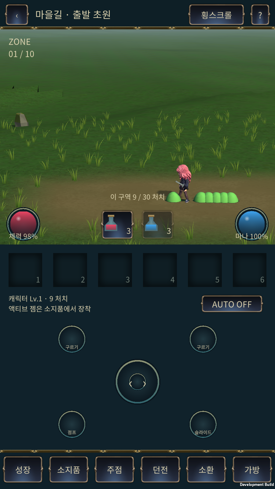
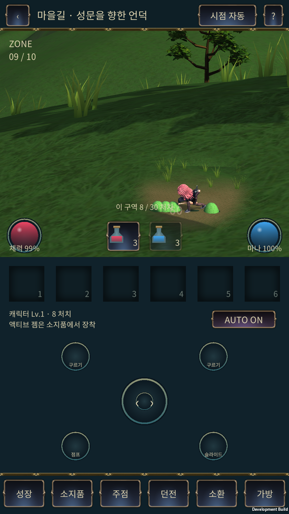

# Mount Sunday 슬라임·시점·전경 가림 수정 — 2026-11-08

기준 GitHub main b0b822f와 이후 스트리밍 브랜치 b1bd9ad를 대조했다. 실제 수정 대상은 G:/new_project/IslandGame이며 전체 프로젝트를 덮어쓰지 않았다. 서버 수정은 기존 스트리밍 버전에서 이어받았다.

## 변경

- 새 Mount Sunday 구역의 슬라임 이동 속도 230 → 115 core units/s (2.3 → 1.15m/s). 플레이어 6m/s는 유지한다.
- 슬라임 모델의 세 축을 0.5배로 줄여 기준 높이 0.62 → 0.31m. 서버 몸통 반지름 25 → 12.5, 피격 캡슐 높이 62 → 31을 함께 적용했다. 기존 보스 모델과 공격 모션은 보존한다.
- 서버 walk가 살아 있는 몸통을 매 6-unit 하위 단계마다 검사한다. 걷기·구르기·슬라이딩·점프의 관통을 막고, 죽은 슬라임은 통행을 막지 않는다. Unity 예측도 권위 좌표부터 같은 간격으로 검사한다. 게임 규칙은 서버에서 처리하며 Unity Rigidbody의 독립 시뮬레이션을 추가하지 않았다.
- 10개 일반 구역 모두 레인 이동과 측면 카메라. 수동 시점 override도 일반 구역에서는 쿼터뷰를 켤 수 없다. 기존 별도 보스 방은 쿼터뷰 및 기존 전환 진행도를 유지한다. 이번 10구역 경로에 새로운 보스 방을 추가한 것은 아니다.
- 캐릭터보다 카메라에 가까운 지형이 몸을 가릴 때 캐릭터 주변 화면 영역을 부드러운 디더로 비운다. 평평한 발밑 지면은 유지하며 Forward/DepthOnly가 같은 판정을 사용한다. 나무·바위는 기존 가림 숨김을 유지한다. 블러 효과와는 다르며 지형 메시·서버 높이·충돌을 변경하지 않는다.

## 코드 검증

- 관련 전투/보스/서버 API 회귀 **49/49 PASS**. 새 검사: 10구역 측면/깊이 입력 차단, 슬라임 추적 속도 정확히 0.5배, 몸통 크기, 네 이동 종류의 관통 차단과 사망 후 통행.
- 일반 자동 입력으로 10구역·300처치 완주, 최대 생존 6마리. 시뮬레이션 1102.64초. 실시간 기기 완주 시간과 구분한다.
- RPG TypeScript 검사 PASS. Unity 재컴파일 오류 0. Play에서 일반 구역 강제 쿼터뷰 요청 후 Side25D 유지, 환경 씬 2개, 현재 Console 오류·경고 0을 확인했다. Pipeline의 이전 세션 오류 이력과 현재 Console 상태를 구분했다.
- 별도 형식 검증은 수행하지 않았다. 이번 변경은 고정 단계의 지역 충돌·표시 조건이며 기존 회귀 및 새 동작 검사로 검증했다.

## 적용 및 범위

[증분 Unity 소스와 해시](client-source-snapshot/2026-11-08-mount-combat-fix/README_KO.md). b1bd9ad의 기존 Unity 적용 상태가 필요하며 서버와 클라이언트를 함께 갱신한다. 전체 Unity 프로젝트 또는 새 환경 아트 제작본이 아니다.

운영 Render 배포와 main 병합은 하지 않는다. 기존 격리 테스트 서버 http://127.0.0.1:18108 및 adb reverse를 사용한다. 9구역 화면 점검에는 별도 로컬 18109 서버에서 시작 위치를 구역9로 바꾸는 테스트 전용 fixture를 사용한다. 이 fixture는 제품 코드에 포함하지 않는다. 실제 휴대폰, 발열, 배터리, 소리 청취, 미술 최종 승인은 미검증이다.

## 최종 Android 및 화면 검증 — PASS

- APK `0.1.0-test.20261108.3` / `2026110803`, ARM64 IL2CPP Development. 최종 빌드 오류 0 / 경고 0, ZIP 무결성·서명·16KB ZIP 정렬 PASS. BlueStacks `emulator-5554`에 데이터 삭제 없이 업데이트 설치.
- 파일: `G:/new_project/IslandGame/Builds/Android/IslandGame-MountFix-20261108.apk`, 135,194,574 bytes, SHA-256 `f7b627794c6a4869cfcbe172269dea2e5d5a9d226074ee7da5ce02d085de78ea`.
- 일반 구역 약 30.7초 관찰, 준비 15초 제외 939프레임: 평균 59.87FPS / p95 16.67ms.
- 9구역 **중간 언덕 가림 지점**에서 별도 시작, 약 30.7초 관찰, 준비 15초 제외 941프레임: 평균 59.87FPS / p95 16.67ms. 전경 언덕 뒤의 캐릭터·근접 전투 영역이 보이고, 평평한 발밑에는 불필요한 구멍이 생기지 않는 실제 화면을 확인했다.
- 두 관찰 모두 Unity 오류/예외 0, 지면 미검출 0, 환경 씬 최대 2. 짧은 기능 검증이며 Android 10구역 장시간 완주·메모리 누수 검증으로 확대 해석하지 않는다.
- BlueStacks에서 AUTO를 끄고 살아 있는 슬라임 방향으로 터치 입력 3초 유지. 이동 중 최소 몸통 간격 0.0085m, 위치 정지 표본 37개, 관통 없음. 일반 구역 시점 버튼도 측면 표시를 유지했다.

원시 결과와 화면은 [검증 자료 폴더](mount-combat-fix-20261108)에 있다. 서버 일반 입력 300처치 회귀와 Android 짧은 실제 조작 검증을 구분한다.
