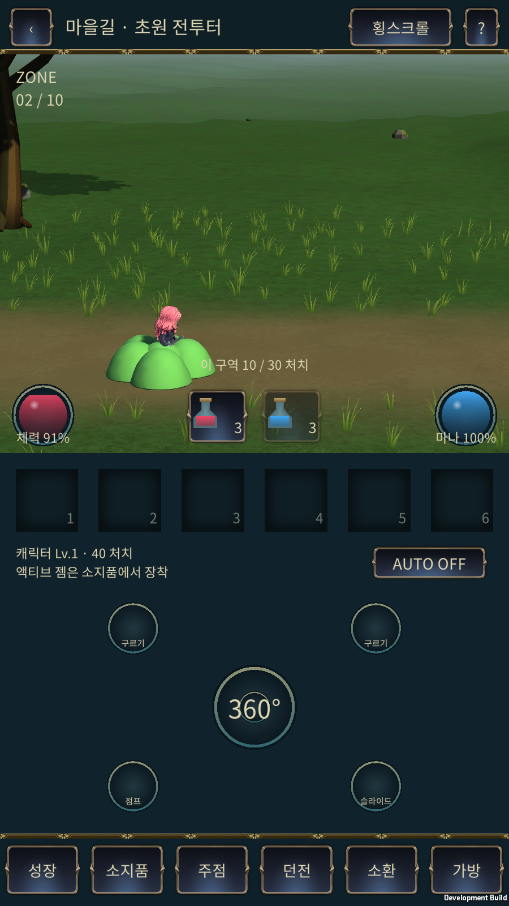
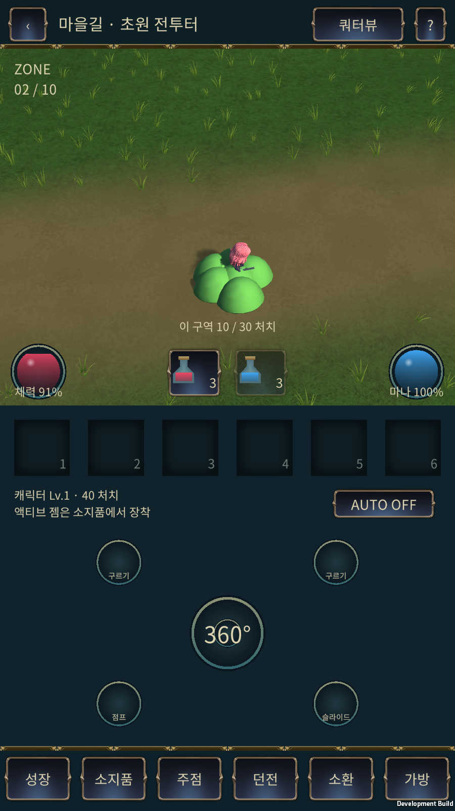
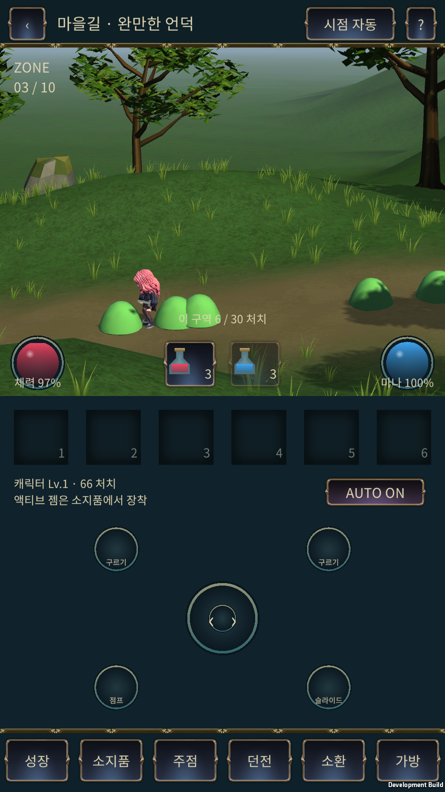
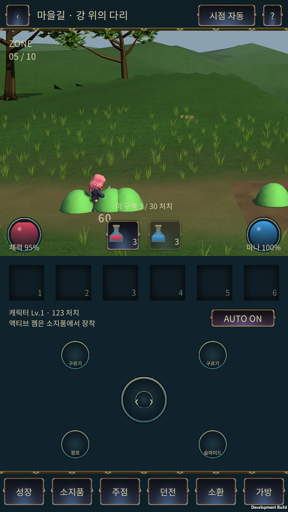
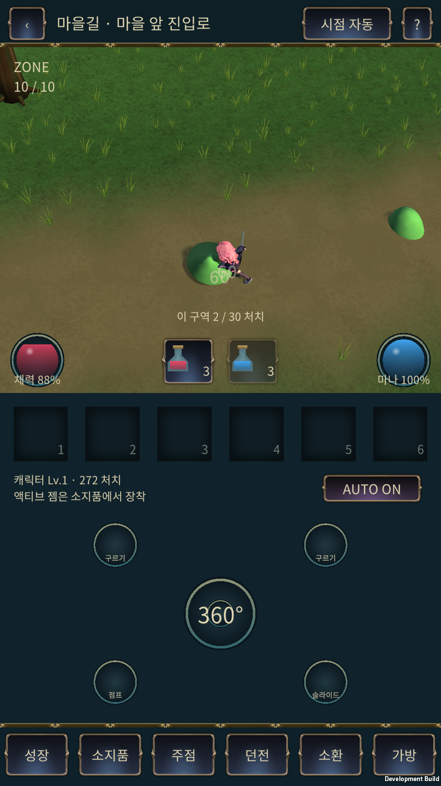

# Mount Sunday 이식·스프린트·Android 테스트 기록 — 2026-11-08

결과: **PASS — 요청한 우선 적용 및 BlueStacks 기능·성능 기준.** 실제 휴대폰·미술 완성도 승인은 별도다. 최종 APK는 `0.1.0-test.20261108.2` / `2026110802`, `com.mist2finer.islandgame.dev`다. 기존 앱에 업데이트 설치했으며 앱 데이터는 지우지 않았다. 실제 작업 프로젝트는 `G:/new_project/IslandGame`, 서버 변경은 `codex/mount-sunday-streaming-20261108` 브랜치다. 운영 Render 배포나 main 병합은 수행하지 않았다.

## 1. 적용한 동작

- 기존 Pink Glass 캐릭터에 사용자 제공 `sprint_loop_anim_only.glb`를 리타깃했다. 원본 0.6667초 스프린트, 65개 본, 41개 발 높이 표본을 사용한다. 원본 GLB는 변경하지 않았다. `test2.mp4`의 실제 프레임을 확인해 짧은 접근·방향 전환에 맞춰 조정했으며 영상에서 정확한 m/s를 추정한 것은 아니다.
- 새 마을길의 서버 기본 이동은 **6m/s**다. 이전 보스 이동 기준 2.1m/s 대비 약 2.86배이며, 클라이언트 예측·카메라 선행 추적·애니메이션 보폭도 함께 맞췄다. Android 터치 입력에서 **5.9993–5.9993m/s**를 확인했다. 기존 성장·보스 서버의 이동 규칙까지 일괄 교체한 것은 아니다.
- 기존 HUD·서버 전투·캐릭터 재질을 새 맵에 연결했다. 캐릭터 기준 높이 **1.30m**, 슬라임 **0.62m**를 유지한다. 자세에 따른 실제 화면 높이는 달라진다. 아래 이미지는 합성 없이 앱에서 캡처했다.
- 슬라임은 **구역당 총 30마리**, 시드 고정 랜덤 좌우 출현, **동시 생존 최대 6마리**, 생성 간격 최소 **1.15초**다. 사망 표시·풀링 객체 수와 생존 몬스터 수를 구분한다. 일반 자동 전투 입력으로 10구역·300마리를 처리하고 마을 입구에 도착했다.
- 환경은 Additive 씬으로 분리했다. 현재 구역만 표시·충돌·잔디를 실행하고 다음 구역의 비활성 루트를 준비한다. 이전 씬을 해제한 뒤 다음 것을 준비해 환경 씬 최대 2개를 유지한다. 전환에는 짧은 암전을 사용한다.
- 원래 플레이 지형의 높이를 유지하고 0.5m 간격의 동일 높이 데이터를 서버와 클라이언트에 전달한다. 원경은 구역별 256 cubemap과 약 1.0–1.1만 삼각형의 중경 메시로 바꿨다. 근거리 잔디는 6m 셀 컬링·거리별 메시·바람·플레이어 눌림을 적용한다. 잔디에 개별 물리나 본을 추가하지 않았다.
- 이전 버전의 Ground 텍스처와 캐릭터 셰이더, 제공 Mount Sunday 소품 재질을 먼저 적용했다. 플레이 구역이 아닌 중경 소품 237개의 높이를 경량 지형에 맞췄다. 다리와 연결 경사로의 원래 높이 오프셋은 보존했다.

## 2. 10구역 사용 방식

긴 원본 이동 경로 전체를 매번 걷게 하지 않고 각 구역의 플레이 구간만 연결한다. 표의 거리는 로컬 X 진행 폭이다. 다리의 굽은 실제 경로 길이와는 다르다. 원본 전체 지형과 이전 검토 씬은 보존한다.

| 구역 | 공간 | 기본 시점 | 플레이 진행 폭 | 경로 고저차 |
| --- | --- | --- | ---: | ---: |
| 1 | 출발 초원 | 사이드뷰 | 24.0m | 0.03m |
| 2 | 초원 전투터 | 쿼터뷰 | 28.0m | 0.08m |
| 3 | 완만한 언덕 | 사이드뷰 | 30.0m | 2.87m |
| 4 | 다리 앞 비탈 | 사이드뷰 | 22.0m | 3.11m |
| 5 | 강 위의 다리 | 사이드뷰 | 45.3m | 2.99m |
| 6 | 강변 굽이 | 쿼터뷰 | 28.0m | 1.84m |
| 7 | 계곡 오르막 | 사이드뷰 | 32.0m | 3.54m |
| 8 | 능선 쉼터 | 쿼터뷰 | 26.0m | 0.91m |
| 9 | 성문을 향한 언덕 | 사이드뷰 | 30.0m | 0.99m |
| 10 | 마을 앞 진입로 | 쿼터뷰 | 26.0m | 1.59m |

사이드뷰는 길을 따라 지면 높이를 추적하며, 쿼터뷰는 앞뒤 이동을 허용한다. 쿼터 구역은 중심 경로 양쪽 최대 6m, 다리는 ±0.5m로 제한한다. 상단 시점 버튼으로 자동/사이드/쿼터 표시를 비교할 수 있고, 조작 축은 카메라 회전 때문에 바뀌지 않는다.

## 3. PASS / FAIL 검사표

| 항목 | 판정 | 실제 근거 |
| --- | --- | --- |
| 스프린트·터치 이동 | PASS | 리타깃 클립 실제 재생, 터치 이동 약 6m/s, 점프/슬라이드/구르기 실제 버튼 입력 확인, 조작 영상 보관 |
| 순차 생성·완주 | PASS | 서버 고정 시드 424.92초, 300마리·동시 최대 6; 최종 APK 426.14초에 10구역/300마리 완료 |
| API·기존 보스 회귀 | PASS | 새 API 검증·동일 재시도·변조/순서/계정/출처/크기 제한 및 기존 보스 포함 46개 통과 |
| RPG 관련 회귀 | PASS | 131개 범위 중 130개 최초 통과. 1개는 G:의 자식 프로세스 TSX 경로 누락이었고 의존 패키지를 준비한 뒤 해당 파일 3/3 재검사 통과 |
| RPG 타입 검사 | PASS | 실제 브랜치 `tsconfig.rpg-check.json`에 기존 설치 의존 경로를 연결해 tsc 오류 0 |
| Android 빌드·설치 | PASS | 최종 빌드 오류 0 / 경고 0; ARM64 IL2CPP, ZIP·v2 서명·16KB ZIP 정렬, BlueStacks 업데이트 설치 |
| 일반 플레이 성능 | PASS | 목표 평균 ≥55FPS / p95 ≤33.3ms; 실측 평균 59.80FPS / p95 16.67ms |
| 지형 접지 | PASS | 25,109회 표본, 지면 미검출 0회, 루트-충돌 지면 최대 차 3.17cm |
| 씬 해제·재입장 | PASS | 환경 최대 2개. Android 로비 왕복 3회, Editor 로딩 도중 취소/재입장 후 2개, 퇴장 후 환경 0개·애니메이션 그래프 0개 |
| 지연·응답 유실 | PASS | RTT 설정 300ms±80ms / 7번째 응답 유실. 동일 명령 재시도 후 sequence·처치 증가, 오류 0 |
| Android 런타임 오류 | PASS | 계측 중 오류·예외 0건, 실제 화면의 잔디·재질·사이드/쿼터 표시 확인 |
| 실제 휴대폰·발열·배터리 | UNAVAILABLE | BlueStacks 에뮬레이터에서 실행; 실제 휴대폰 테스트로 해석하지 않는다 |
| 미술·조작감 최종 승인 / 소리 청취 | UNAVAILABLE | 실제 화면과 조작 영상은 확보했으나 사용자 미술 승인·스피커 청취 평가는 별도 |

## 4. 최종 성능·메모리

BlueStacks, Android 앱 900×1600, 60FPS 상한, Development/ARM64 변환 실행, 고정 시드 111, 로컬 격리 서버 RTT 설정 40ms다. Unity Editor Play와 APK 빌드 작업을 종료한 상태로 측정했다. 최초 15초 준비 구간은 프레임 통계에서 제외하며, 씬 전환 상태의 프레임은 별도 집계한다. 자동 사진·메모리 수집 비용은 포함한다. 기기 정보의 OnePlus/Adreno 문자열은 에뮬레이터가 보고한 값이다.

- 일반 플레이: 24,391프레임, 평균 59.80FPS, p95 16.67ms, p99 16.67ms, 최악 66.66ms. 50ms 초과 2회, 100ms 초과 0회. 평균/p95 통과가 일시 정지 0회를 뜻하지는 않는다.
- 전환 중: 183프레임, p95 33.33ms, 최악 50.00ms. 이 값은 단일 프레임 시간이며 암전 전체 길이가 아니다.
- Unity 할당 메모리 표본 최대 219.6MiB, 예약 356.2MiB, 관리 힙 48.3MiB. Android PSS 표본 최대 554.7MiB. 구역별 리소스 차이와 풀링을 포함한다. 한 번의 10구역 완주와 재입장 검사로 장시간 누수 부재를 증명하지 않는다.
- 애니메이션 그래프 최대 7개, 로드된 환경 씬 최대 2개였다. 씬에서 로컬 임시 MonoScript 315개를 제거하고 가림 처리 클래스를 독립 파일로 분리했다. 최종 씬 10개의 누락 스크립트는 0개다.

| 구역 | 평균 FPS | p95 ms | p99 ms | 최악 ms |
| --- | ---: | ---: | ---: | ---: |
| 1 | 59.46 | 16.67 | 16.67 | 50.00 |
| 2 | 59.88 | 16.67 | 16.67 | 66.66 |
| 3 | 59.69 | 16.67 | 16.67 | 33.34 |
| 4 | 59.88 | 16.67 | 16.67 | 33.33 |
| 5 | 59.87 | 16.67 | 16.67 | 33.33 |
| 6 | 59.69 | 16.67 | 16.67 | 33.34 |
| 7 | 59.91 | 16.67 | 16.67 | 33.33 |
| 8 | 59.86 | 16.67 | 16.67 | 33.34 |
| 9 | 59.86 | 16.67 | 16.67 | 33.33 |
| 10 | 59.83 | 16.67 | 16.67 | 33.33 |

첫 APK 검사에서는 빌드 작업과 동시에 BlueStacks를 실행해 최악 프레임 682.79ms가 기록됐다. 최종 수치와 혼합하거나 이를 순수한 게임 개선율로 비교하지 않았다. Android run-as 권한이 제한되어 계측 파일은 앱의 외부 files 경로에서 읽었다. 오류 0건은 Unity Error/Exception 계측 기준이다. Android 정보 로그에는 Play Core AssetPack 클래스 조회 실패가 있었으며, 이번 일반 APK의 시작·완주에는 영향을 주지 않았다. Play Asset Delivery 동작은 이번 검사 범위가 아니다.

## 5. 실제 화면

[실제 Android 20초 조작 영상](https://github.com/mist2finer-spec/holdem_coin/blob/e460b37490265a523670b77b56756201007d9086/docs/unity/mount-stream-20261108/mount-sprint-controls.mp4) · [이미지 모아 보기](mount-stream-20261108/REPORT_KO.html)

| 사이드뷰 비교 | 쿼터뷰 비교 |
| --- | --- |
|  |  |

| 언덕 구역 | 다리 구역 | 마을 앞 |
| --- | --- | --- |
|  |  |  |

## 6. 수정 과정과 남은 범위

배경 cubemap 상하 반전, Unity fake-null Skybox 참조, 직렬화된 임시 가림 컴포넌트, 원경 지형을 낮춘 뒤 소품이 떠 보이는 문제, 맵 재입장 주소 누락을 수정했다. 임시 원경 소품 보정에서 다리 경사로의 개별 높이 오프셋을 건드린 것은 배포 전 복원했다. 플레이용 원본 지형·서버 높이 데이터는 이 소품 보정에서 변경하지 않았다.

현재 접지는 공통 지면 높이와 애니메이션 발 높이 보정이다. 경사별 양발 IK, 오래 남는 풀 눌림 텍스처, 공격 방향에 따른 잔디 흔들림은 추가 확장 범위다. 원경 저폴리 경계와 잔디 밀도·조명은 실제 이미지로 검토할 수 있으며, 참고 영상과 같은 미술 완성도를 통과 판정한 것은 아니다.

## 7. 파일·재현

- APK: `G:/new_project/IslandGame/Builds/Android/IslandGame-MountSunday-20261108.apk`, 134,873,009bytes, SHA-256 `e2d0b0e6bdee33b66a888f5af2ba089b09adfdb41315b200952fd45cf13ca957`.
- [APK·Unity 변경 패치·검사 자료 다운로드](https://github.com/mist2finer-spec/holdem_coin/releases/tag/mount-sunday-stream-20261108.2)
- [실제 변경 소스·의존 에셋·적용 안내](client-source-snapshot/2026-11-08-mount-stream/README_KO.md), [파일 해시](client-source-snapshot/2026-11-08-mount-stream/manifest.json), [원시 계측](mount-stream-20261108/android-complete.json), [판정 데이터](mount-stream-20261108/final-results.json).
- 서버 `npm run check:rpg`, `npm run test:rpg:mount`, `npm run test:rpg:unity-boss`. 이 PC는 별도 의존 패키지 설치본을 사용했으며 실행 로그에 검사 범위를 기록했다.
- 운영 서버는 새 엔드포인트가 아직 배포되지 않았다. BlueStacks는 `adb reverse tcp:18108 tcp:18108`로 이 PC의 격리 테스트 서버를 사용한다. 서버가 꺼져 있으면 사냥 연결이 안 된다. 테스트 서버 실행과 앱 시작 명령은 적용 안내에 있다.
