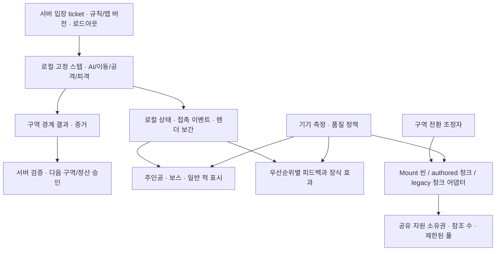

> 구현 갱신: [마을길·보스 훈련의 로컬 전투 이관](LOCAL_COMBAT_BUILD_20261109_KO.md). 아래 정적 감사 이후의 변경이며 Android 검증 범위는 해당 인계를 따른다.

> 권한 방향 정정: [로컬 전투·구역 경계 서버 검증](LOCAL_COMBAT_AUTHORITY_20261109_KO.md). 기존 Stage Sync와 M2 지침을 따른다. 아래 서버 실시간 경로는 현재 구현의 진단이며 최종 유지 목표가 아니다.

# Unity 콘텐츠 확장 대비 성능 구조·작업 인계

기록: 2026-11-09. 기준 main `de7a874c4beb4f39c0758aa306dfc6d598b209cf`, 실제 프로젝트 `G:/new_project/IslandGame`. **이번 작업은 구조 감사와 문서 게시다. 런타임·임포터·품질 설정·에셋을 수정하거나 새 APK를 만들지 않았다.**

사용자 목표: 앞으로 에셋 품질, 배치 오브젝트, 이펙트가 늘어날 것을 고려해 현재 구조를 점검하고 조절 방법과 제작 기준을 다른 에이전트에게 전달한다. 뒤에 다시 제공된 완전한 6개 주제를 기준으로 작성했다. 앞서 깨진 메시지의 4~6번을 추측해 채우지 않았다.

## 1. 먼저 읽을 결론

기존 풀링·스트리밍·애니메이션 샘플링 제어를 유지하면서 **텍스처 반입 규칙, 렌더링 경로별 품질 연결, 이펙트의 동시 수와 화면 점유, 자원의 소유·해제, 실기 측정**을 먼저 갖춘다. 지금의 짧은 BlueStacks 60FPS 결과를 고품질 신규 에셋의 수용 능력으로 해석하지 않는다.

- [사용자 제공 영상 6개 주제와 적용 시 주의점](performance/UNITE2026_REFERENCE_KO.md)
- [아트·이펙트 담당 반입 계약과 제출 양식](assets/PERFORMANCE_ASSET_CONTRACT_KO.md)
- [실제 소스·설정 감사 및 해시](performance/20261109/audit.json), [소스 찾아가기](performance/20261109/SOURCE_INDEX_KO.md)
- [기존 로컬 전투/구역 정산 구현](STAGE_SYNC_20261105_KO.md), [싱글 RPG 로컬화 지침 M2](../../unity/IslandGame/RPG_COMBAT_STABILIZATION_20261107_KO.md)
- [현재 전투/배포/검증 인계](COMBO_DEPLOY_20261109_KO.md), [영상 스타일·Tripo·원본 PDF 인계](assets/video-style/ASSET_AGENT_HANDOFF_20261109_KO.md)

현재 전투는 **Unity 6000.0.62f1 / URP 17.0.4 / Universal Forward Renderer + 3D 스킨 캐릭터**다. 측면 시점이어도 URP 2D Renderer가 아니다. Unity 6.3/6.4 기능을 이용하기 위해 먼저 엔진을 올리거나 렌더러를 교체하는 계획으로 바꾸지 않는다.

## 2. 현재 구조: 확인한 것과 빈 부분

아래는 정적 소스·설정 확인이다. 병목 후보와 실제 병목 확정은 구분한다. 정확한 파일·SHA-256·동일한 GitHub 스냅샷은 소스 색인에 있다.

| 영역 | 현재 구현 | 확장 시 조절할 부분 |
|---|---|---|
| 렌더링 | Graphics와 6개 Quality 설정이 DioramaURP 참조. SRP Batcher ON, Dynamic Batching OFF. Forward, HDR ON, MSAA 2, Render Scale 1, 주광 그림자2048/2 cascade/거리55, 추가광 그림자 OFF | 이 값은 설정값이며 실제 패스 수가 아니다. 프레임 캡처로 HDR·MSAA·그림자·Bloom의 개별 비용을 확인 |
| 화면 출력 | `IslandBattleHud`의 3D 경로는 `NativeBattle.ConfigureScreenViewport`로 카메라 직접 출력. 레거시용720 RenderTexture 객체/복귀 경로도 있음 | 현재 3D가 항상720 RT로 렌더링한다고 가정하지 않는다. 해상도 조절은 실제 카메라/URP 출력 경로에 적용 |
| 품질 제어 | `IslandFrameBudget`은 FrameTimingManager를 읽고 CPU active/GPU 중 큰 값을 기준으로0~3단계 조절. 내부 목표 약10.83ms, 8회 초과 시 하향·120회 여유 시 복구. Frame Timing Stats 설정 ON | GPU 시간이 유효한지 기기별 확인. 정책이 샘플을 못 받는 경우의 보수적 기본값·사용자 품질 선택·발열 연동은 별도 설계 |
| 일반 구역 | `MountZoneStream`의 단일 worker가 additive scene을 직렬 관리. 현재+다음 최대2개, 다음 root 비활성화, 구역 변경 뒤 이전 해제 | scene 전체 활성화/Awake/OnEnable 비용은 별도다. 최대2개라는 개수 제한만으로 메모리 용량이 제한되지 않음 |
| 보스 환경 | `NatureAuthoredEnvironment`는 기본 맵 동기 Load/Instantiate, 주변 청크 LoadAsync. 거리38에서 요청/준비,52 밖 제거. 요청 루프는.12초 간격, 해당 루프에서 최대2개 새 요청 | 완료 청크 Instantiate는 한 덩어리이며 시간 추정.7ms로 허가한다고 실제.7ms 이내가 되는 것은 아님. 취소·종료 후 pending 정리/동시 요청 총량/청크 크기 기준 필요 |
| 레거시 환경 | `NatureEnvironmentStream`+`NaturePropCache`는 지형1청크/프레임, 소품 최대6개/프레임 및1.25ms(.6ms 저품질) slice, lease, 전체 풀16/타입별2, TTL12초 | **이 제한이 Mount additive scene이나 authored boss 청크에 자동 적용되지는 않는다.** 기존 구현의 계약을 재사용하되 경로별 어댑터 필요 |
| 품질 연결 | authored 청크 완료 시 `BindScenery`; legacy는 자체 Quality 적용. Mount 진입은 `BindScenery(null)`, MountZoneEnvironment.Bind에는 품질 등록 없음 | Mount 지형/소품/잔디를 공통 품질 정책에 연결하는 작업 우선. 단일 root 등록을 덮어쓰기보다 활성 구역별 등록/해제 계약 검토 |
| 잔디 | `MapReviewGrass`: 저장된 위치·결정적 회전/크기,6m 셀, 카메라 프러스텀, 거리32 이내,17 기준 near/far 메시, RenderMeshInstanced. 버텍스 바람·플레이어 눌림 | 현 셰이더는 Opaque 양면 메시이며 반투명 풀 카드가 아님. 품질단계별 거리/밀도 연결, 셀당 API 인스턴스 상한 검증, Rebuild 중복 비용 확인 |
| 캐릭터 | 수동 PlayableGraph, 슬라임 풀 최대16, 전용 카메라 bounds 컬링, 중요도별5~60Hz 샘플. 주인공은 선택적 샘플 생략 제외 | 샘플링 간격 기준은 화면 중심에서의 가로 거리이며 실제 공간 거리 LOD와 다름. 공격·피격·착지 프레임 우선권을 명시하고 실제 GPU 스키닝 비용도 측정 |
| 재질 | `BattleDioramaLook`는 생성 branch에만 적용, source Material별 변환 캐시, instancing 허용, 승인된 Nilo 룩 유지 | `ForgetBranch`는 Renderer 추적 제거만 하고 변환 재질은 world Dispose까지 보관. 이질적 에셋을 계속 로드하면 byte/개수 상한 및 참조 수가 필요 |
| 타격 효과 | `CombatFeedbackRouter`가 spark6/무기 trail3, 재사용 오디오, 이벤트ID 중복 방지, 저품질에서 장식 생략. 플래시는 MaterialPropertyBlock 사용 | 일반 스킬/폭발/연기 전체를 관리하는 전역 VFX 예산은 없음. target별 flash 사전은 Dispose까지 남으므로 actor 반환/새 ID 연결 때 수명 정리 필요 |
| HUD | 피해 텍스트24개 재사용, HUD20/15/10/8Hz. texture를 Resources.Load 후 Sprite.Create, sprite 사전 캐시 | 아틀라스만 추가해도 이 로딩 경로가 자동으로 바뀌지 않음. 화면별 Sprite 공급자와 해제 책임을 먼저 설계 |
| 통신·표시 | RpgSession은 요청1개씩, 시작 간격 목표.1초, RTT/응답 bytes/parse-merge 기록. CombatSnapshotBuffer는 최대12 스냅샷,160ms 지연, 확정 접촉 시점 보존 | 버퍼 Sample에서 매 렌더 프레임 JObject/DeepClone과 몬스터 대응 중첩 탐색. 적·FX가 늘기 전 GC Alloc/CPU marker를 찍고 typed/reused view buffer로 단계적 변경 |

### 실제 반입 설정에서 확인한 우선 사항

`Assets/Island/Resources/WebAssets`의 TextureImporter **162개 모두** 기본 `textureCompression=0`(Uncompressed), Android override0, mipmap OFF, Read/Write OFF, Texture Type Default다. `IslandProject.cs / IslandTextures.OnPreprocessTexture`가 이 경로에 비압축·max4096·mipmap OFF·Repeat를 일괄 지정한다. Inspector만 고치면 재임포트에서 되돌아갈 수 있으므로 후속 구현은 임포터 정책부터 분리한다. 모든 텍스처를 즉시 압축하는 지시가 아니다. UI 글자/아이콘/노멀/배경 별 시각 검사가 필요하다.

Assets 아래 Unity `.spriteatlas`/`.spriteatlasv2`는0개다. 이것은 Spine의 별도 atlas 텍스트 파일이 없다는 뜻이 아니다. Unity 2D Animation·Addressables·Memory Profiler 패키지는 현재 lock에 없고 **Burst1.8.30은 전이 의존성으로 존재**한다. Burst가 이미 있어도 기존 수동 Playables/Spine/C# 루프가 자동으로 Burst 코드가 되지는 않는다.

Mount 배경10개는 일반 PNG importer가 아닌 **직렬화된 Cubemap .asset**이다. 헤더상256×256,9 mip, RGB24(format3), Readable1. PNG용 ASTC preset을 바꾸는 것만으로 이 경로까지 바뀌었다고 보고하지 않는다. CPU 접근 필요성·베이크 종료 후 CPU 복사 해제·Android 최종 포맷을 별도 확인한다. .asset 파일3.15MB는 직렬화 크기로 GPU 상주 크기가 아니다.

## 3. 영상의 6개 주제를 현재 프로젝트에 적용하는 결정

| 영상 주제 | 현재 적용 방향 | 지금 그대로 적용하면 안 되는 해석 |
|---|---|---|
| 1. Draw Call/SetPass/Dynamic Batching | Frame Debugger로 pass/variant/material/sorting 원인을 찾고 CPU Render Thread·GPU 시간과 함께 비교 | SetPass만 낮으면 무조건 빠르다, 같은 재질이면 모든 패스에서 SetPass1회라는 보장 |
| 2. SRP Batcher/2.5D | SRP ON 유지, 호환 셰이더와 불필요한 variant 억제. 반복 정적 소품·풀은 별도 instancing 경로 검토 | 6.0 Forward 프로젝트에 6.3 `Sort 3D as 2D`를 바로 켜거나 모든 캐릭터에 Sprite 셰이더 적용 |
| 3. 라이팅 | 현재는3D 주광/그림자/추가광과 후처리를 측정. 경고·가독성은 유지하고 장식광·그림자부터 단계별 축소 | 2D Light Batching Debugger를 현3D 라이팅의 직접 분석 도구로 사용. Additive로 바꾸면 항상 저렴하다고 가정 |
| 4. 텍스처 압축 | Android 용도별 포맷/해상도 preset, Cubemap 별도, 기기 지원·실제 빌드 포맷 확인 | 원본 확장자만 바꾸거나 APK가 작아진 것을 VRAM 절약으로 계산. 전 기기 ASTC 지원 단정 |
| 5. 아틀라스 | 전투HUD/성장/소지품/장식FX를 로딩 수명에 맞게 분리. Sprite.Create 경로부터 변경 계획 | 전부 한8K atlas, 원본 전체None 일괄 적용, 3D skinned 캐릭터도 Sprite Atlas로 한 draw가 된다는 가정 |
| 6. 애니메이션 | 현재 수동graph/풀링/컬링 재사용, 원거리 비필수 포즈만 낮은Hz, 본/정점/가중치 예산 | Burst 설치만으로 현재3D/Spine가 자동 가속. Animator Cull Completely만 바꾸면 수동 Evaluate까지 해결된다는 가정 |

SRP Batcher는 같은 variant의 드로 준비·제출 CPU 비용을 낮춘다. draw 수 감소나 GPU fill-rate 개선을 보장하지 않는다. Unity6.0 문서상 MaterialPropertyBlock은 해당 Renderer의 SRP Batcher 호환 조건을 벗어난다. 현재 피격 flash와 batch 경로를 **피격 전/중/후** 캡처하고, 전 객체 재질 복제로 대체하기 전에 측정한다. [SRP 동작](https://docs.unity3d.com/6000.0/Documentation/Manual/SRPBatcher.html), [호환 조건](https://docs.unity3d.com/6000.0/Documentation/Manual/SRPBatcher-Materials.html).

## 4. 확장할 구조와 소유권

이 그림은 **목표 구조**다. 기존 일반 미궁에는 로컬 Stage Sync가 있으나 Mount/Boss 로컬 이관, VFX 관리자, 통합 어댑터는 아직 완료되지 않았다. 파일·형식 이름은 후속 구현자가 기존 API와 맞춘다.

- **게임플레이**: 규칙 버전과 입장 로드아웃은 서버가 관리하고, 싱글 RPG의 충돌·피해·점프 가능 높이·착지 공간·일반 모션당 적1회 계산은 로컬 전투로 이관하는 것이 목표다. 현재 Mount/Boss는 아직 서버 실행 경로다. 낮은 품질/컬링/이펙트 부족이 피해·AI tick·이동 속도를 바꾸면 안 된다.
- **공유 자산**: prefab/mesh/material/texture/atlas를 canonical key로 취득하고 누가 마지막 참조를 해제하는지 정의한다. pool이 asset을 계속 참조한다는 점까지 메모리 계산에 포함한다. `Destroy(instance)`와 공유 texture 해제를 혼동하지 않는다.
- **구역**: 현재+다음을 기본으로 하되 둘의 합산 메모리/업로드 peak를 예산화한다. 준비에는 IO 완료뿐 아니라 Instantiate·GPU 업로드·충돌·카메라/환경 연결을 포함한다. 준비되지 않으면 대기한다. 현재 readyZone/readyBoss 계약은 이관 시 구역 경계 승인과 환경 준비의 결합으로 유지하며 매 전투 tick에 의존하지 않게 한다.
- **비동기 수명**: 세션/구역 generation을 붙여 이전 요청 완료가 새 구역에 붙지 않게 한다. 취소 불가능한 Resources/Scene 작업은 완료 후 정리한다. `allowSceneActivation=false`로 여러 씬을 오래 정지시키는 설계는 피한다.
- **정적 배치**: 동일 재질·가시성 셀 안에서 합치거나 인스턴싱한다. 마을 전체를 하나의 거대 mesh로 합쳐 컬링과 부분 해제를 잃지 않는다. 이동/상호작용/충돌 proxy는 분리한다.
- **캐시**: global resident/UI screen/zone/encounter/frame 수명을 구분한다. 재질 변환 cache와 flash target 사전에 제거 경로를 추가할 계획을 먼저 세운다. 무한 풀 대신 타입별 개수·전체 개수·보관 bytes·최근 사용 시간으로 제한한다.
- **로딩 분산**: preload는 백그라운드 IO와 main-thread 생성·GPU 업로드를 별도 계측한다. 큰 prefab 한 번의 Instantiate는 frame slice 바깥으로 튈 수 있으므로 묶음 크기도 제한한다. 잔디 Rebuild는 Load/OnEnable/Bind에서 반복 호출되므로 generation별 재사용 가능성을 측정한다.
- **메모리 압박**: 장식 풀/다음 구역 preload/사용하지 않는 atlas부터 줄이는 순서를 만든다. 전투 도중 무조건 `GC.Collect`/`UnloadUnusedAssets`를 호출하지 않는다. 현재 구역 전환의 UnloadUnusedAssets 비용을 기록해 화면 공개 시점과 조율한다.

## 5. 이펙트가 많아질 때의 규칙

이펙트는 오브젝트 개수·particle 개수만으로 제한하지 않는다. 동일 particle 수라도 화면 전체를 덮는 연기 여러 겹은 GPU 비용이 크다. 표시 영역 비율, 겹침, 해상도, shader sample 수, lights/shadows/distortion까지 함께 제출한다.

| 우선순위 | 예 | 부족할 때의 동작 |
|---|---|---|
| P0 판독 필수 | 보스 위험 범위, 점프 경계/출구, 적 피격 여부와 주인공 공격 접촉 | 항상 남기는 저비용 mesh/icon/flash 대체를 미리 확보. queue에서 장식보다 우선 |
| P1 전투 강조 | 주요 스킬 궤적, 대표 타격 spark, 핵심 사운드 | emit 수·수명·trail 점 수를 줄이고 같은 표적/프레임 장식만 합칠 수 있음 |
| P2 장식 | 잔불·먼지·추가 연기·꽃가루·장식광·카메라 흔들림 | 거리/화면 점유/동시 수 초과 시 생략 또는 회수 |

`CombatFeedbackRouter`의 현재 spark6/trail3은 타격 피드백용 시작점이다. 이것을 모든 스킬 동시 수의 충분한 예산으로 간주하지 않는다. 후속 전역 VFX 관리자는 effect key, priority, owner/session/zone, lifetime, bounds, pooled bytes, particle cap, transparent coverage를 관리한다. pool 고갈 시 P2 거절→P1 경량 대체→P0 예약 자원 순서를 시험한다. VFX 효과 삭제가 전투 코어의 damage 이벤트 삭제로 이어져서는 안 된다. 이 코어는 현재 Mount/Boss에서는 서버에서 실행되고, 목표 구조에서는 로컬에서 실행된다.

프리웜은 로딩 중 작은 작업으로 분할한다. 한 프레임에 모든 prefab/particle/material을 준비하지 않는다. 반환 시 ParticleSystem/Trail/Audio/PropertyBlock/콜백/구역 참조를 초기화하고, 완료 콜백 중복 반환을 막는다. 한 효과마다 MonoBehaviour.Update나 실시간 Light를 붙이는 기본 템플릿을 만들지 않는다.

수십 개 피해 숫자는 현재24개 pool을 유지하고 표현 집약을 검토한다. 숫자를 합쳐도 전투 기록·타격ID·실제 피해를 합치거나 누락시키지 않는다. 후처리 Bloom·왜곡·depth/opaque texture의 추가 패스는 개별 토글로 전후 측정한다.

## 6. 품질 단계·잔디·에셋 예산

현재 단계0~3은 주로 frame timing 반응형 표현 정책이다. 별도의 Low/Medium/High **콘텐츠 품질 프로필**과 연결하되 무조건 같은 숫자로 묶지 않는다. 정적 profile은 텍스처/mesh/그림자 선택, 동적 pressure는 장식·sample rate·preload를 줄이는 역할을 맡긴다.

- 먼저 줄일 것: 화면 밖 장식, 먼 풀 밀도/거리, 작은 소품 shadow, 추가 light, VFX emit/수명, Bloom/장식 trail. 해상도는 GPU 병목 확인 후 별도로 비교한다.
- 유지할 것: 주인공·보스 공격 접촉·위험 표시·터치 반응·충돌 공간·고정 스텝 전투 시간·일반 공격1/2/3 규칙. silhouette/가림 처리는 저품질에서도 판독 가능해야 한다.
- 실제30FPS 옵션은 입력·시뮬레이션 tick와 분리한 제품 선택이다. 단순히 CPU가 바쁘다는 이유로 전투 시뮬레이션 진행을 늦추지 않는다. 발열 장시간 검사와 30/60 목표를 함께 기록한다.
- 잔디 위치는 고정 시드·저장 데이터 유지. 밀도 하향은 각 셀의 동일한 subset을 선택해 깜빡임을 막는다. near/far가 같은 뿌리 위치를 유지하고 바람/눌림 최대 변위까지 bounds에 포함한다.
- 현재10개 씬은 구역별905~1180군락, 최대 셀28개다. 이는 정적 저장 개수로 동시에 그리는 수가 아니다. 밀도 확대 시 Renderer API batch 상한을 먼저 검사한다. Unity6.0 RenderMeshInstanced는 데이터 구성에 따라 상한이 달라지며 기본 양방향 행렬 구성은511개다. 자동 분할 없는 현재 cell 호출에 대량을 몰아넣지 않는다. [API 조건](https://docs.unity3d.com/6000.0/Documentation/ScriptReference/Graphics.RenderMeshInstanced.html).
- 모델별 수치는 기존 Tripo 인계의 시작 예산을 따른다. 삼각형만 맞춰도 submesh·material·bones·shadow pass·화면 점유가 크면 반려한다. 전체 visible scene 예산은 S20 기준선 후 확정한다.

## 7. 측정 절차와 통과 기준

### 현재 있는 것 / 없는 것

기존 .4 APK BlueStacks 운영 검사: 짧은 구간 p95 약16.67ms, 공격 포즈 불일치0, 오류0. [원시 결과](combo-deploy-20261109/android-public.json). **이번에 새 성능 측정을 한 결과가 아니며**, 최대 부하·폰 발열·배터리·CPU/GPU 병목·총 PSS를 증명하지 않는다.

현재 `MountDeviceProbe`는 첫15초 이후 frame 간격을 모으고10초마다 JSON 저장/정렬을 한다. 자체 List 증가·정렬·JSON/File IO도 측정에 영향을 줄 수 있다. 장시간 검사에서는 bounded ring buffer/집계 방식으로 바꾸는 별도 작업을 계획하고 기록 프레임을 구분한다. Profiler 메모리 API의 allocated/reserved와 GC.GetTotalMemory는 OS의 총 앱 메모리와 다르다.

### 도구별 사용

| 도구 | 확인할 결과 | 한계/사용 조건 |
|---|---|---|
| Unity Profiler CPU Timeline/Hierarchy | Main/Render Thread, Animation/GC/Canvas/Instantiate/렌더 준비, marker별 시간 | Android Development Player 연결, Deep Profile 기본 OFF. 긴 WaitForPresent를 실제 CPU 작업으로 합산하지 않음 |
| GPU Profiler 또는 지원되는 타깃 GPU 도구 | shadow/opaque/transparent/postprocess의 GPU ms | 기기·API에서 지원 여부 먼저 확인. GPU 타이밍이0/미지원이면 UNAVAILABLE, CPU bound로 단정하지 않음 |
| Frame Debugger | pass 순서, batch break, material/variant, shadow/추가 RT, 피격 전중후 MPB 경로 | 단계별 draw 확인용이며 켠 상태의 FPS는 성능 기준선으로 쓰지 않음 |
| Memory Profiler 패키지 | 기기 snapshot 전후 Texture/Mesh/Material/관리 힙 및 참조 보유 원인 | 현재 미설치. 설치는 후속 구현 범위. 캡처 스파이크를 정상 frame 통계와 분리 |
| ADB/Android 도구 | `dumpsys meminfo`, logcat OOM/오류, OS thermal 상태·지원되는 전력 정보 | BlueStacks에서 실제 배터리/발열을 판정하지 않음. 온도·소모율은 주변 조건/충전/밝기 고정 |
| 기존 probe/FrameTimingManager | 구역별 frame p95/p99, scene/graph 수, 접촉 동기화, 품질단계, 유효 timing | 접촉 지연0은 VisualTime-contactAt 지표이며 실제 입력-to-display0ms가 아님 |

[Profiler](https://docs.unity3d.com/6000.0/Documentation/Manual/Profiler.html), [Frame Debugger](https://docs.unity3d.com/6000.0/Documentation/Manual/FrameDebugger.html), [Memory 모듈의 집계 범위](https://docs.unity3d.com/6000.0/Documentation/Manual/ProfilerMemory.html).

### 반복 가능한 장면과 증거

1. 기존 검증된 Unity CLI/build 설정으로 별도 Development 빌드를 준비한다. 오래된 `IslandProject.BuildAndroid` 메뉴는 씬 생성과 패키지ID 변경 코드가 있으므로 그대로 호출하지 않는다. S20의 모델/SoC/GPU/OS/그래픽API/해상도/품질/APK 해시를 기록한다. S20 계열 GPU 차이를 구분하고 출시 전 다른 실제 중간급 기기에서도 재현한다.
2. 동일 시드·카메라·이동 입력으로①마을 측면 소품 최대 시야②잔디 최대 시야③6슬라임 동시 교전④합법적인 스킬 동시사용⑤보스 경고+피격⑥9구역 가림⑦구역 전환을 비교한다. 증가 부하 fixture는 격리 환경에서6/12/24 visual actor,1×/2× 장식/VFX 등으로 실험하며 운영 activeCap6을 임의 변경하지 않는다.
3. 60초 워밍업 뒤 각 고정 장면120초를3회, 장시간20분,10회 재입장/구역 왕복을 출발 절차로 쓴다. 이는 앞으로 실행할 절차이며 이번 완료 검사 수가 아니다.
4. 동일 빌드 조건의 A/B 한 변수씩. Profiler OFF release에 가까운 빌드의 frame pacing도 별도 확인한다. Development 측정과 일반 빌드 결과를 섞지 않는다.
5. 제출: frame/active CPU/GPU p50/p95/p99,50/100ms spike, GC Alloc/frame·수집, draw/SetPass/triangles, Texture/RT/mesh/material/graph/pool bytes, loaded/preloaded scene, OS PSS, RTT·응답 bytes·parse ms, 기기 thermal 및 에너지 조건. 시간/파일 경로와 원시 capture를 연결한다.

**출발 검수 목표(미확정 실기 SLA)**: 60FPS 목표의 frame 예산16.67ms를 기준으로 CPU/GPU 각각 여유를 확보한다. UI 타이밍·드라이버 오차를 감안해 분포로 판정하고, p99>33.3ms와>50ms 반복을 조사한다. 전투/전환 spike를 별도 집계한다.10회 반복 후 살아 있는 scene/graph/material/texture/풀 참조가 정착값으로 돌아오는지 확인한다. 새 표시 루프는 steady-state 할당0을 목표로 하되 기존 JSON 비용까지 이미0이라고 보고하지 않는다. 장시간 발열 후 결과와 원인 설명이 없으면 에셋 밀도 확대 승인을 하지 않는다.

## 8. 다음 구현 순서와 담당 경계

| 우선순위 | 작업 묶음 | 완료 근거 |
|---|---|---|
| P0 | 실기 baseline, route/zone별 로딩·VFX·버퍼·pose marker, timing 유효성, bounded 진단기 | 위 시나리오 raw capture와 캡처 조건; 프로파일러/계측 부하 구분 |
| P1-0 | 기존 Stage Sync 계약에 Mount/Boss 로컬 전투 이관, 경계 검증/정산, 후속 이상 이동 정의 | 전투 중 combat tick HTTP0, 규칙 동치·입력 반응·경계/재시도 검증. [상세 방향](LOCAL_COMBAT_AUTHORITY_20261109_KO.md) |
| P1-A | WebAssets importer 용도 분리, Android 포맷 preset, Cubemap Readable/format, 화면별 atlas 공급자 | 기기 texture/메모리 diff + 아이콘·그라데이션 시각 비교 + 재임포트 후 설정 보존 |
| P1-B | Mount scene·authored 청크 품질 등록, create/upload slice와 generation, cache/target 수명 | 최대2씬+전환 memory peak, 반복 입장 후 재질/graph/참조 회수, ready 계약 유지 |
| P1-C | 공통 VFX 예산·우선순위·pool/reset·장식 생략·필수 경고 fallback | 동시 cast 부하와 overflow 시험에서 판정/위험표시/일반3모션 접촉 유지 |
| P2 | 병목이 확인된 경우 typed 표시 버퍼·ID index, 3D 리그/LOD/그림자 최적화 | GC Alloc/CPU·GPU 전후,59개 서버 회귀 및234포즈/접촉 barrier 검사 재사용 범위 확인 |
| P3 | 큰 콘텐츠/다운로드 요구가 생긴 뒤 Addressables 등 배포·로딩 계층 선택, 엔진 업그레이드 별도 검토 | 현재 ownership 계약과 동등성/메모리·전환 개선을 비교. 패키지 설치 자체를 최적화 완료로 보지 않음 |

계측 담당은 숫자와 재현 조건, 시스템 담당은 소유권·상한·fallback, 아트 담당은 에셋 manifest와 silhouette/화질, VFX 담당은 겹침/수명/priority, 통합 담당은 로컬 전투와 서버 입장/검증/정산 경계·전환·회귀를 책임진다. 이번 문서는 다른 에이전트를 실행하거나 별도 서비스로 메시지를 보낸 결과가 아니다.

## 9. 유지할 계약과 이번 완료 범위

- 일반10구역 측면, 보스11번째 구역만 쿼터뷰. 회전 때문에 측면 배경 카드가 노출되지 않도록 한다.
- 작은 슬라임 .31m, 기존 플레이어1.30m·보스·원본 클립 보존. 일반3모션 각 attackId당 적1회, 스킬 별도. 성능 때문에 hitbox/루트 scale/고정 step을 바꾸지 않는다.
- 승인된 수정 Nilo 룩, 새 에셋 제작 보류, 기존 PDF·PR#9 인계를 유지한다. 낮은 품질에서도 전경 가림과 보스 경고가 읽혀야 한다.
- **PASS**: 정적 코드/설정/임포터 감사,6개 주제 매핑, 출처·소스 해시·작업 우선순위·에셋 제출 기준 문서화 및 링크 검사.
- **UNAVAILABLE/미실행**: 이번 턴의 CPU/GPU capture, S20 실기, 발열/배터리, Memory Profiler snapshot, 새로운 미술 비교·최대 부하 검증. runtime 개선/신규 에셋/빌드·운영 배포는 이번 문서 작업에서 실행하지 않았다.

[문서·해시·링크 P0 검사 결과](performance/20261109/validation.json).
