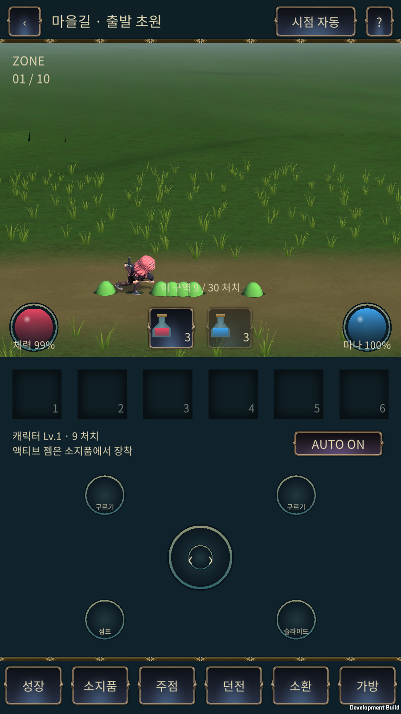
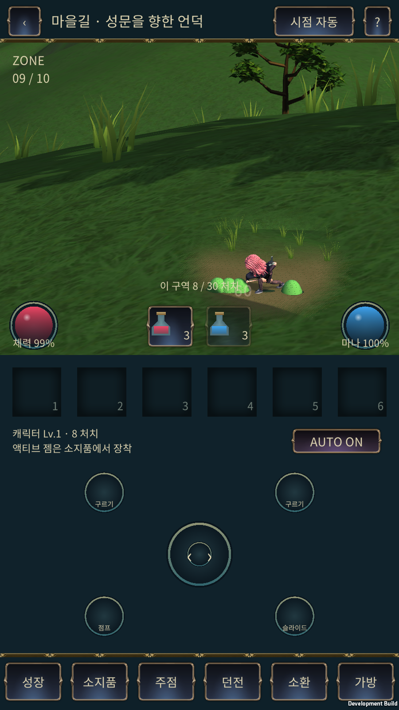

# Unity 현재 상태와 영상 대비 진단 — 2026-11-09

사용자 요청: “현재 유니티 상태를 체크하고 (깃허브를보고) 어떻게 개선하며좋을지. (영상느낌나게) 문서화해서 깃허브로 올려줘”.

**결론: 최신 작업에는 구역 스트리밍과 잔디 렌더링의 기반이 이미 있다. 현재 우선순위는 새 지형 제작이나 잔디 물리 재구현보다 화면 구도, 풀 군락, 지면·배경 색, 전투 판독성이다.** 다만 최신 수정본은 일반 구역을 모두 측면으로 고정했으므로, 원하는 사이드뷰→쿼터뷰 전투→보스 구성에는 이동·구역 규칙을 함께 확장하는 작업이 필요하다.

이 문서는 원격 소스·인계 기록·기록된 화면과 사용자가 제공한 두 영상을 대조한 감사다. 이 세션에서 Windows Unity Editor, 실제 프로젝트, APK 또는 휴대폰을 실행하지 않았다. 구현 절차는 [영상 스타일 구현 계획](VIDEO_STYLE_IMPLEMENTATION_PLAN_20261109_KO.md)에 있다.

## 1. 어떤 버전을 확인했는가

| 대상 | 고정 리비전 | 확인 결과 |
| --- | --- | --- |
| `main` | `b0b822fd689f854f64c043ff2a7baff3bc4bf771` | 11월 7일 Mount Sunday 독립 검토 인계까지 포함. 아래 11월 8일 통합 작업과 다르다. |
| `codex/mount-sunday-streaming-20261108` | `b1bd9ad5724facfdcdd95180b931459cbe71a32a` | main 이후 1커밋. 실제 게임 10구역 이식·스트리밍·잔디·달리기. |
| `codex/mount-combat-fix-20261108` | `7f47d5675af46892afffc6524c75e51b99d5c5b8` | main 이후 2커밋이며 streaming 포함. 슬라임 크기·속도·몸통 충돌, 일반 구역 측면 고정, 전경 지형 가림 처리. **후속 구현의 출발점.** |

조회 시 두 기능 브랜치는 main 미병합이다. 후속 에이전트는 실행 직전 원격 head를 다시 확인하고 로컬 변경과 비교해야 한다. 이 문서 PR은 main 기반 문서만 포함하며 기능 브랜치를 병합하지 않는다.

- 실제 통합 프로젝트는 최신 인계 기준 `G:/new_project/IslandGame`, Unity `6000.0.62f1`, URP `17.0.4`다. 이 경로의 현재 파일 상태는 직접 확인하지 못했다.
- `C:/Users/SHK/mount-sunday-review-20261107`은 이전 독립 검토 복사본이다. “원본은 아직 미수정”이라는 11월 7일 설명을 11월 8일 통합 작업에 그대로 적용하지 않는다.
- 원격 `unity/IslandGame` 최소 폴더와 날짜별 `client-source-snapshot`은 최신 완성 프로젝트 전체가 아니다. 최신 적용은 기존 통합 프로젝트에 streaming 패치, 이어서 combat-fix 패치를 해시·diff로 대조하는 방식이다. 기존 캐릭터·폰트·패키지·수동 씬 배치를 통째로 덮어쓰지 않는다.

근거: [streaming 인계][stream-doc], [combat-fix 인계][fix-doc], [streaming 적용 조건][stream-readme], [fix 적용 조건][fix-readme].

## 2. 이미 구현된 것과 남은 것

| 영역 | 최신 기능 브랜치에서 확인한 사실 | 후속 개선의 의미 |
| --- | --- | --- |
| 구역 로딩 | `MountZoneStream`: Additive 10씬, 현재+다음 최대 2개, 다음 씬 root 비활성 준비, 검은 페이드, 이전 씬 해제. 단일 직렬 worker가 소유한다. | 새 로더를 만들지 않는다. 활성화 지연·재진입·실패 복구와 장시간 메모리를 보강한다. |
| 로딩 준비 신호 | `readyZone`가 서버 진행을 제어한다. | “문에 닿으면 즉시 다음 방”으로 우회하지 않는다. 다음 구역 준비 확인 후 권위 상태를 전환한다. |
| 원경·중경 | 256 cubemap 배경, 약 1만~1.1만 삼각형 중경, 지형에 맞춘 소품. | 기본 구조를 유지하고 배경색·실루엣·주요 소품의 화면 배치를 개선한다. Cubemap에는 이동 시차가 없다. |
| 풀 배치·컬링 | 6m 셀, 프러스텀 AABB 검사, **플레이어 중심** 거리 17m 이내 near / 32m 이내 far / 이후 제외. `RenderMeshInstanced` 직접 호출. | 카메라 거리 LOD로 설명하지 않는다. 레퍼런스에 맞게 군락과 길 경계를 고치고 시점별 화면 커버리지를 검증한다. |
| 풀 메시·바람 | `ZoneGrass.shader`: 불투명 양면 메시, UV.y² 뿌리 고정, 바람 기본 진폭 0.11m. 그림자 투사 off, 수신 on. | 현재 풀은 알파 카드가 아니다. 불투명 메시를 기준으로 개선한다. |
| 풀 접촉 | 플레이어 반경 1.1m 내 즉시 방사형 굽힘, 옆으로 최대 0.5m / 아래로 0.23m. | 리깅·풀별 Rigidbody는 불필요. 지속 흔적·공격 방향 반응·시간 기반 복원은 추가 기능이다. |
| 일반 구역 시점 | 최신 fix에서 10개 모두 `Side25D` + 레인 이동. 수동 쿼터뷰 override도 차단. | 이전 streaming 문서의 혼합 시점 표는 최신 규칙이 아니다. 쿼터뷰를 다시 쓰려면 서버·클라이언트를 함께 수정한다. |
| 보스 | 기존 별도 보스 방은 쿼터뷰 유지. Mount 10구역 경로에 새 보스는 연결되지 않았다. | “구역→구역→보스 완료”라고 보고하면 안 된다. 보스 진입·클리어·정산 계약을 별도로 설계한다. |
| 이동 권위 | `/api/rpg/mount-sunday` HTTP 서버 권위. `planar=false`, 플레이어 6m/s, 슬라임 1.15m/s. | Jint 로컬 rogue 경로와 혼동하지 않는다. Unity 독립 물리로 규칙을 다시 계산하지 않는다. |
| 크기·전투 | 주인공 기준 1.30m, 최신 슬라임 0.31m. 구역당 30마리, 동시 생존 최대 6마리. | 이전 슬라임 0.62m 화면을 최신 상태로 소개하지 않는다. 현 단계에서 적 수 증가보다 타격감·가독성을 먼저 조정한다. |
| 보상 상태 | Mount 경로는 `training:true`, `gold:0`, `bossVisible:false`. | 현재 테스트 루트를 바로 운영 성장·파밍 루프로 취급하지 않는다. |
| 화면 구성 | `IslandBattleHud`: 기준 1080×2340, `PortraitFrame`, 상단 약 50% 전투 뷰포트. | 영상의 전체 가로 화면과 같은 카메라 값만 넣어서는 같은 구도가 되지 않는다. 실제 PlayerSettings 방향 잠금 여부는 미확인이다. |
| 카메라 | Mount side: pitch10°, yaw0°, FOV20°, distance24, pivot(0,2,0), lookAheadX1.6. Quarter 프리셋은 존재하지만 최신 일반 Mount 규칙에서 비활성. | 기존 `BattleCameraController`와 공유 전환 진행도를 유지한다. main의 일반 기본값과 Mount override를 구분한다. |
| 재질·가림 | 캐릭터의 기존 Nilo 계열과 Mount 전용 Ground/Grass/Sky/Environment 셰이더가 공존. 최신 지형은 캐릭터 주변 화면 영역 디더, Forward/DepthOnly 판정 일치. | 전부 같은 2단 cel 셰이더로 교체하지 않는다. 재질 계열별 색·명암 반응을 맞추고 깊이 가림 계약을 보존한다. |

구현 근거: [씬 로더][loader], [풀 렌더러][grass], [풀 셰이더][grass-shader], [서버 규칙][engine], [시점 강제·좌표 처리][native], [Mount 카메라 override][view].

## 3. 실제 기록 화면과 영상의 차이

### 최신 `.3` 기록 화면

아래는 저장소에 있는 **11월 8일 BlueStacks 검증 스크린샷**이다. 이번 감사에서 새로 촬영한 화면이나 실제 휴대폰 화면이 아니다.

직접 확인한 차이:

1. **화면 배분:** 현재 전투 화면 아래에 넓은 조작·장비 영역이 있다. 영상은 대부분이 월드다. 전투 뷰포트 안에서도 캐릭터가 하단에 작게 있고 먼 녹색 면적이 넓다. 레퍼런스 구도는 전체 UI가 아닌 전투 뷰포트 기준으로 맞춰야 한다.
2. **풀의 밀도와 모양:** 현재는 작고 비슷한 잎 묶음이 반복되고 길 경계가 비교적 일정하다. 영상은 큰 명도 패치 안에 넓고 뾰족한 잎, 드문 꽃, 빈 공간이 함께 있다. 균일한 풀 개수 증가는 우선 해법이 아니다.
3. **색·깊이:** 현재 기록은 짙은 녹색·올리브 지면이 넓고, 원경과 플레이 영역의 색 분리가 약하다. 영상은 황토 길, 밝은 녹색 풀, 주황·민트 천막, 옅은 청록 산이 화면의 역할을 구분한다. 한 스크린샷의 차이를 특정 노출 설정 하나의 문제로 단정하지 않는다.
4. **구조물:** 현재 초원 테스트 화면에는 레퍼런스 마을의 천막·화로·퀘스트 보드 같은 중경 중심물이 없다. 풀만 바꿔서는 마을의 인상을 만들 수 없다. 전투 초원은 비우고 마을 대표 장면에 소품을 집중한다.
5. **전투 판독성:** `.3`에서 슬라임 크기가 줄고 언덕 가림 처리가 추가됐다. 다만 작은 휴대폰 화면에서 작은 녹색 적과 녹색 배경이 분리되는지 별도 확인이 필요하다. 이전 `.2`의 큰 슬라임 화면을 근거로 최신 크기 문제를 재지적하지 않는다.

### 사용자 영상에서 관찰한 목표

| 레퍼런스 | 직접 관찰한 것 | 첫 조정 기준 — 확정 규격 아님 |
| --- | --- | --- |
| 사이드뷰 마을 | 무성한 하단 풀, 노란 흙길, 주황·크림·민트 천막, 밝고 옅어지는 숲·산. 붉은 캐릭터가 녹색과 분리됨. | 주인공 높이 약 전투 뷰포트의 20~25%, 전경 풀 화면 하단 약 20~25%를 출발점으로 비교. 몸통·무기·프롬프트는 보호. |
| 쿼터뷰 초원 | 넓은 녹색 군락과 빈 공간, 작은 붉은 플레이어, 밝은 적, 흰 원형 베기·피해 숫자. | 레퍼런스 캐릭터 높이 대략 12~16%를 비교 기준으로만 사용. 실제 폰에서 작으면 키운다. 보스 바닥 전조와 이동 공간을 우선한다. |

레퍼런스 식별 정보:

| 파일 | 미디어 정보 | 확인 프레임 |
| --- | --- | --- |
| `화면 녹화 중 2026-11-08 145057.mp4` | 1018×640 / 9.10초 | 2.5초, 7.3초 등 — 사이드뷰 마을 |
| `화면 녹화 중 2026-11-08 145145.mp4` | 916×586 / 약 9.83초 | 0.3초, 2.5초, 7.3초 등 — 쿼터뷰 전투 |

SHA-256: 첫 파일 `f3c7bb4f75f11c984272478b6cf9d7e6994ea7149f2da0e0417caa8cf09b94f4`, 두 번째 파일 `fb6a1170d599f96117e90037cb7cbc13b8a3f95dfc5e8047ecfaf2119e876959`.

첨부 영상은 이 문서와 함께 저장소에 재배포하지 않았다. 컨테이너의 30fps는 게임 성능 측정값이 아니다. 영상만으로 Tripo 사용 여부, 실제 엔진·셰이더·리깅·인스턴싱·물리 구현은 확인할 수 없다. 영상의 인상을 목표로 삼되 제작 방식은 별도로 설계한다.

## 4. 성능 기록을 어디까지 믿을 수 있는가

아래 숫자는 **기존 인계 기록의 보고값**이며 이번 세션 재측정값이 아니다.

| 버전·환경 | 기록된 검사 | 해석 한계 |
| --- | --- | --- |
| streaming `.2` / BlueStacks 900×1600 / ARM64 Development / 로컬 서버 | 10구역·300처치, 게임 프레임 24,391개, 평균 59.80FPS, p95/p99 16.67ms, 최악 66.66ms. 환경 씬 최대 2. | 에뮬레이터 결과. 폰 GPU·발열·배터리 보증이 아니며 최신 `.3`의 장시간 결과도 아니다. |
| 같은 `.2` 메모리 기록 | Unity allocated 219.6MiB, reserved 356.2MiB, managed 48.3MiB, Android PSS 554.7MiB. | 측정 지표가 다르므로 합산하지 않는다. 같은 기기·시나리오 기준으로 후속 비교한다. |
| combat-fix `.3` 서버 회귀 | 49/49 통과, 일반 입력 300처치 시뮬레이션 1102.64초. | Android 실시간 완주가 아니다. |
| combat-fix `.3` BlueStacks | 일반 구역·9구역 각 약 30.7초 관찰, 준비 15초 제외 각각 939/941프레임, 평균 59.87FPS, p95 16.67ms. | 짧은 기능 확인 2회. 10구역 장시간 메모리·발열 결과로 확대하지 않는다. |

### 배포·다운로드 구분

- 확인 시 공개 Mount 최신 릴리스는 [`.2` streaming 릴리스][release2]다. APK와 Unity 증분 패치·증거 ZIP이 있다.
- `.3` APK는 최신 인계에 로컬 빌드 결과가 기록돼 있지만 **조회한 공개 릴리스 자산에는 없다**. `.2` 링크를 최신 충돌·시점·가림 수정본으로 안내하지 않는다.
- 이전 약 399MB 전체 Unity ZIP은 독립 검토 프로젝트다. 최신 통합 프로젝트 전체 백업으로 취급하지 않는다.
- 두 최신 인계는 main 병합·Render 배포를 하지 않았다고 명시한다. 공개 `/api/release` 재조회는 이번 세션에서 시간 초과로 **실시간 운영 리비전 미확인**이다.
- 현재 공개 `.2` 테스트 APK는 호환 로컬 서버와 `adb reverse 18108`을 전제로 한다. 운영 서버 업데이트와 새 APK 배포는 별도 단계다. Unity 메시·셰이더·카메라 수정은 서버 병합만으로 설치된 앱에 반영되지 않는다.

## 5. 이번 감사의 결과 상태

| 분류 | 상태 | 확인한 범위 |
| --- | --- | --- |
| 원격 상태·구조 확인 | PASS | 세 커밋, 패치 순서, 인계, 관련 소스, 공개 릴리스 목록 대조. |
| 실제 화면 확인 | PASS — 기록물 한정 | 위 `.3` 스크린샷, `.2` side/quarter 스크린샷, 사용자 두 영상의 추출 프레임 확인. 라이브 플레이 승인과 구분. |
| 문서 검증 | PR의 검증 기록 참조 | 내부 연결·고정 소스 경로·변경 범위 검사. |
| Unity 재생·Android 빌드·실기 | UNAVAILABLE | 이 환경에서 실제 Windows 프로젝트·Unity·휴대폰을 실행하지 못함. |
| 사운드·미술 최종 승인 | UNAVAILABLE | 소리 청취 및 사용자 미술 승인 미실시. |

다음 작업은 최신 통합 프로젝트에서 **사이드뷰 대표 장면 1개와 쿼터뷰 보스 대표 장면 1개**를 고정하고, 같은 기기·카메라·전투 조건으로 개선 전후를 비교하는 것이다. 구체적인 파일과 완료 조건은 [구현 계획](VIDEO_STYLE_IMPLEMENTATION_PLAN_20261109_KO.md)을 따른다.

[stream-doc]: https://github.com/mist2finer-spec/holdem_coin/blob/7f47d5675af46892afffc6524c75e51b99d5c5b8/docs/unity/MOUNT_SUNDAY_STREAM_PLAYTEST_20261108_KO.md
[fix-doc]: https://github.com/mist2finer-spec/holdem_coin/blob/7f47d5675af46892afffc6524c75e51b99d5c5b8/docs/unity/MOUNT_COMBAT_FIX_20261108_KO.md
[stream-readme]: https://github.com/mist2finer-spec/holdem_coin/blob/7f47d5675af46892afffc6524c75e51b99d5c5b8/docs/unity/client-source-snapshot/2026-11-08-mount-stream/README_KO.md
[fix-readme]: https://github.com/mist2finer-spec/holdem_coin/blob/7f47d5675af46892afffc6524c75e51b99d5c5b8/docs/unity/client-source-snapshot/2026-11-08-mount-combat-fix/README_KO.md
[loader]: https://github.com/mist2finer-spec/holdem_coin/blob/7f47d5675af46892afffc6524c75e51b99d5c5b8/docs/unity/client-source-snapshot/2026-11-08-mount-stream/ProjectPatch/Assets/Island/Runtime/MountZoneStream.cs
[grass]: https://github.com/mist2finer-spec/holdem_coin/blob/7f47d5675af46892afffc6524c75e51b99d5c5b8/docs/unity/client-source-snapshot/2026-11-08-mount-stream/ProjectPatch/Assets/Island/MapMigration/Runtime/MapReviewGrass.cs
[grass-shader]: https://github.com/mist2finer-spec/holdem_coin/blob/7f47d5675af46892afffc6524c75e51b99d5c5b8/docs/unity/client-source-snapshot/2026-11-08-mount-stream/ProjectPatch/Assets/Island/MapMigration/Shaders/ZoneGrass.shader
[engine]: https://github.com/mist2finer-spec/holdem_coin/blob/7f47d5675af46892afffc6524c75e51b99d5c5b8/src/lib/rpg-mount-sunday-engine.ts
[native]: https://github.com/mist2finer-spec/holdem_coin/blob/7f47d5675af46892afffc6524c75e51b99d5c5b8/docs/unity/client-source-snapshot/2026-11-08-mount-combat-fix/ProjectPatch/Assets/Island/Runtime/NativeBattle.cs
[view]: https://github.com/mist2finer-spec/holdem_coin/blob/7f47d5675af46892afffc6524c75e51b99d5c5b8/docs/unity/client-source-snapshot/2026-11-08-mount-combat-fix/ProjectPatch/Assets/Island/Runtime/Battle3DView.cs
[release2]: https://github.com/mist2finer-spec/holdem_coin/releases/tag/mount-sunday-stream-20261108.2
