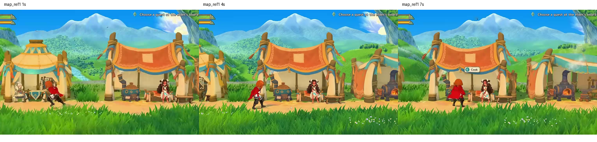
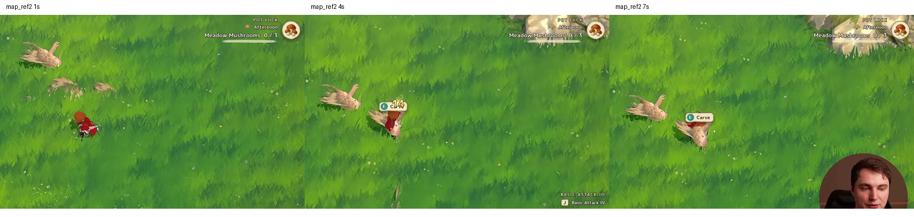

> 콘텐츠 확장 전 확인: [현재 성능 구조·영상6개 주제·에셋/이펙트 예산·측정/다음 작업](../../PERFORMANCE_ARCHITECTURE_20261109_KO.md). 2026-11-09 정적 감사 문서이며 런타임 최적화 적용 완료를 뜻하지 않습니다.

# 영상 스타일 · 에셋 에이전트 통합 인계 ? 2026-11-09 UTC

현재 사용자의 지시는 **에셋을 추가하지 않고 원본 문서와 후속 제작 인계를 GitHub에 정리하는 것**이다. 이번 작업에서 Tripo 생성, 신규 모델·텍스처 반입, 기존 모델 교체를 하지 않았다. 아래 제작 항목은 다음 작업 목록이며 완료된 자산이 아니다.

> 후속 전투/배포 상태: [세 모션 콤보와 최종 APK 인계](../../COMBO_DEPLOY_20261109_KO.md). 일반 공격1·2·3 각각 적별1회이며, Mount의 낮은 슬라임에만 상완 보정과 lowAttacks 접촉 프로파일을 함께 적용한다. 큰 적/보스는 기본 프로파일을 유지한다. 향후 모델/검/클립 교체 시 두 프로파일과 실제 검 포즈를 재검증한다. 원본 PDF·PR 원문은 유지했고 새 에셋은 추가하지 않았다.

## 먼저 읽을 자료와 적용 우선순위

1. 저장소 [AGENTS.md](../../../../AGENTS.md), [Unity 안내](../../../../unity/IslandGame/AGENTS.md), 기존 아트·모션 지시서. 최신 사용자 요청이 우선한다.
2. [사용자 원본 PDF](IslandGame_영상스타일_로드맵_Tripo에셋.pdf). 재작성·최적화 없이 바이트 그대로 복사했다. [출처·SHA-256](source-manifest.json).
3. [PR #9 감사 원문](../../UNITY_VISUAL_AUDIT_20261109_KO.md), [구현 계획 원문](../../VIDEO_STYLE_IMPLEMENTATION_PLAN_20261109_KO.md). PR head `6791bf088e39a162d0d44b7c9584dd168680e612`에서 가져왔으며 내용 수정 없이 보존한다. 해당 원문의 '실행하지 않았다'는 문장은 그 검토 당시의 범위다.
4. [Mount 환경 검토](../../MOUNT_SUNDAY_REVIEW_20261107_KO.md), [10구역 스트리밍](../../MOUNT_SUNDAY_STREAM_PLAYTEST_20261108_KO.md), [슬라임·전경 가림 수정](../../MOUNT_COMBAT_FIX_20261108_KO.md), [기존 시점·액션 인계](../../COMBAT_VIEW_ACTION_20261107_KO.md).
5. **현재 동작은 [이번 전투·보스 패치 인계](../../CONTACT_BOSS_HANDOFF_20261109_KO.md)가 우선**한다. 이전 문서의 '보스 미연결', '점프·회피도 몸통 관통 차단'은 이번 요청으로 바뀌었다.

실제 프로젝트는 `G:/new_project/IslandGame`이다. 원격 `unity/IslandGame`과 날짜별 ProjectPatch는 전체 프로젝트가 아니다. 오래된 스냅샷으로 로컬 씬·수동 수정 에셋을 덮어쓰지 않는다.

## 현재 구현과 남은 미술 작업

| 항목 | 현재 확인 상태 | 다음 에셋 작업에서 지킬 것 |
|---|---|---|
| 일반 구역 | Mount 1~10 모두 측면·레인 | 일반 구역 쿼터뷰를 다시 켜지 않는다 |
| 보스 | 10구역 30마리 처치 후 우측 출구 → 기존 거인 보스 별도 구역 | 기존 Nature 환경 재사용. 새 보스·보스 맵 생성 완료로 해석하지 않는다 |
| 캐릭터 | 기존 Pink Glass 높이 1.30m, 기존 모델·모션 유지 | 루트 배율·무기 본·판정 좌표 임의 변경 금지 |
| 슬라임 | 높이 .31m, 몸통 반경 .125m, 속도 1.15m/s | 녹색 바닥과 분리되는 색 후보를 검토하되 이번에는 미적용 |
| 일반 공격 | 서버 검 궤적 캡슐과 적 캡슐 접촉, attackId당 적 1회 | 새 스윙·검 길이 변경 시 접촉 프로파일 다시 추출·검증 |
| 풀·지형 | 기존 고정 시드 군락, 셀 컬링, 바람·눌림, 전경 디더 | LOD 전환 때 군락 위치 유지; 최대 바람 변위까지 bounds 확보 |
| HUD | 세로·상단 50% 전투 화면 유지 | A/B1(70%)/B2(오버레이93%)는 비교·선택해야 할 시안 |
| 보스 전환 | 서버 대기 + Unity 환경 준비 확인 후 시작 | 출구 문(T24), 보스 문(T25)은 표시 자산만. 진행 판정은 서버 |

## 영상 근거

원본은 `G:/new_project/map_forest/map_ref1.mp4`, `map_ref2.mp4`에 있다. 1·4·7초 프레임을 추출했다. 영상 파일 자체는 저장소에 추가하지 않았다. 파일 해시는 manifest에 기록했다.

마을은 전경 풀 → 밝은 이동 길 → 천막·NPC·소품 → 숲·언덕 → 푸른 원경 산·하늘의 깊이가 읽힌다. 초지는 낮은 풀 군락과 빈 이동 공간, 밝은 공격 효과가 읽힌다. 영상만으로 Tripo 제작 여부는 확인할 수 없다. 부드러운 색 변화가 있으므로 모든 재질을 딱딱한 2단계 툰으로 통일하는 방식은 기준으로 삼지 않는다.

[팔레트 표본 v1](palette-samples-v1.json)은 **실제 4초 프레임의 지정 좌표 9×9 RGB 중앙값**이다. 영상 조명·압축을 포함한 화면색이며 승인된 BaseColor가 아니다. PDF의 v0 추정색과 구분한다. 좌표·원본 프레임 해시를 보존했으므로 재추출 가능하다. 주황 천막 표본에는 밝은 문양이 섞일 수 있다. 실제 재질 팔레트는 넓은 영역과 다른 프레임을 비교해 확정한다.

## 대표 화면과 제작 순서

첫 목표는 측면 마을 한 화면 + 기존 보스 쿼터 전투 한 구역 + 전환이다. 측면 전용 원경 카드를 쿼터뷰에 그대로 노출하지 않는다. 5층은 배치 그룹이며 카메라 5개를 뜻하지 않는다. 먼저 박스·기존 자산으로 캐릭터 크기, 지평선, 터치 가림을 비교한다. 가로 화면 전환은 확정된 제품 결정이 아니다.

| 배치 | ID·내용 | 착수 조건 |
|---|---|---|
| 1 | T01 프레임, T02 주황 천, T03 민트 색 변형, T04 드레이프, T05 퀘스트보드, T06 화로, T07 모루, T08 작업대, T09 상자·통, T10 랜턴, T11 허수아비, T12 이정표 | 우선 천막 세트와 화로 2건의 검토 파이프라인부터 |
| 2 | T20 바위, T21 수관 나무, T22 통나무, T23 돌기둥, T24 구역 문, T25 보스 문, T26 덤불 | 기존 Mount 자산 재색칠·재배치로 부족한 부분만 생성 |
| 3 | T30 수레, T31 무기대, T32 모닥불, T33 의자, T34 상자, T35 코인, T36 젬 | 대표 화면 승인 후 |
| 4 | T40 NPC, T41 몬스터 후보, T42 원경 실루엣 | 본·스킨·모션 별도 검수. 원본 PDF 목록을 기준으로 판단 |

분할은 움직이거나 교체할 기능 단위로 한다. 천막 프레임/지붕/드리운 천, 화로 본체/발광·불·연기 등이다. 정적 조각을 모두 독립 Renderer로 남기지 않는다. 잔디는 리깅 없이 공용 메시·인스턴싱을 유지한다.

## 시작 예산과 반입 기준

- 주인공 H=1.30m 기준. 천막 2.8~3m, 입구 ≥1.7m, 작업대 .6m, 화로 본체1.35m·굴뚝2.6m. 실제 화면에서 비율을 다시 검토한다.
- LOD0 시작값: 프레임400~800 tris, 천300~700, 화로1200~2500, 작업대500~1000, 개별 상자150~400. T03은 T02 공유 메시·색 변형으로 추가 삼각형 0. 다른 항목은 원본 PDF p7~8 참고.
- LOD1 약45%, LOD2 약15%부터 시작한다. 재질1~2개, 텍스처≤1024와 대표 화면 15k tris/6재질 등은 출발용 가이드이며 실기 측정으로 조정한다.
- 미터 단위, 바닥 중심 pivot, 노멀·UV·단순 충돌 프록시, 큰 천 주름·실루엣 우선. 구워진 강한 그림자·얼룩·글자·로고를 제거한다. 낮은 Metallic/Smoothness만으로 BaseColor 잡티가 없어지지 않는다.
- 원본 GLB + 정리된 FBX를 분리 보관하고, v01/v02에 입력·프롬프트·결과·해시·라이선스 근거를 남긴다. Tripo 버전·요금제별 기능과 상업적 권한은 실제 제작 시 확인한다.
- 검토 폴더 → Blender 정리 → Unity 대표 화면 → 사용자 미술 승인 → 정식 자산 반영. 2~3회 연속 개선이 없으면 중단하고 실패 원인을 기록한다.

## 다음 담당자의 작업 목록

1. 이 문서와 원본·PR #9를 읽고 최신 로컬 프로젝트/브랜치 해시 대조.
2. HUD A/B1/B2, 동일 카메라·시드의 대표 화면 비교. 작은 폰 크기에서 캐릭터·길·적 가독성 확인.
3. 팔레트 후보 확정, 지면 색 패치와 풀의 빈 공간·군락 분포 설계. 기존 Zone/Grass 렌더링을 활용.
4. 사용자가 에셋 제작을 진행하도록 지시한 뒤 천막·화로 2건 검토. 지금은 제작 보류 상태.
5. 승인 후 배치1 → 보스 무대 팔레트/배치2 → 디테일 순으로 확대.
6. 실제 Android 저사양·중간급 2대에서 20분·재입장·메모리·발열 검증. BlueStacks 결과는 실기 성능 승인 근거가 아니다.

이번 완료: 원본 PDF 보존, PR 문서 통합, 영상 프레임·화면색 표본, 최신 전투 계약 인계. 미완료: 신규 에셋, 대표 마을 완성, 새 환경 미술 승인, HUD 개편, 실제 휴대폰 기준선.
